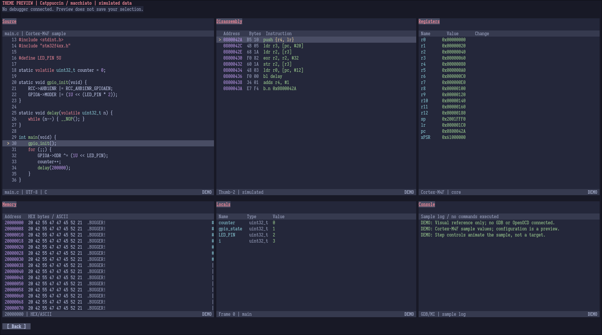
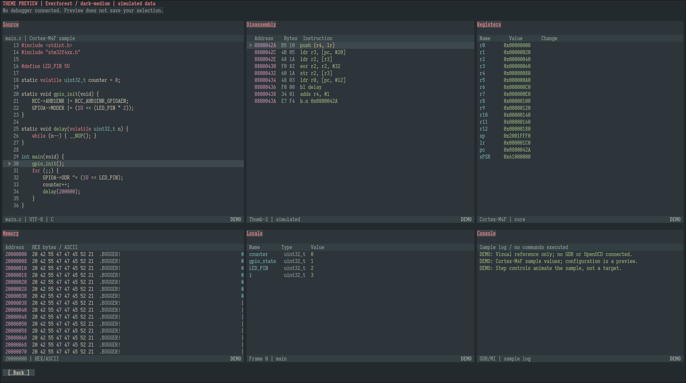
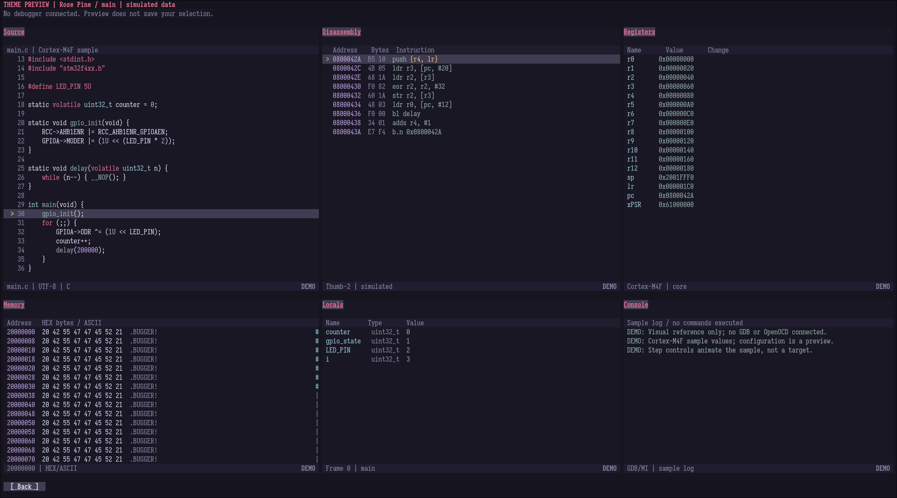

# The Bugger

A lightweight, full-featured terminal UI for embedded debugging, built in C and
powered by GDB/MI. Step through firmware, inspect memory and registers, and trace
calls in a tiled workspace with keyboard and mouse controls. Use it in a terminal
on its own or alongside your tools in tmux.

<p align="center">
  
</p>

## Debugging in one workspace

- **Follow execution:** Navigate source code and mixed disassembly, step through instructions or source
lines, run to selected locations, and explore threads and call frames. Open multiple source files
or switch to fullscreen when you need more room.

- **Inspect state:** Examine registers with change highlighting, explore memory in hex and ASCII,
and inspect the stack, local variables, and watch expressions. Expand compound values and view
detailed call frame information.

- **Control execution:** Set conditional breakpoints, configure ignore counts and hardware requirements,
and use hardware data watchpoints when supported. Execute GDB commands and inspect logs directly from
the integrated Console.

- **Make the workspace yours:** Arrange, split, and resize panes; navigate between tabs;
and save connection profiles and workspace layouts for later sessions.

Memory and variable inspectors are read-only. Peripheral reads can still have
side effects: MMIO sampling requires explicit access decisions and is available
for the validated STM32/OpenOCD configuration; navigation never samples MMIO.
See [Memory access controls](docs/usage.md#memory-inspection) and
[Stack inspection](docs/usage.md#stack-inspection). Console commands and debugger
scripts can change target state. Firmware programming remains external.

## Targets and platforms

The Bugger runs on **Linux** and focuses on embedded C/C++ debugging. Native
Linux launch and attach are also supported.

| Debug target | Physically validated setup |
|---|---|
| ARM / Cortex-M | STM32 NUCLEO-F446RE with ST-LINK and OpenOCD |
| Xtensa | ESP32-S3 with native USB/JTAG and Espressif OpenOCD |
| 32-bit RISC-V | ESP32-C6FH4 with native USB/JTAG and Espressif OpenOCD |
| Native Linux x86-64 | Local GDB launch and permitted process attach |

Embedded sessions use a target-compatible GDB and debug server. The OpenOCD flow
can start a local server or connect to an existing one; a separate connection
flow supports existing remote GDB servers.

Architecture support is distinct from validation of a particular board, probe
and backend. Other GDB targets are not automatically supported, and features
depend on the capabilities reported by the target and server. Consult the
[validation records](docs/validation.md) for tested configurations and limitations.
Current scope and planned features are documented in the
[requirements](docs/requirements.md) and [roadmap](docs/roadmap.md).

## Build and first session

Build on Linux with a **C17 compiler**, **GNU Make**, **pkg-config**, and development
files for **ncursesw**, **libelf** and **json-c**. Native launch needs **GDB 17+** and
ptrace permission. Embedded debugging needs the appropriate GDB, probe and server.
A C++ compiler is needed only for C++ test fixtures.

```sh
make
./build/the-bugger
```

For a workspace preview without connecting a debugger:

```sh
./build/the-bugger --demo
```

**Start an embedded session:**

1. Have your firmware's matching debug ELF and target GDB available. Program the
   firmware with your existing tooling if needed; loading symbols does not flash it.
2. Choose **Embedded target – OpenOCD** to configure a board or adapter/target
   pair, or **Connect to GDB server** for a server you already run.
3. Enter the ELF, GDB binary and connection settings. Choose **Review session**,
   review the tools and ownership, then **Start session** or **Connect**.
4. Halt the target, set a breakpoint in your code, then continue and inspect the
   stopped state. Use the visible toolbar or shortcuts below to step.

The [OpenOCD guide](docs/usage.md#openocd-sessions) covers script selection and
server ownership; the [remote connection guide](docs/usage.md#existing-remote-gdb-servers)
explains existing servers and protocols. See
[embedded startup debugging](docs/usage.md#debugging-embedded-startup-code) for
reset handlers and early boot, or the
[embedded fixture guide](tests/fixtures/embedded/README.md) for sample firmware.

<details>
<summary>Try a native Linux session without hardware</summary>

Build the small C debug fixture; this does not run tests:

```sh
make build/code-fixture
./build/the-bugger
```

Choose **Linux application → Launch**, enter `./build/code-fixture`, then
**Review session → Start native**. Expand **Console** with `^`, enter `start`
in its **Command** field and press Enter to stop at `main`.

</details>

| Default shortcut | Action |
|---|---|
| F5 / F6 | Continue / Pause or Halt |
| F10 / F11 / Shift+F11 | Step over / into / out |
| F9 | Toggle a code breakpoint |
| Ctrl+arrows | Move content focus between neighboring panes |
| Esc | Leave content focus or return from a local menu |
| q / Ctrl+Q | Close the session / quit the application, with confirmation (outside text fields for q) |

Focus Source for source stepping or Disassembly for instruction stepping. Saved
keybindings may differ from these defaults. In tmux, enable mouse forwarding
with `set -g mouse on`. The [usage guide](docs/usage.md) covers the remaining
controls, saved setups and troubleshooting.

<details>
<summary>Linux x86-64 downloads</summary>

Prefer a prebuilt executable? Get the Linux x86-64 archive and `SHA256SUMS` from
[Releases](https://github.com/gnix0/the-bugger/releases), extract the archive, and
run `./the-bugger`. GDB, OpenOCD and shared libraries remain external dependencies;
the included `BUILD-INFO.txt` lists host and runtime requirements.

Release changes are in the [changelog](CHANGELOG.md). Distribution contents and
build instructions are in the
[packaging guide](docs/maintaining.md#linux-x86-64-release-artifacts).

</details>

## Make it yours

Choose **Config → Themes** for appearance and **Config → Keybinds** for controls.
**Catppuccin Macchiato** is the default.
Optional Vim-like navigation and field editing are available alongside the
standard keyboard and mouse controls.

Themes include Everforest, Rosé Pine, Tokyo Night, Catppuccin, Modus, Gruber Darker,
Gruvbox Material, Solarized, Nightfox, Zenburn and Monokai Pro, with dark and light
variants across the catalogue. See [themes](docs/usage.md#configuration-and-themes),
[keybindings](docs/usage.md#personal-keybinds) and
[Vim-like input](docs/usage.md#vim-like-input) for configuration. Examples:

| Catppuccin Macchiato | Everforest (Dark Medium) | Rosé Pine (Main) |
|---|---|---|
|  |  |  |

## Documentation and contributing

| Find out more | Reference |
|---|---|
| Controls, connections and saved setups | [Usage](docs/usage.md) |
| Current scope and future work | [Requirements](docs/requirements.md), [roadmap](docs/roadmap.md) |
| Tested targets and results | [Validation records](docs/validation.md) |
| Development and implementation | [Contributing](CONTRIBUTING.md), [architecture](docs/architecture.md) |
| Test commands, fixtures and coverage | [Testing](docs/testing.md), [suite catalog](tests/README.md) |
| Maintenance and releases | [Maintaining](docs/maintaining.md), [changelog](CHANGELOG.md) |
| Reporting vulnerabilities | [Security policy](SECURITY.md) |

Bug reports and contributions are welcome. Include the target, GDB/server versions
and reproduction steps when reporting a problem. Check the roadmap before starting
feature work, and report security issues privately through the security policy.
