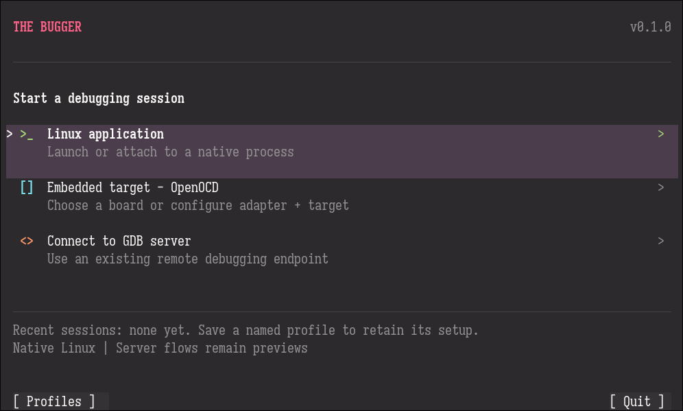
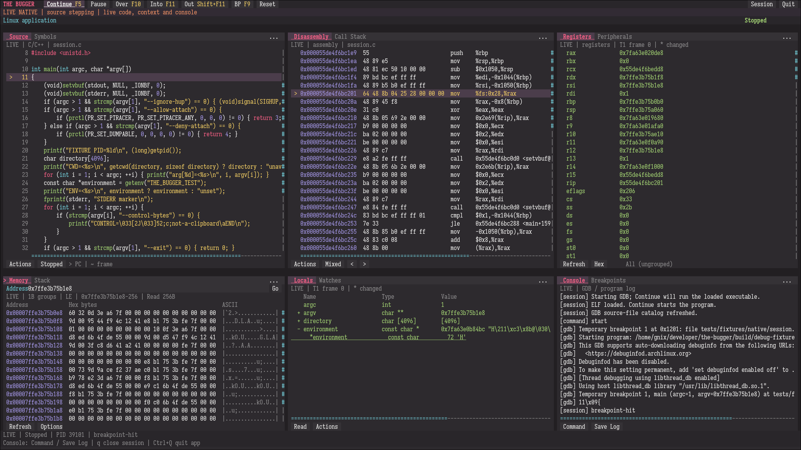

# The Bugger

<p align="center">
  
</p>

<p align="center">
  
</p>

A terminal-native GDB frontend written in C17 for embedded firmware development.
It combines source, disassembly, registers, memory, variables and debugger output
in a configurable tiled workspace with semantic theme colors.

The Bugger is **embedded-first, not embedded-only**. Native Linux debugging is a
supported capability and the repeatable foundation for the current development
build. After v0.1.0, feature development focuses overwhelmingly on embedded
workflows; native fixes, compatibility and shared interface/infrastructure
improvements continue.

## Current capabilities and limitations

The current build supports native Linux x86-64 launch/attach, stepping, source
and mixed disassembly, threads/frames, code breakpoints and Run to Selected,
hardware-required data watchpoints, read-only registers/Memory/Locals/Watches,
GDB Console, program output, Save Log, named profiles and personal keybind customization.
Availability depends on GDB and the target's capabilities.

v0.1.1 adds **Config → Themes** with seven built-in families and 37 variants,
preview and saved appearance preferences.
**Catppuccin Macchiato** is the default; Monokai Pro remains available.
v0.1.2 preserves exact theme colors inside RGB-advertising tmux
sessions, with 256-color and monochrome fallbacks.
[Theme controls and variants](docs/usage.md#configuration-and-themes) describe
what is included. The development build starts the three lower pane groups minimized; restore
them above the footer and resize their overlay heights independently.
[Workspace controls](docs/usage.md#workspace-controls) describe the current behavior.
Shared UI additions also include
[Source fullscreen and spatial keyboard navigation](docs/usage.md#workspace-controls).
These features extend the original v0.1.0 workspace. v0.1.2 also
provides [Config → Keybinds](docs/usage.md#personal-keybinds) for debugger and
workspace/navigation shortcuts. Bindings are personal preferences alongside
themes; connection profiles never carry or override them.
[Vim-like input](docs/usage.md#vim-like-input) is optional and off by default,
with Normal/Insert field modes and visible mode feedback when enabled.

Existing TCP GDB servers support reviewed `remote`/`extended-remote` connections
and shared inspectors. OpenOCD support includes reviewed startup, installed-script
browsing, owned lifecycle and explicit Reset/Halt/disconnect actions.
[Embedded startup debugging](docs/usage.md#debugging-embedded-startup-code)
covers stopping before `main`, instruction stepping and reset-catch limitations.

Physical hardware validation covers **STM32 NUCLEO-F446RE** through onboard ST-LINK
and **ESP32-S3** through native USB/JTAG, with the
[recorded GDB/OpenOCD configurations](docs/validation.md#m17--physical-board-validation).
These results cover the tested workflows, not all boards, probes or architectures.
OpenOCD is optional, not universal; broader compatibility needs separate evidence.
Physical RISC-V acceptance is deferred for v0.1.0 and is not a hardware support claim.

This checkout targets **v0.1.2**. Its release validation status is recorded in the
[roadmap status](docs/roadmap.md#implementation-status) and
[recorded validation evidence](docs/validation.md).

## Build and first session

Build on Linux with GCC or Clang supporting C17, GNU Make, pkg-config, and the
ncursesw, libelf and json-c development libraries/headers. Interactive use needs
a TTY and usable TERM/terminfo. Native launch requires GDB 17 or newer to preserve
literal arguments without a startup shell, plus permitted ptrace;
Linux pidfds support owned-inferior crash recovery. Remote sessions need a
target-compatible GDB and an already running server; `gdbserver` is required only
for the localhost integration fixture. A C++ compiler is used only
for optional debug-target fixtures. Dependencies are external, not bundled.

```sh
make
./build/the-bugger --help
./build/the-bugger --version
./build/the-bugger
```

For a reproducible first debug session:

```sh
make fixtures
./build/the-bugger
```

Choose **Linux application → Launch**, enter `./build/code-fixture`, then
**Review session → Start native**. In Console's inline **Command** field, enter
`start`, then press Enter or click Send to ask GDB to stop at main.
The fixture runs under GDB; do not pass `start` to it
as a shell argument. Ordinary Continue starts the loaded program without an
automatic main breakpoint.

Click Source for source stepping or Disassembly for instruction stepping.
Source **+ File** opens another GDB-known source file in a pane-local tab;
**Current** follows the stopped frame while opened files remain available.
Arrows navigate by default; opt-in Vim-like input adds h/j/k/l aliases and
Normal/Insert field editing. During CONTENT FOCUS, Ctrl+arrows (or optional
Ctrl+h/j/k/l aliases) move between neighboring panes.
[Source fullscreen](docs/usage.md#source-fullscreen) expands a Source pane while
retaining the toolbar/status bars and restores the existing tiled workspace.
Defaults are F5 Continue, F10 Over, F11 Into, Shift+F11 Out and F9 Breakpoint;
clickable actions remain available when a terminal intercepts keys. Outside
fields, `q` closes/backs out; `Ctrl+Q` quits, confirming active-session closure.
Memory has an inline address/expression field; variable values require deliberate
reads when automatic access safety cannot be established.

`./build/the-bugger --demo` opens the explicitly simulated visual reference.
It does not connect to hardware. In tmux, mouse support requires the opt-in
`set -g mouse on`; the application does not alter tmux configuration or bindings.

## Linux x86-64 distribution

`make release` prepares the host-binary archive, corresponding source archive
and `SHA256SUMS` in `build/dist/v0.1.2/`. Other versions use their own
version directory; `RELEASE_DIST_DIR` can override the destination. Extract the binary archive and run
`./the-bugger` from a terminal. GDB/OpenOCD and the shared runtime libraries remain
external; `BUILD-INFO.txt` lists the actual build host and dependency requirements.
This build does not promise compatibility with every Linux distribution.
See [artifact validation](docs/testing.md#release-artifacts-m18) and
[release procedures](docs/maintaining.md#linux-x86-64-release-artifacts).
Prepared artifacts do not establish release acceptance or publication.

## Documentation

| Audience | Start here |
|---|---|
| Users | [Usage and configuration](docs/usage.md), including themes, profiles, controls and limitations; [security policy](SECURITY.md) |
| Contributors | [Contributing](CONTRIBUTING.md), [architecture](docs/architecture.md), [testing](docs/testing.md) and [suite catalog](tests/README.md) |
| Product and design | [Requirements](docs/requirements.md), [roadmap](docs/roadmap.md), [interface specification](docs/requirements.md#interface-constraints) |
| Maintainers | [Maintenance/release procedures](docs/maintaining.md) and [validation records](docs/validation.md) |

The [current development sequence](docs/roadmap.md#current-development-sequence)
starts with rendering stability, then lower-pane organization and approved
Disassembly/Memory browsing improvements. These are planned work, not current
capabilities. Both browsing views require implementation, verification and owner
acceptance before the next release.

The roadmap retains all M00–M18/F01–F47 gates. Post-release priorities progress
from safe editing and hardware/fault diagnosis to flashing/text channels, RTOS/
images and validated runtime analysis. Version assignments are planning targets;
advanced acquisition depends on actual hardware/backend evidence.

## Development checks

```sh
make test
make test-native
make test-tmux
```

[CI](.github/workflows/ci.yml) runs tests and static analysis on pull requests and
manual dispatch; see [contributor guidance](CONTRIBUTING.md#continuous-integration).
These checks have different prerequisites and evidence boundaries. See
[testing](docs/testing.md#commands-and-prerequisites) for focused suites,
compiler/sanitizer/static-analysis checks and hardware validation. `build/` is
ignored/disposable; use a fresh `BUILD_DIR` for different compilers or flags.
