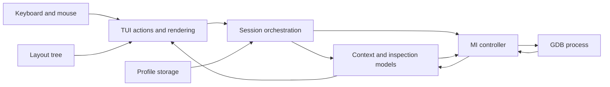

# Architecture

## Overview

The Linux frontend shares target-neutral models between native launch/attach
and remote GDB sessions. OpenOCD management handles reviewed startup and target
actions. [Validation records](validation.md) cover the tested architectures.

The frontend is C17, built with Make. Its runtime libraries are ncursesw for
terminal presentation, libelf for ELF metadata and json-c for profiles and
preferences. GDB performs instruction decoding and target operations.

| Location | Responsibility |
|---|---|
| `src/main.c` | CLI help/version and terminal entry point |
| `src/tui/` | Pages, input, rendering, themes, preferences and explicitly simulated demo data |
| `src/layout/` | Tiled geometry, splits, resizing and pane membership |
| `src/gdb/` | Owned MI parsing, nonblocking transport, request correlation and debugger lifecycle |
| `src/session/` | Session setup, ownership, capability/region evidence, profiles and OpenOCD lifecycle |
| `src/model/` | Context, code, breakpoints and bounded inspection/editing state |
| `src/symbol/` | Native metadata primitives, supervised helper and artifact/decoder foundations |

Module headers live in the matching `include/<module>/` directories.
`include/the_bugger/tui.h` and `version.h` retain the application-facing namespace.
Models own debugger data; the TUI presents it and requests deliberate actions.
Unavailable views are labelled, profiles require review before connection, and
keybindings are separate personal preferences.

For backend work, start with [data flow](#data-flow-and-invariants),
[session ownership](#shared-native-and-remote-sessions) and the
[controller](#nonblocking-controller-and-process-ownership). Changes to inspectors
also need the [request audit](#value-producing-request-audit) and
[shared mutation lifecycle](#stopped-inspector-mutations-f03f05).

### Planned Native Symbol Engine

The [Native Symbol Engine](native-symbol-engine.md) is an accepted design for
bounded project-owned ELF/DWARF metadata discovery supporting F07. Foundations
are progressing below; symbol discovery and live native actions remain unavailable.
The module inventory above describes the existing frontend; existing libelf image
consumers remain in place. GDB retains
instruction decoding and supported live target operations, with explicit
consumer integration rather than implicit symbol-file reloads.

The design separates retained artifact backing/open contexts, exact physical
records, scoped validation evidence, discovery indexes, immutable publications,
prepared action facts and runtime bindings. These are distinct ownership and
authority boundaries; metadata alone grants no target access. A supervised helper
isolates acquisition/decoding from the responsive TUI; disposable worker/cache
state does not own independently retained frontend guarantees.

The detailed [ownership/interface contracts](native-symbol-engine.md#layers-ownership-and-identity),
[resource policy](native-symbol-engine.md#resource-policy),
[consumer integration](native-symbol-engine.md#consumer-integration-and-live-actions),
[Console provenance and retirement rules](native-symbol-engine.md#guarded-dso-breakpoints-and-console-5a)
and [D04 prerequisite](native-symbol-engine.md#d04-bounded-mi-rejection-recovery)
are authoritative planned contracts. They do not describe behavior already
available in the current parser, Console, Watch or Memory transfer paths.
The [subsystem roadmap](native-subsystems.md) keeps other candidates at future
research/design scope; it selects no additional architecture or dependencies.

### Symbol Engine primitives (SE01)

`src/symbol/reader.c`, `identity.c` and `sha256.c` provide the first independent
foundation. They are built into the frontend but have no runtime consumers yet.
They introduce no helper process, artifact acquisition, symbol discovery or live
debugger operation. The [overall design](native-symbol-engine.md) remains the
contract for later integration.

The checked reader borrows immutable byte spans. Fixed integers decode explicit
target byte order and width, independently of host representation; bounded
LEB128 and string operations retain the cursor and outputs on failure. Subreaders
cannot cross their declared span. Checked arithmetic uses subtraction/division
bounds before addition or multiplication.

Physical record IDs distinguish content, section, unit and record coordinates
and DWARF/ELF record kinds. Their validity check establishes shape only. Content
handles must later come from admitted, nonreused identities; paths, truncated
hashes and runtime addresses cannot substitute. Open-context identity remains
separate. No artifact manager or handle allocator is implemented in SE01.

Streaming SHA-256 owns fixed caller-provided state and publishes a digest only
on explicit finalization with the exact expected complete byte count. Invalid
input, length overflow or a final length mismatch poisons the active stream;
failed or repeated finalization leaves output unchanged. A digest is only a
candidate for later byte-equality comparison, never coherence or access evidence.
These primitives allocate no heap storage and perform no file/debugger I/O.
Callers remain responsible for input lifetime and bounded update/scan allowances.

### Symbol Engine helper (SE02)

`src/symbol/helper.c` owns the lazy helper lifecycle and operation interests;
`worker.c` provides the private early executable entry. The frontend event loop
pumps the helper and polls its channel/process descriptor independently of GDB.
Initialization and opening/editing Symbols start no process or acquisition.
Artifact Open will explicitly start work when the SE11 workflow is introduced.
The worker dispatches bounded artifact storage operations; unknown operation IDs
remain Unsupported. Decoders and artifact UI are separate foundations.

`src/symbol/process.c` uses `fork()` followed by isolated `execve()` of the running
executable. Child setup uses async-signal-safe operations, installs null standard
descriptors and the private channel, resets signal state and closes inherited
endpoints. The parent can supervise a child blocked before exec. The initial
Linux profile requires pidfd and `close_range` support, default SIGCHLD disposition
and exclusive child reaping. Unsupported ownership/isolation conditions disable
the engine without changing the debugger connection. Signals use the verified
owned process descriptor; there is no numeric-PID signalling fallback. A previous
helper must be reaped before explicit restart; uncertain ownership prevents it.
See the Linux [pidfd ownership](https://man7.org/linux/man-pages/man2/pidfd_open.2.html),
[signalling](https://man7.org/linux/man-pages/man2/pidfd_send_signal.2.html) and
[descriptor isolation](https://man7.org/linux/man-pages/man2/close_range.2.html)
interfaces.

`src/symbol/wire.c` implements versioned big-endian frames with separate header,
payload and descriptor-trailer receive boundaries. Every receive uses `recvmsg()`
with atomic close-on-exec. Read-only regular backing descriptors are checked;
these properties alone establish neither acquisition coherence nor writer
relinquishment. One outgoing and one incoming frame remain owned until completed
or consumed. Protocol/resource/I/O failure closes the channel and releases its
incomplete storage and descriptors. Framing success grants no metadata authority.

`src/symbol/schedule.c` separates underlying jobs from consumer interests.
Explicit sharing preserves each captured identity. Cancellation detaches only
that interest; a sent job retains its underlying slot until acknowledgement or
helper reaping. Completed work remains owned until its consumer accepts delivery.
Publication attempts rotate so one backpressured consumer cannot obstruct others.
Finite interactive-first rounds preserve service for admitted construction jobs.
Control metadata and small control-frame storage remain available at saturation.

Requests carry separate frontend-context and helper-process generations. Worker
service/progress reports include monotonic work timestamps, checked against
admission and receipt; buffered progress cannot extend a stalled operation.
Repeated counters do not refresh the watchdog. Parent-enforced queue, absolute
operation, progress and cancellation deadlines remain distinct. Failure explicitly
completes unfinished interests, while callers retain independently accepted
results. Resource operations have a separate cleanup notification. The worker sends it
only after destroying operation state and finishing the outgoing result frame;
the parent delivers it after completion acceptance and releasing its borrowed
result resources. Backpressure retains the underlying job slot. Cancellation
before dispatch can prove that no worker ownership was acquired. Missing cleanup
acknowledgements use the cancellation deadline and supervised termination; a
confirmed reap can retire worker ownership, while uncertain reap cannot. Staged
or retained filesystem objects remain independently owned and charged until
their cleanup is confirmed.

There is no automatic retry, rescan or restart. The supervisor exposes separate
current-process and last-confirmed-reap generations. Acquisition owners can retain
failed-operation reservations until worker ownership has ended; EOF, cancellation
and lost/uncertain reap do not advance that evidence. Independently retained
frontend descriptors and results still require their own cleanup.

`src/symbol/budget.c` checks nested reservation chains before mutation. IPC and
frontend limits apply concurrently, with each allocation charged once to its
owner and all containing accounts. Failed allocation rolls reservations back;
reclamation precedes release. Fixed bookkeeping and retained capacity count too.
These are owned-storage limits, not RSS guarantees. Defaults, units, supported
startup settings and failure policy are authoritative in the
[resource policy](native-symbol-engine.md#resource-policy).

The [helper tests](testing.md#supervised-symbol-engine-helper-se02) distinguish
component, real-process and real-GDB isolation evidence. Artifact storage and scoped ELF validation
integration are described below; search publication and live consumers remain
later foundations. This
execution boundary does not complete F07 or qualify physical targets.

### Artifact admission accounting (SE03, partial)

`src/symbol/admission.c` provides an independent logical-storage ledger. Each
acquisition preallocates ownership before discovery and reserves the complete
offered size before file growth. Separate opens and
companion contexts each retain a full charge, including when their backing is
shared. Allocation failures leave existing tickets and charges unchanged.
Bookkeeping allocations also count toward the enclosing frontend account.

The ledger performs constant-time ownership transitions without filesystem or
GDB calls. Publication uses backing ownership preallocated during reservation;
commit and cleanup require no further allocation. It checks lifecycle, owner
and length when sharing, while the acquisition manager must independently prove
complete byte equality and confirm disposal of temporary storage before sharing.
No digest, path or ledger ticket establishes content identity.

Closing the last context transfers its full charge to cached backing. Eviction
marks cleanup pending; cancellation likewise retains its reservation until
cleanup is confirmed. Neither helper failure nor a cleanup request alone proves
that storage has been relinquished. The ledger refuses destruction while any
reservation, context, cached backing or cleanup owner remains, including zero-byte
files. Opaque tickets are internal owner handles and are consumed on successful
close or confirmed cleanup.

The frontend registry combines this ledger with acquisition and supervised
cleanup. Acquisition validation and byte equality remain prerequisites outside
the ledger; it cannot grant admission by itself.

### Private byte acquisition (SE03, partial)

`src/symbol/acquire.c` implements the helper-side filesystem state machine,
independently testable without transport. The caller first owns a fresh slot in a
protected namespace and preallocates an unsized admission ticket. The helper
inspects the regular origin, creates an empty staging file and captures its exact
storage identity. Its size offer is available before any file-data write. The
parent assigns the full logical size and grants copying explicitly; source growth
cannot grow backing beyond that extent. Unknown size is distinct from a validated
empty file and cannot be committed as one.

Each service step performs at most one filesystem operation and bounds file-data
inspection in userspace to its supplied checkpoint allowance. A clone may process
the full reserved extent inside one kernel call. Blocking calls require
independent parent supervision. Namespace qualification is shared with retained
storage. The file is protected to owner-read mode, reopened read-only with
close-on-exec, and checked against its original storage identity before the sole
staging writer closes. No writable mappings are created. Only then does
complete-file SHA-256 run. Success transfers one read-only descriptor and complete
identity/digest facts; no unfinished digest is exposed.

Size, inode and modification/change-time comparisons, plus an origin-path check,
reject detected mutations. Unchanged checks prove no atomic source coherence.
Required ELF/DWARF validation, content identity and deduplication remain separate.
For a nonempty grant, acquisition first attempts Linux `FICLONERANGE` with exact
source length and zero source/destination offsets. It never uses a zero-length
clone request, which means through EOF, or unbounded `FICLONE`. Unsupported range
cloning resets the owned staging file before the complete streaming fallback.
Resource and other operational errors fail explicitly. Successful cloning still
passes exact-size/identity checks, source mutation checks, writer closure and
complete frozen-byte hashing. The internal method diagnostic appears only after
success and does not upgrade source-coherence evidence.

Linux documents [range-clone atomicity](https://man7.org/linux/man-pages/man2/FICLONERANGE.2const.html),
but a captured range does not establish that source file size remained constant.
The bounded clone path therefore makes no coherent-source snapshot claim.
Filesystem-specific positive qualification remains separate from branch tests.

Destroying acquisition state closes its local descriptors and releases its
construction account. The named slot remains owned by the caller, including on
failure; its charge cannot disappear with helper metadata. This permits frontend
read-only descriptors to close while the file is still linked, with final
filesystem deletion under helper supervision. Linux [descriptor release](https://man7.org/linux/man-pages/man2/close.2.html)
is distinct from persistence and namespace cleanup.

The component takes a ready owned namespace, fresh slot and explicit file ceiling.
Helper offer/grant framing and the frontend registry now connect its ownership
contracts. Explicit Open workflow and positive reflink/coherence profile qualification remain
separate work; this does not make Symbols functional.

`src/symbol/equal.c` compares two pinned frozen backings independently of their
fingerprints. Positive equality requires every byte of both inputs; differing
bytes give a distinct, successful negative result. Checkpoints bound both reads
and comparison work, including when later service slices shrink. Descriptor
properties and expected lengths are checked, then inode/length/time evidence is
rechecked before reporting either result. Failure identifies affected input
relationships, never treats an unread suffix as equal, and preserves caller-owned
descriptors. This primitive does not perform artifact deduplication or merge
open-context identities.

### Retained filesystem namespaces (SE03, partial)

`src/symbol/storage.c` owns helper-local handles to protected filesystem
namespaces. Creation advances through directory creation, open, identity and
filesystem checks without scanning a directory. Reopening requires the captured
namespace identity and owner-only protection; a pathname alone cannot adopt a
replacement namespace. Local backing-type qualification is shared with the
byte-copy component.

File slots are explicitly granted and never reused. The namespace permits no
arbitrary leaf names or recursive deletion. Retained files stay linked while
frontend descriptors close; their final deletion belongs to the supervised
helper after dependent leases retire. Reader/open and unlink operations check
exact storage identity, and unlink cannot delete a replacement file. Removing a
namespace refuses nonempty or replaced directories. An identified empty owned
directory can also be removed after its filesystem fails data-storage qualification;
this does not admit that filesystem for retained bytes. Destroying a local handle
closes its descriptor and releases bookkeeping, without claiming filesystem
cleanup. Storage coordinates establish ownership, not native record identity or
byte equality.

Named retention is connected to the copier and the ledger can preallocate
unsized ownership. The helper-side operation dispatcher in `src/symbol/operation.c`
validates bounded, explicitly encoded requests before opening a namespace. It
combines creation, acquisition, comparison and cleanup without merging content
identity with storage coordinates. Acquisition pauses on an identified empty
slot until granted the exact size. Unpublished slots whose growth grant was never
dispatched have a separate empty-file cleanup operation; nonempty or nonregular
entries are refused. Local state destruction never claims retained-file cleanup.

Private request dispatch now connects those operations to the supervised worker.
After first-service evidence flushes, bounded steps emit meaningful progress and
an acquisition offer. Offers identify the empty slot and exact extent. Only an
explicit matching grant permits growth, and dormant offers wait for control
traffic rather than spinning. The parent preserves offers until retirement and
rejects duplicate, wrong-context or inconsistent ownership evidence. Grants are
single-use; cancellation fences unsent grants without undoing framed traffic.

Failure diagnostics carry the captured context, system error, operation detail
and any established storage identity. A failed result serialization uses reserved
failure framing and publishes no candidate prefix. Worker state and outgoing
descriptors retire before cleanup acknowledgement. The frontend registry below
owns contexts, backing and scoped sharing; explicit Open orchestration and the
artifact UI remain SE11 work.

### Frontend artifact registry (SE03, partial)

`src/symbol/artifact.c` owns artifact-open contexts, retained backing and leases
under the shared frontend allocation account. Preparation reserves complete
candidate bookkeeping before discovery; an exact offer reserves its full logical
charge before a helper grant. Descriptor admission checks the offered storage
identity, extent, owner, protection, access mode and close-on-exec. Retention
establishes frozen bytes with unproven source coherence, not ELF/DWARF validity or
runtime authority.

Context and content identities come from a frontend-owned monotonic domain that
outlives registry replacement and historical facts. Equal origin paths create
independent contexts. Fixed-depth identifier lookup and checked reservations
bound bookkeeping without scanning names or reallocating a whole context index.
A lease pins backing while current-context eligibility remains a separate check;
closing an artifact revokes that eligibility immediately. Detected backing
correspondence/integrity loss withdraws storage-dependent capabilities through a
separate content revision, without reclaiming bytes or releasing charges. Late
comparison results cannot restore withdrawn correspondence. Final closure transfers
its logical charge into cache. Eviction waits for leases, closes frontend file
descriptors while storage remains linked, and retains its charge until exact
supervised cleanup is confirmed.

Digest and extent select possible duplicates. A scoped comparison token pins the
exact existing backing, captures request identity separately from artifact context
revision, and accepts only the corresponding completion and worker retirement.
Positive complete-byte equality retains that pin through candidate cleanup;
sharing is committed without allocation only after the duplicate file is removed.
Comparison resource/operational failure prevents candidate publication. Closing
while comparison or cleanup is pending cannot reactivate the context or bind it
to a replacement. Each independently open context keeps its full logical charge.

Frontend initialization creates only empty registry/helper owners and reads the
[startup settings](native-symbol-engine.md#available-startup-configuration).
The explicit Open workflow and artifact browser remain SE11 work; initialization,
Symbols navigation and editing controls still perform no acquisition. Decoding,
validation evidence, source correspondence and live-action consumers remain
separate foundations.

### Retained-file scratch reads (SE04, partial)

`src/symbol/file.c` supplies bounded byte spans from already frozen, pinned
backing. Construction reserves its complete owned state against a required
caller budget and performs no I/O. The descriptor remains borrowed: its owner
keeps the file and content lease alive until reader retirement. Destroying the
reader releases scratch storage, never the descriptor or filesystem charge.

Each request covers 1–65,536 bytes within the captured file extent. Each service
step performs at most one filesystem syscall and limits byte inspection to the
supplied checkpoint allowance. Descriptor checks require read-only, close-on-exec,
non-`O_PATH` regular protected backing with the expected storage identity/extent.
Pre/post-read metadata checks retain the first observed timestamps across later
requests, rather than silently accepting a changed file as a new baseline.
Blocked syscalls still require independent parent supervision.

A view becomes available only after every requested byte and the final metadata
check succeed. An invalid request preserves the previous valid view; an accepted
replacement invalidates that borrowed view immediately. Interrupted/partial reads
remain pending; failure publishes no prefix and cannot be silently retried on the
same reader. Reconstructible scratch owns no published metadata guarantee.

This scratch span is distinct from a Symbols result window or decoded-cache
allowance. There is no new production cache budget or startup setting. Descriptor
inspection does not prove writer closure or source coherence; acquisition retains
those ownership/evidence obligations. Request generations and consumer interest
belong to the outer operation. No frontend helper request or UI consumer uses this
component yet.

### ELF record decoding (SE04, partial)

`src/symbol/elf.c` decodes fixed ELF headers, section headers, program headers and
symbol records through the checked reader. Class and target byte order are
independent of the host; no input is cast to a native C ELF structure. Each call
examines at most 64 bytes, allocates nothing and leaves outputs unchanged on
failure. Linked executables and shared objects are supported; other file types
and unknown format versions remain explicit unsupported cases.

Header decoding provides raw fields. Layout validation separately resolves
escaped section/program counts and section-name indexes through section zero,
then checks complete table extents with checked arithmetic. Before fetching
section zero, its prefix must also be checked against retained file bounds.
Larger record schemas are unsupported rather than guessed. A successful layout
does not validate individual records, section overlaps, names or cross-section
relationships.

`SHT_NULL` fields do not describe file payload; section zero may hold extended
counts. `SHT_NOBITS` describes memory extent without requiring stored file bytes.
Supported structural checks include file bounds, alignment and target-width
address ranges. Raw machine/ABI flags, symbol bindings/types, visibility bits and
special section indexes remain intact. In particular, TLS, undefined, absolute,
common, extended-index and processor-specific symbols gain no ordinary-storage
or code-location meaning from decoding success. Compressed payloads are not
decoded by this layer.

The layouts follow the [ELF generic ABI](https://gabi.xinuos.com/elf/02-eheader.html)
and its [section](https://gabi.xinuos.com/elf/03-sheader.html),
[program-header](https://gabi.xinuos.com/elf/07-pheader.html) and
[symbol-table](https://gabi.xinuos.com/elf/05-symtab.html) definitions.
These allocation-free components introduce no helper request, catalog, search,
Source navigation or runtime binding. Section-directory and symbol-table validation
follow below, including scoped helper validation. Existing
`src/model/images.c` libelf consumers are unchanged.

### ELF section directories (SE04, partial)

`src/symbol/sections.c` constructs a complete helper-local section directory over
frozen backing, using the bounded reader and fixed-record decoders. It reserves
all entries and an auxiliary ordering array against a caller budget before
allocation. Individual entries remain in physical section order. Incremental
heap operations sort only the auxiliary array, yielding after each bounded
action; file-backed section ranges must neither overlap each other nor consume
structural header/table bytes. NULL, NOBITS and empty payloads retain their
distinct meanings.

Section-name validation checks the declared string table and supported references.
Names retain exact full byte lengths and backing coordinates, including duplicate
names, substring references and names longer than one scratch span. No full-name
copy or truncated-name identity is introduced. Nonempty tables require their first
and last bytes to be NUL; empty tables permit only index zero, following the
[ELF string-table contract](https://gabi.xinuos.com/elf/04-strtab.html).

The complete directory becomes visible only after its requested checks succeed.
Compressed name tables produce explicit unavailable-name coverage, without
interpreting their payload or pretending nonzero name indexes are empty names.
An absent section-name table does not prove that the artifact contains no DWARF.
Malformed supported dependencies and allocation/read failures expose no candidate
prefix. Reader/storage errors remain distinct from malformed encoded metadata.

The directory and its views are reconstructible helper cache, borrowed until
destruction. They do not own frontend publication guarantees or grant code/storage
meaning to raw section attributes. Program entry semantics, other cross-section
relationships and processor/OS semantics remain separate validation scopes.
Symbol-table dependencies have their own scope below. Production cache sizing
still belongs to SE10. Scoped helper integration is described below; this
component introduces no UI consumer.

### ELF symbol-table dependencies (SE04, partial)

`src/symbol/symbols.c` validates one selected `.symtab` or `.dynsym` inventory
against a complete section directory and its exact retained backing. Construction
performs no I/O; subsequent steps yield between bounded dependency, record, name
and reader actions. The caller retains the directory, descriptor and content
lease. All owned state and the complete entry array require checked reservations
against the caller's construction budget. No candidate prefix is exposed.

The scope checks the selected table's stride, linked string table, reserved zero
entry, local/nonlocal ordering and ordinary section references. A unique associated
`SHT_SYMTAB_SHNDX` supplies extended indexes; its words correspond one-to-one with
symbols, and unused words must be zero. An extended ordinary index whose numeric
value equals a reserved 16-bit marker remains an ordinary physical section index.
The raw index and other symbol fields remain available separately. Unknown framed
bindings/types and all `st_other` bits retain their original values.

Names retain full backing coordinates and lengths, including duplicates, substring
references and strings spanning scratch reads. No name is truncated or copied into
an identity. Compressed symbol/string/index dependencies are explicitly unsupported;
malformed supported dependencies fail the complete selected scope. An unsupported
scope does not establish an empty inventory or artifact-wide completeness.

The completed view is borrowed helper cache. Its table section, section-relative
record offset and record kind distinguish physical coordinates; constructing a
physical identity still requires the admitted content identity. Undefined, absolute,
common, TLS and processor-specific records gain no ordinary-storage or code claim
from these checks. Object footprints, language types, program/section mapping,
runtime correspondence, access authorization and independent frontend evidence
remain separate work. Scoped helper validation follows below; no UI action is
introduced. SE10 still determines production cache/index limits.

### Supervised ELF validation (SE04, partial)

The internal helper dispatcher accepts explicit directory or selected symbol-table
validation requests over an already retained file. Requests carry its namespace
identity, slot, file identity and extent. The helper checks the private namespace
and reopens that exact backing read-only; it never searches an origin path,
admits a new file or discovers companions. The caller retains the content/backing
lease through the matching worker-retirement acknowledgement or confirmed reap.

Directory construction precedes selected symbol validation. Only completed scopes
produce the fixed 56-byte summary; it identifies the selected scope, counts and
supported header/name-coverage facts. It is not an inventory window, physical
record binding or frontend validation-evidence owner. Unsupported coverage,
malformed dependencies, cancellation, stale interest, resource and operational
failure expose no candidate prefix. Diagnostics retain the failing dependency
category and section/record ordinal where available. Program semantics and
runtime mappings remain unexamined by this request.

Decoder construction uses one shared helper account, independently of IPC and
frontend storage. The internal helper configuration accepts an explicit byte
ceiling without reserving it upfront. Zero disables decoder requests before
filesystem access; there is no selected production default or user-facing startup
setting yet. Positive allowances in the harness qualify the bounded implementation,
not production sizing. SE10 must select the production bounds before dependent
acceptance. Exhaustion fails the request and releases construction ownership;
a subsequent smaller scope can succeed against the same retained file.

The private wire schema is version 2: the handshake includes the decoder ceiling,
and failure diagnostics include the ordinal. Reserved inline control storage
accommodates these bounded messages. Version mismatch closes the helper channel;
it does not affect GDB. Decoder progress reaches the existing parent watchdog.
The parent samples monotonic time after a complete frame is received, so progress
created after the pump's initial sample is not mistaken for a future event.
Worker timestamps retain their queue/deadline meaning; genuinely future or stale
claims still fail closed. Cancellation/restart use the existing supervision and
exact retirement rules.
Scratch and entry arrays are released before their backing descriptor; physical
backing cleanup and logical admission remain separate owner responsibilities.

### DWARF unit headers (SE05, partial)

`src/symbol/dwarf.c` decodes initial lengths and non-split DWARF 4–5 unit headers
without allocation or I/O. The supplied section extent and section-relative unit
offset are checked independently of the available prefix. Initial-length decoding
examines at most 12 bytes; unit decoding examines at most 40. Reserved length
encodings, arithmetic overflow and out-of-section contributions fail without
changing outputs. Bytes from the next contribution cannot complete a short header.

Offset format and raw address size remain independent. DWARF 4 `.debug_info`
headers identify a compile-or-partial scope until its root DIE is validated;
`.debug_types` has a separate type header. DWARF 5 supports compile, partial and
type headers in `.debug_info`. Split, skeleton and unknown headers remain explicit
unsupported cases. Separately valid length framing does not decode their fields
or establish complete coverage.

Type-unit signatures remain raw metadata. Type offsets must fall after the header
inside the same contribution; no DIE boundary, type relationship or semantic
identity follows. Abbreviation offsets remain unresolved dependencies. Nonzero
raw address sizes are retained without granting numeric/location support.
Unit-body, abbreviation, form and reference validation follow in later SE05 steps;
no catalog, helper request or UI action is introduced here. The layouts follow
[DWARF 4](https://dwarfstd.org/doc/DWARF4.pdf) and
[DWARF 5](https://dwarfstd.org/doc/DWARF5.pdf), Section 7.5.1.

### Complete DWARF header inventories (SE05, partial)

`src/symbol/units.c` builds a complete header inventory for one explicitly selected
info/types section over exact retained backing. The caller retains the validated
section directory, descriptor and content lease. Construction performs no I/O;
steps check the section profile and descriptor, count contributions, reserve the
exact entry array and reconstruct the same ordered scope in a second pass.
Even an empty selected section verifies the backing descriptor before success.

Every entry retains its physical section-relative offset and checked extent.
Supported headers retain their decoded facts. Safely framed unsupported units
remain explicit entries with unavailable headers and an aggregate coverage count;
no guessed fields or empty-inventory substitution is introduced. Malformed framing
or supported headers fail the selected scope. No candidate prefix is exposed.

Owned state, reader scratch and complete entry capacity use the caller's checked
construction account. Each service action handles one bounded reader step or
contribution. Cancellation releases construction ownership while preserving the
borrowed descriptor; no implicit retry, rescan or artifact discovery occurs.
The view is borrowed helper cache, not independent frontend validation evidence.
Unit bodies, DIEs, abbreviation dependencies, forms and cross-unit references
remain unvalidated. This component adds no helper opcode or UI action and selects
no production cache/index limit ahead of SE10.

### DWARF abbreviation tables (SE05, partial)

`src/symbol/abbrev.c` validates one explicitly selected table at a section-relative
abbreviation offset and DWARF version. It borrows the complete section directory,
exact retained descriptor and content lease. Creation performs no I/O; bounded
steps frame declarations through the table's zero-code terminator. The component
recognizes standard DWARF 4/5 form identifiers for the selected version. Unknown
forms are Unsupported because their declaration layout cannot be assumed.

A counting pass reserves exact entry, attribute and lookup-array capacity before
reconstruction. Incremental heapsort validates unique codes without changing
physical declaration or attribute order. Duplicate codes, invalid child markers,
inconsistent attribute terminators and truncated fields fail the selected table.
No incomplete or failed candidate is exposed. Duplicate attribute names and
unknown numeric tags/attributes remain raw metadata; this layer selects no
semantic winner. Numeric identifiers exceeding its 64-bit lookup profile remain
explicitly Unsupported rather than truncated or classified as malformed.

`src/symbol/leb.c` supplies allocation-free streaming LEB framing with at most 256
bytes inspected per call, independently of numeric representability. Abbreviation
implicit constants retain their complete encoded coordinates even when no signed
64-bit value is available. Long valid padding is framed across scratch windows;
framing never consumes the following field. Owned state, scratch and all array
capacity use the caller's checked construction account. Cancellation/destruction
release that ownership without closing the borrowed descriptor.

A complete table view establishes its selected schema only. Unit-to-table
association remains the caller's responsibility; DIE bodies, attribute payloads,
reference targets and semantic relationships require subsequent validation.
No helper opcode, discovery, frontend evidence owner or runtime authority is
introduced. Production sizing remains at SE10. Declaration encoding follows
[DWARF 4](https://dwarfstd.org/doc/DWARF4.pdf) and
[DWARF 5](https://dwarfstd.org/doc/DWARF5.pdf), Sections 7.5.3 and 7.6.

### DWARF attribute-form framing (SE05, partial)

`src/symbol/form.c` frames one attribute payload incrementally without allocation
or I/O. The caller supplies its declared form, DWARF version, target byte order,
independent address/offset widths and exact remaining unit-body extent. Every
feed inspects at most 256 bytes and stops at the attribute boundary, preserving
the next field. Standard DWARF 4/5 fixed, string, block, expression, indexed,
reference and variable-length forms have explicit layouts; unknown forms remain
Unsupported. Arbitrary nonzero byte-sized address widths are framed without
assuming that their values fit a runtime address.

Complete views preserve the effective form, whole encoded footprint and payload
coordinates. Payloads exclude indirect selectors, length prefixes and string
terminators; LEB payloads retain their complete encoding. Optional 64-bit bits
indicate representability only, never a type, signed interpretation of raw data,
reference validity or location. Wider values retain their exact spans. String
framing proves termination inside the supplied unit, not source encoding or
matching against another section.

Direct implicit constants consume no DIE bytes; their value remains in the
validated abbreviation schema. Indirect selectors are iterative, including
repeated indirection and an implicit constant encoded in the DIE, following the
[DWARF 5 errata](https://dwarfstd.org/errata-dwarf5.html). No recursion, whole-unit
buffer or numeric truncation is introduced. Truncation and unsupported encodings
expose no candidate view. The outer construction owner accounts for embedded
scanner state and enforces scheduling, cancellation and deadlines.

This component establishes payload boundaries only. Complete DIE traversal,
unit-to-schema association, tree structure, reference targets and semantic
attribute requirements remain subsequent validation work. No helper opcode,
frontend catalog, target access or production sizing default follows.

### Complete selected DIE trees (SE05, partial)

`src/symbol/dies.c` composes complete unit-header and abbreviation views over the
same retained backing. The selected schema version and table offset must match
the unit header; the caller establishes the section relationship. Construction
performs no I/O. Bounded reader, code and form actions frame the entire unit in a
counting pass, reserve exact record/attribute/parent-stack capacity, then populate
the same physical sequence. Every allocation uses the caller's construction
account; no production depth/cache ceiling is selected ahead of SE10.

The complete view preserves section/unit/record coordinates, physical attribute
order, exact payload spans, schema coordinates and parent indexes. Null entries
close child chains; leading/trailing null padding is not a semantic definition.
Missing roots, multiple roots, unclosed chains, missing abbreviation codes and
truncated payloads fail without exposing a prefix. Unknown wide code identifiers
and unknown root profiles remain explicitly unsupported. Root tags resolve the
DWARF 4 compile-or-partial distinction without rewriting the retained header;
known contradictory unit/root kinds fail. Type offsets must identify actual DIE
boundaries, which alone does not prove type semantics.

Direct zero-byte attributes retain their schema dependency; indirect attributes
retain both declared and effective forms. Wider values retain spans without
numeric truncation. Names, duplicate attributes, cross-unit/reference targets,
string/address tables and type/location meaning require subsequent validation.
The view is borrowed decoded metadata, not frontend-owned evidence or runtime
authority. Cancellation/destruction releases owned construction storage and
preserves the caller's descriptor/content lease. No helper opcode or live action
is introduced.

### Physical DWARF reference targeting (SE05, partial)

`src/symbol/references.c` selects reference attributes by their exact unit, DIE
and attribute indexes. Effective forms distinguish unit-relative, info-section,
type-signature and supplementary references; a numeric constant is not treated
as a reference because its bits happen to match an offset. Raw source provenance
and backing remain attached to prepared coordinates. All operations are
allocation-free and perform no I/O, admission, discovery or target access.

Unit-relative offsets must fit inside the exact source contribution after its
header. Binary lookup requires an actual physical DIE boundary in the complete
matching tree. Section-relative references require an explicitly selected
same-backing `.debug_info` inventory, then the exact target unit/tree. Missing
or mismatched target views remain dependency outcomes. Looking up a raw encoded
offset does not validate applicable relocation correspondence or semantic
specification/type relationships.

Type-signature lookup incrementally examines a fixed captured inventory set,
one header or scope transition per step. It exposes no candidate before the
entire set is examined. Different physical matches conflict even when signatures
are equal; repeated views of the same physical unit do not duplicate a match.
Unsupported headers prevent a claim of unique resolution. Missing types, coverage
limitations and conflicts remain distinct. The selected type offset still needs
its complete target DIE tree. A signature never replaces physical identity.

Supplementary references remain explicitly unsupported. Caller-owned inventory
pins, construction accounting, cancellation, deadlines and context revisions
bound these primitive operations. Complete reference/dependency evidence and
semantic attribute validation remain separate work; physical lookup grants no
frontend guarantee, runtime correspondence or access authority. Reference
encodings follow [DWARF 4](https://dwarfstd.org/doc/DWARF4.pdf) and
[DWARF 5](https://dwarfstd.org/doc/DWARF5.pdf), Section 7.5.5, with the
[same-object clarification](https://dwarfstd.org/issues/230120.1.html).

### Retained DWARF strings and offsets (SE05, partial)

`src/symbol/strings.c` validates one explicitly bounded, terminated string over
retained metadata. The caller establishes its section/attribute relationship and
exclusive scan bound. Creation performs no I/O; bounded steps check the backing
and scan within the captured range. Read windows respect the current service
allowance, rather than loading a full maximum window for every short string.
Complete views retain exact backing, section, start, length and scope. Empty
strings and offsets into existing strings remain distinct valid spans.

The decoder allocates no full string and performs no locale/Unicode conversion.
Termination proof does not establish semantic names, valid UTF-8 or an entire
ELF string table's invariants. Failed or cancelled scans expose no prefix;
destruction releases construction storage while preserving the borrowed
file descriptor and caller's content lease.

`src/symbol/string_offsets.c` resolves one DWARF 5 indexed-string entry. It walks
length framing from the selected section's start, so the requested CU base must
be a proven contribution's first entry. Bytes preceding an arbitrary base cannot
substitute for that boundary proof. The selected header must have version 5,
zero padding, an integral entry count and the CU's DWARF32/64 offset format.
Index multiplication and every range are checked before reading the entry.
Mixed-format contributions belonging to different CUs remain supported.

Unrelated earlier contributions receive framing examination only. An unknown
selected version is unsupported; malformed framing, forged bases, truncated
headers, format mismatches and invalid indexes fail explicitly. No value is
exposed before the selected entry is complete. The resulting raw string offset
still requires an explicitly selected string section and termination validation.
The layout follows [DWARF 5](https://dwarfstd.org/doc/DWARF5.pdf), Sections 7.4,
7.5.5 and 7.26. Split/headerless tables remain outside this profile.

Both components use required caller-owned construction accounts and outer-job
cancellation, deadlines and revisions. They introduce no discovery, helper opcode,
frontend evidence owner, semantic naming policy or target access. Scope-specific
string/dependency facts do not establish full unit semantics or production sizing.

### Selected text attributes (SE05, partial)

`src/symbol/attributes.c` scans a selected DIE's complete attribute scope before
exposing a unique field. Missing and duplicate fields have separate results;
equal duplicate values remain distinct physical attributes. Each step examines
at most 256 attributes. Complete diagnostics retain the source identity, total
matches and first two physical occurrences. This allocation-free cursor borrows
the complete tree; its caller owns accounting, lifetime and cancellation.

`src/symbol/text.c` composes that lookup with retained string and string-offset
validation. It accepts inline strings, direct string/line-string offsets and
DWARF 5 indexed strings. Indexed strings require a unique root
`DW_AT_str_offsets_base` with the proper form and a complete selected table entry
using the CU's offset format. All dependent sections are explicitly selected;
missing sections or bases never trigger discovery or a numeric fallback.

Only a completed resolution exposes a text span. The view retains the exact
source DIE, attribute, abbreviation coordinates and backing; indexed results
also retain the base attribute and table-entry provenance. Empty text is a
successful zero-length span, distinct from a missing field. Conflicting fields,
unsupported forms, malformed dependencies, resource refusal and operational
failure remain distinguishable. A failed/cancelled construction exposes no
partial view. No full string is allocated or interpreted as Unicode.

Creation checks source-view correspondence and reserves construction storage
without I/O. Bounded steps own their child decoders through the same account;
the completed offset fact is copied before its child is released. The caller
retains all borrowed views, descriptor and content lease and supplies outer-job
deadlines, request identity and revision checks. These primitives do not inherit
names through references, create frontend evidence ownership or establish
semantic names, runtime correspondence or permission to access a target.

### Direct DWARF entry facts (SE06, partial)

`src/symbol/entities.c` inspects one complete physical DIE before exposing its
selected direct fields. It records name, linkage name, declaration, external,
artificial, inline, specification, abstract-origin and type attributes with their
exact source coordinates. Every selected field must be unique; equal values do
not merge duplicate attributes. Missing fields remain explicit. Unrelated
attributes do not receive semantic validation from this inspection.

Only declaration, external and artificial flags receive class/value validation
here. `DW_FORM_flag` accepts every nonzero byte as true; `DW_FORM_flag_present`
is true without an encoded value. Physical presence is retained separately from
truth, so an absent flag and an explicitly encoded false flag remain distinct.
Names, inline codes and references remain raw fields for their own interpreters.
These rules follow [DWARF 5](https://dwarfstd.org/doc/DWARF5.pdf), Sections 2.13,
3.3 and 7.5.5.

Entry kinds distinguish subprogram, variable and concrete inline-instance tags;
other tags remain metadata without adding a search category. A subprogram tag
does not prove standalone emitted code, and a variable tag does not prove
nonlocality, storage or a live address. No attribute inheritance,
reference-target validation, type rendering or semantic name construction occurs.

The cursor borrows its complete tree and context. It performs no allocation or
I/O and examines at most 256 attributes per step; its caller accounts the embedded
state and supplies cancellation, deadlines and revision checks. A complete view
retains the backing, unit, DIE, parent and abbreviation coordinates. Conflicts,
malformed selected flags and invalid requests expose no candidate view. This
component introduces no helper operation, frontend publication or target access.

### Scoped DWARF relationship links (SE06, partial)

`src/symbol/relations.c` prepares one specification, abstract-origin or namespace
extension reference from an explicitly selected DIE. It examines that field's
complete attribute scope before publishing a raw source fact. Missing fields,
equal-value duplicates, non-reference forms and invalid reference operands have
separate outcomes. Other attributes remain outside this validation scope.

Target preparation selects a required physical unit before binding an exact DIE.
Unit-relative links use the captured source contribution; section-relative links
require an explicitly selected complete info inventory. Missing inventories and
unavailable trees are dependencies, while a complete empty inventory or an
invalid target boundary has its own outcome. No file discovery or unit decoding
occurs here. Supplementary and signature-based relationship targets, vendor tags
and tags not assigned by the selected DWARF version remain unsupported.

The direct tag-pair profile accepts matching specification tags, the
inlined-subroutine to subprogram origin pair, and namespace extension pairs.
It also supports a variable definition referencing a DWARF 4 member declaration
inside a class, structure or union. DWARF 5 represents that declaration with a
variable tag. The target version comes from its own inventory, including mixed
version links. This distinction follows [DWARF 4](https://dwarfstd.org/doc/DWARF4.pdf)
and [DWARF 5](https://dwarfstd.org/doc/DWARF5.pdf), Section 4.1. A specification
target need not carry a true declaration flag: a non-defining variable can
reference its definition. No declaration flag is inherited by this component.

Each completed edge preserves the original source identity, selected attribute,
raw reference, target identity, unit kinds/versions, abbreviation coordinates
and target parent provenance. Source and target records remain distinct.
Wrong tag pairs and self-references expose no edge; the raw source reference
remains available for diagnostics. Multi-record cycles require the separate
[graph traversal](#bounded-dwarf-relationship-traversal-se06-partial).
Inheritance, language semantics and applicable relocation correspondence need
their own validation.
An exact link is not a canonical identity or authorization for a live action.

The caller owns and accounts the embedded cursor and retains its complete views,
content/context evidence, cancellation and revision checks. Steps inspect at most
256 attributes; target lookup uses bounded inventory/DIE searches. No allocation,
I/O, helper operation or frontend publication is introduced. Failed output
arguments remain unchanged.

GCC's older call-site extension reuses `DW_AT_abstract_origin` with different
semantics, as shown in its [DWARF 5 transition](https://gcc.gnu.org/pipermail/gcc-patches/2016-October/459758.html).
Those vendor-tag records retain raw metadata and explicit unsupported coverage;
they do not acquire standard inline-inheritance semantics.

### Bounded DWARF relationship traversal (SE06, partial)

`src/symbol/graph.c` validates the reachable specification, abstract-origin and
namespace-extension graph of one exact selected record. It scans each selected
field's complete attribute scope, binds each direct link through the scoped
relationship profile, and visits every reachable target before exposing a
successful graph. Acyclicity applies to these three relation kinds in this
captured scope, not to type references, lexical ancestry or all artifact metadata.

Traversal uses iterative depth-first work with caller-owned node storage. A link
to an active ancestor is a cycle; a link to a completed node is a shared path.
Both incoming edges survive, and no physical records are canonicalized. Stored
nodes retain source/target coordinates, tag/version/unit/abbreviation context,
parent provenance and full direct edges. A supplied target's context must agree
with its later source view and with an already visited record's context.

The cursor requests explicit source views or target dependencies. Supplying a
source selects its exact unit and DIE; target supply uses the relationship
validator and an explicitly selected info inventory where required. These
requests cause no discovery, decoding, file access or debugger traffic. Wrong
source supplies leave the request intact; an explicitly unavailable dependency
or a failed direct relationship ends the traversal. Diagnostics distinguish
cycles, missing dependencies, relationship failures and exhausted storage, with
raw source/field provenance where available. Failed traversal exposes no
successfully validated graph prefix.

Each step performs at most 256 bounded attribute examinations or traversal
actions; each visited-record comparison is a separate action. This initial
visited lookup is linear, so total work can be quadratic in graph size. The outer
job owns cancellation, absolute deadlines, context revisions and the checked
account for the entire state and workspace, including unused capacity. There is
no allocation, recursion or production capacity default here; production sizing
and responsiveness remain SE10 obligations. Views are borrowed through the
stated source/workspace lifetimes and establish no independent frontend evidence.

A successful graph does not select inherited attributes, qualified lexical
context or canonical language entities. In particular, declaration coordinates
must retain the compilation unit of the eventual attribute owner; the selected
record cannot borrow another unit's file number as its own. The separate
[inherited-field selector](#inherited-dwarf-attribute-owners-se06-partial) retains
that ownership. Semantic field agreement, qualified names/signatures, inline
interpretation, relocation correspondence and live authority remain separate work.

### Inherited DWARF attribute owners (SE06, partial)

`src/symbol/inherit.c` selects physical attribute owners over a completed,
unchanged relationship graph. Its explicit profile covers `DW_AT_name`, standard
`DW_AT_linkage_name`, `DW_AT_type` and the three declaration coordinates.
A direct field stops inheritance on that path; a missing field follows the
captured specification, origin and namespace-extension links. Every visited
field's complete attribute scope must finish before it can become an owner.
Duplicate fields conflict even when their values agree.

The result distinguishes absent, unique and multiple physical owners. A shared
owner reached through two paths occurs once, while the graph retains both
paths. Distinct owners remain multiple even if their raw values agree: field-value
agreement, string interpretation and type equivalence require separate checks.
A direct malformed or unsupported value cannot silently fall back to another
record. Owner selection itself retains raw forms and spans; it does not validate
their value classes or grant semantic naming or type claims.

Every owner retains its exact attribute, backing, section, unit and record
coordinates. Inherited declaration-file numbers belong to that owner's unit,
not automatically to the selected root. Explicit source supply must match the
captured tag, version, unit kind, abbreviation and parent context. DWARF 4 info
headers permit compilation/partial refinement only through the validated root;
that header ambiguity is not accepted for DWARF 5 or type-unit mismatches.

Flags, sibling links, runtime locations and other fields are outside this
inheritance profile. Physical flag presence is not a generic inheritance rule:
[DWARF 5](https://dwarfstd.org/doc/DWARF5.pdf), Section 7.5.4, represents a zero
flag as semantic absence. Declaration and sibling attributes also have explicit
inheritance exclusions. The direct-entry reader continues to record physical
presence and truth separately; it makes no inherited-flag claim.

The cursor performs no allocation, I/O, callbacks, discovery or recursion. It
initializes caller-owned workspace and advances at most 256 bounded actions per
step. Source requests are explicit; missing dependencies, conflicting fields and
invalid scopes expose no completed candidate prefix. Invalid source supplies
preserve the pending request. The caller accounts the entire workspace capacity
and state and retains the graph/context and current borrowed source for their
stated lifetimes. Linear queue/edge lookup can require quadratic total work;
absolute deadlines and SE10 production sizing remain necessary.

This component selects owners, not complete inherited definitions, qualified
lexical contexts, signatures or usable locations. Its borrowed results do not
establish independent frontend evidence, runtime bindings or action authority.

### Inherited DWARF text agreement (SE06, partial)

`src/symbol/inherited_text.c` composes physical owner selection with the retained
text provider for standard `DW_AT_name` and `DW_AT_linkage_name`. Each selected
owner must have a supported string-class value. The provider validates its full
attribute scope, string bytes and, when indexed, the owning unit's root base and
string-offset contribution. Source supply must match the graph's captured
physical coordinates and unit/abbreviation/parent context. A cross-unit owner
uses its own format and table base, including mixed DWARF32/DWARF64 artifacts.

Multiple physical owners succeed only when their complete byte sequences agree.
All owners and their exact selected attributes remain in the result; the first
is a value representative, not a canonical definition. Equal names do not merge
records or prove equal lexical contexts. Empty names remain distinct from absent
attributes. Duplicate attributes, disagreeing values, malformed strings and
missing dependencies expose no successful prefix. Supplementary strings remain
unsupported; a direct unsupported value never falls back to another owner.
Rejected backing readers are operational failures with nested diagnostics, not
unsupported metadata coverage.

`src/symbol/string_order.c` compares two fully validated retained strings in
unsigned byte order without locale conversion, normalization, hashing or summary
truncation. It uses two bounded readers and examines at most 64 KiB across both
operands per comparison step. Each reader step performs at most one filesystem
call. Empty strings still require descriptor validation and comparison through
the terminating byte. Invalid step arguments preserve the pending operation;
EOF, changed backing, descriptor and read failures remain explicit.

The composed provider owns checked construction storage for its state, owner
workspace and exact fact array, plus at most one text decoder or byte comparator.
A completed child claim is copied into a pointer-free local fact before its
reconstructible decoder scratch is released. The parent retains the graph,
directory, frozen descriptor lease and **every supplied source view** through
destruction; those borrowed scopes remain independently pinned and accounted.
Facts include their owning unit, root coordinates, selected attribute and text
validation dependencies. They cannot outlive the parent as independent evidence.
Destruction releases all owned allocations without traversing the owner array.

The outer job still owns request/consumer identities, captured revisions,
cancellation and monotonic deadlines. This pull interface performs no discovery,
constructor I/O or debugger dispatch. It establishes simple-name/linkage-value
agreement only. Qualified context, definition roles, signatures, inline semantics,
frontend evidence/publication and runtime eligibility require subsequent work.

### Declaration-context anchors (SE06, partial)

`src/symbol/context.c` selects one layer of declaration-context dependencies from
a complete relationship graph. It follows the captured specification,
abstract-origin and namespace-extension paths to their terminal records, then
obtains each terminal's exact lexical parent from an explicitly supplied complete
tree. This is independent of name ownership: a direct name on an out-of-line
method does not discard its specification's class context, and an inline
instance's caller is not automatically the callee's declaration scope.

Each terminal retains its own physical record, parent, unit/root coordinates,
version and abbreviation provenance. Distinct terminals remain distinct even
when they have the same parent. A shared terminal occurs once; the original
graph retains its incoming derivations. Compilation, partial and type-unit roots
are explicit boundaries, so a unit's source filename need not become a qualifier.
Cross-unit parents retain their actual unit and format.

The cursor checks completeness across the captured graph before requesting source views.
Missing dependencies and invalid graphs expose no successful prefix; invalid
source supplies preserve the pending request. Unit-root shape and coordinates
must agree with the selected unit header. Caller-owned state and at least
`graph.count` anchor slots are accounted in full, including unused capacity.
Steps perform at most 256 bounded actions, with no allocation, I/O, discovery,
callbacks or recursion. The outer job retains cancellation, deadline and captured
revision responsibilities. Production sizing remains part of SE10.

These anchors do not establish a complete qualified name, scope equivalence,
nonlocality or independent evidence. Recursive qualification must detect cycles
that combine relationship and lexical-parent dependencies, interpret supported
scope/language profiles and compare complete constructed values. An acyclic
relationship graph can still lead back to an earlier record through a lexical
parent; this layer preserves that dependency for the recursive consumer.

### Recursive declaration-context graph (SE06, partial)

`src/symbol/scope_graph.c` composes complete relationship graphs and their
context anchors into a dependency graph for one selected physical record.
Each lexical parent requests its own explicit relationship/context inputs;
compilation, partial and type-unit boundaries stop traversal. A depth-first
cursor rejects cycles that combine otherwise acyclic relationship and lexical
parent edges. Completed shared parents are reused without merging distinct
physical records. Conflicting captures of the same physical parent fail
explicitly rather than selecting one path.

Every terminal anchor retains its derivation, unit and physical coordinates.
Before traversal, bounded validation checks complete relationship coverage,
anchor order, unit/root boundaries and agreement between captured source and
parent context. These checks validate composition of successful decoder views;
they do not independently decode or replace their underlying validation.
A successful result includes one edge per anchor, with an explicit boundary
sentinel where no lexical parent is required. No result view is available after
missing dependencies, contradictory inputs, cycles or capacity exhaustion.

The caller owns and accounts the cursor and complete node/edge arena capacities,
including unused slots. Every supplied successful graph and anchor view remains
pinned and unchanged until the entire operation is discarded. Construction uses
no allocation, I/O, discovery, callback or recursion. Each step performs at most
256 bounded actions; incremental linear lookups can make total work quadratic.
Cancellation, captured revisions and absolute deadlines remain the outer job's
responsibility. No production arena capacity is selected before SE10.

This graph establishes dependency acyclicity, not qualified-name agreement,
language-specific scope equivalence, nonlocality or definition roles. Full name
construction, signatures, inline interpretation, frontend evidence ownership and
runtime authorization remain separate work.

### Event loop and text rendering

The UI uses nonblocking ncurses input and polls terminal/backend/PTY/pidfd
descriptors together, redrawing after input or session revisions. Idle waits are
100 ms without a session, bounded to 25 ms with one. Raw input preserves function keys and Ctrl+Q;
Ctrl+C and SIGINT/SIGTERM/SIGHUP leave through normal cleanup. Module-owned globals are limited to a signal-safe exit flag and the screen's
color-enabled flag and selected palette index. Mouse and keyboard share action dispatch and rendered hit regions. Lowercase
navigation aliases are dispatched outside editable fields. Vim-like input is a separate
personal boolean, disabled by default. Its toggle fills unassigned direction slots
atomically, rejects conflicts and preserves custom assignments; disabling removes
only stock aliases in their corresponding slots. Legacy preference files without
this boolean lose only those old stock aliases on load, without a write. Theme
and key saves preserve the boolean; profiles remain independent.

The shared text renderer confines each call to its assigned row and display-cell
width. Printable multibyte characters are measured before drawing; a wide
character is omitted if it cannot fit completely. Control and invalid bytes are
escaped as inert text rather than passed to ncurses for tab/newline expansion.
ASCII runs retain a bounded fast path. Console and source models still apply
their existing byte-escaping policy; this adds neither ANSI Console interpretation
nor a Unicode Console decoding feature. Curses-cell regression checks cover
controls, invalid UTF-8, accented/combining/double-width text and the bottom-right
screen boundary.

### Input and focus

Focused text fields retain `(page, kind, value, pane)` identity. Newly acquired
fields start Normal; Insert is retained only while that field remains focused.
`src/tui/editor.c` implements bounded cursor/deletion actions shared by ordinary
fields and Insert, plus single-line Normal commands, with no target operations.
Normal `D` truncates at the cursor; the application tracks the first `d` by field
identity and clears that field on the second. Other input, focus/page changes,
paste and resize discard the pending deletion. Capture precedes modal
handling; fixed quit/signal cleanup stays available. Enter submits through existing
explicit actions in either mode. Field-edge colors, cursor shape where supported,
and a textual footer communicate the mode, including monochrome terminals.
Rendering uses the same field buffers and Unicode cell widths, with bounded
horizontal viewports; nonfocused fields never mutate the focused cursor.
File-filter edits still reset paging.

Without an applicable saved Ctrl assignment, Ctrl+B/F/P/N are translated into
the same arrow events used by fields, lists and pane content. Ordinary/Insert
fields also support Ctrl+A/E/U, Ctrl+K truncation and Meta+B/F word movement.
The latter uses ncurses definitions for Escape+b/f, so Escape alone retains its
existing bounded disambiguation delay. Word motions use wide-character indices;
alphanumeric/underscore runs are words, punctuation/whitespace are separators.
Saved directional Ctrl assignments become the corresponding arrow events; other
saved Ctrl actions bypass ordinary editing and the Vim editor. Printable aliases
remain literal in ordinary/Insert fields. Content-transfer assignments retain
their existing workspace content-focus scope. These changes add neither Console
history nor a kill/yank buffer.

Bracketed paste is handled before shortcut, mouse and modal-editor dispatch.
Its payload is read literally with ncurses keypad decoding suspended until the
closing delimiter, including across input chunks and resizes. All text fields
share the existing bounded editor: tabs and line breaks become spaces, other
control characters are ignored, and overflow is discarded without changing focus.
Pastes outside a text field are discarded. The field identity must remain valid
throughout the paste; no pasted key can submit a command or navigate controls.
Ordinary input drawing resumes at paste completion, while debugger pumping remains
active. Terminal cleanup disables bracketed-paste mode on normal and signal exits.

Controls retain `(kind, value, pane)` identities across redraws; rectangles are
rebuilt from the existing layout. Directional navigation scans at most 1,024
rendered controls, excludes content/scrollbars/dividers, and prefers aligned
candidates before forward distance and perpendicular offset. Left/Right stay
within a visual row. Directions do not wrap; Tab/Shift+Tab retain sequential
control traversal. Scrollable menus/forms reveal adjacent items before painting
focus. No second layout tree or cached focus graph is maintained.

Content focus is separate from the last control identity. Only a deliberate body
or scrollbar click acquires it; arrows then use that view's existing navigation.
Escape/Tab or a click outside the pane returns to controls. A header `*` and
CONTENT FOCUS help text identify it without relying on color. Resizing and
fullscreen redraws preserve identity when visible, otherwise fall back to a
visible control. Opening a page resets content focus; value-read actions do not
implicitly acquire it.

While content is focused, Ctrl+arrows and optional Ctrl+h/j/k/l aliases transfer focus between
rendered BODY controls using the panes' outer rectangles. The shared directional
scoring requires perpendicular overlap for pane movement, prefers nearby aligned
panes and does not wrap. Only visible bodies participate, including nested splits;
fullscreen/compact rendering cannot focus a hidden pane. Transfer preserves
viewports, active view tabs and the last control identity, updating the execution
mode when Source or Disassembly receives focus. ncurses decodes the standard
`CSI 1;5 A/B/C/D` Ctrl+arrow sequences through application key definitions.
Legacy Ctrl+H/J/K/L bytes are intercepted only during workspace content focus,
before text editing or Enter dispatch; terminfo-decoded Backspace also acts as
Ctrl+H there. Outside content focus, existing handling applies.
Startup explicitly calls `nonl()` after `raw()` so curses preserves Enter's
carriage return separately from Ctrl+J's line feed, including in `get_wch`.

### Terminal capabilities

Theme roles separate workspace, panel, raised header, notice and footer
surfaces. Selected-row variants retain semantic foreground colors. Direct-color
terminfo supplies exact RGB values. `src/tui/terminal.c` selects matching
`alacritty-direct` outside tmux or `tmux-direct` inside tmux when RGB is advertised
through `COLORTERM=truecolor`/`24bit`, terminfo `RGB`/`Tc`, or both `setrgbf` and
`setrgbb`. The tmux mapping is restricted to its tmux/screen TERM names and a
nonempty TMUX environment. Explicit direct-color TERM descriptions already work.
Capability selection uses ncurses' terminfo reader before screen initialization. Missing direct entries
fall back to the original TERM. NO_COLOR remains authoritative. The app never
rewrites TERM, changes terminal palette slots or modifies tmux configuration.
Some direct-color descriptions reserve values 0–7 for ANSI palette slots, making
RGB zero depend on the terminal's configurable black. `tb_terminal_screen` copies
such a description into ncurses' bounded extended-number format, preserving its
standard and extended input capabilities while replacing `setaf`/`setab` with
explicit RGB sequences. It loads this private description through ncurses'
inline `TERMINFO` mechanism and restores the previous environment value before
returning, before any debugger/server is started. Installed descriptions and
terminal palette entries remain untouched. Other color modes retain their
installed capabilities. See the [ncurses compiled-description format](https://invisible-island.net/ncurses/man/term.5.html).
These capability signals follow the established conventions described by
[Neovim](https://neovim.io/doc/user/tui/) and
[Notcurses](https://github.com/dankamongmen/notcurses/blob/master/TERMINALS.md);
[ncurses terminfo](https://invisible-island.net/ncurses/man/terminfo.5.html)
provides the matching direct-color descriptions. See the
[interface constraints](requirements.md#interface-constraints) for rendering adaptations.

### Workspace and menu presentation

The workspace preserves per-view scroll/selection and tabs through compact
rendering, with interactive split-tree geometry, dragging and closing as
described below.

Tab activation promotes the active tab to the left. Focus follows its identity
as rendering promotes it to the first position. Mouse input suppresses the
additional inverse keyboard-focus marker;
keyboard input restores it.  The active-tab theme
and monochrome selection indicator remain intact.

The launcher uses the existing render/theme primitives: a bounded
card centered in the usable terminal area, full-row hit regions including choice
descriptions, simple ASCII icons/chevrons and a compact height below 28 rows.
Profile review and q/Ctrl+Q handling use the same controls as session setup.

Menu footer guidance is derived from the current page rather than stored as a
persistent launcher status. Page navigation clears transient notices; explicit
operation-result transitions retain their relevant success/error message at the
destination. Keybinds keeps its capture/progress hints and Vim fields keep their
mode feedback. Background session revisions refresh workspace status only, so
they cannot replace menu guidance while a configuration/input page is open.

Menu/application footer text uses semantic status, hint and Normal/Insert roles
on the workspace background. A shared renderer aligns status left and help right
on the bottom row when they fit, otherwise uses the last two rows without overlap.
The centered menu-card helper bounds setup/action pages to their content and the
available area between chrome and footer. Rendered field/button hit regions and
caret positions use those same rectangles; list paging uses actual visible rows.
Session-form height includes the wrapped explanatory note and the action rows,
with one empty row around the primary action row when height permits. Compact
forms retain field scrolling and configuration state. Native/Embedded forms add
one row after their initial setup selector and before the final Start OpenOCD
selector. Script-browsing controls have equal one-row gaps above and below when space permits. Those gaps collapse
in compact rendering; field hit rectangles and carets follow the rendered rows.

Keybinds adds an overflow-only one-cell `|`/`#` bar beside its tables. It shares
the tables' row viewport, supports track paging and thumb dragging, and never
joins keyboard control traversal. Resizing cancels a drag. Capture blocks scrollbar
changes; wheel and page/navigation keys retain their existing behavior.

Action button labels use centered padding inside their hit rectangles; full-row
menu choices remain left aligned. The profile catalog groups its four creation/
reload actions on the bottom row with gaps between their hit regions, keeping
Back at the right edge; below 78 columns the group wraps into two rows.
Session profile actions reserve separate rows
at narrow widths. Keybind cell borders use color/bold or capture reverse video,
without underlining box glyphs, which produces extra strokes in terminal fonts.

## Source fullscreen rendering

`App_t.fullscreen_source` is a temporary pane identifier, or -1 for ordinary tiled
rendering. The Source Actions and Source pane-actions entries share one toggle;
Restore and workspace Escape/q leave it. Entry selects Source stepping without
moving execution. Leaving for the launcher clears the override.

While fullscreen, `draw_workspace` keeps the normal application chrome but gives
only that Source pane the available workspace rectangle. The layout module is
not rearranged: its split tree, ratios and pane membership stay intact. Hidden
render rectangles are zero-sized, so the existing code/context/register/variable/
memory visibility APIs hide their inspectors. They retain their normal pending
reply and stale-generation handling. Restoring recomputes normal rectangles for
the current terminal size from the original tree.

The fullscreen header exposes Restore instead of tab switches and the pane menu.
Divider rendering/hit tests and pane-switch shortcuts are disabled while the
override is active; retained geometry cannot create invisible click targets.
Source navigation, scrollbars and normal execution controls use their existing
paths. No saved layout, new session backend or target-access policy is introduced.

## Theme selection and preferences

`src/tui/theme.c` and `include/tui/theme.h`
define the built-in palette catalog, stable family/variant
identifiers and semantic curses pairs. Catppuccin Macchiato is the default.
The seventeen families appear alphabetically in dropdowns and cycling. The
66 palettes use shared workspace/panel/raised/selection surfaces and semantic
foregrounds. Muted/accent colors are adjusted toward text where required for
contrast. RGB roles map to direct color, nearest xterm 256-color entries, or
existing 8-color/monochrome fallbacks. If quantization merges a foreground with
its background, the text color supplies a contrasting fallback.

All view and menu scrollbars share a renderer and a one-cell track-inset helper.
Track length is independent of visible content length: thumb proportions use the
actual content viewport, then scale to the drawn track. Drawing, track clicks and
dragging use that same geometry. Horizontal pane tracks span the pane's inner
width, including the area below Source's fixed line gutter. Vertical pane tracks
reserve a right-side cell outside the body hit region; headers and toolbars remain
separate. Popup tracks extend beside pinned footer controls without counting those
controls as scrollable content. Keybind and script tracks use the same inset rule
within their header-adjusted frames.
Vertical tracks and proportional thumbs use background-filled cells. Horizontal
bars draw lower-half blocks in a single-cell-width UTF-8 locale, with the same
track/accent colors in the foreground and the panel surface behind them. Other
locales retain full-cell horizontal bars. Both use theme roles derived from the
raised surface and a family-specific interface accent.
That accent is consistent across views and independent of value/status colors. Monochrome uses an
ACS line track and reverse-video thumb. Bars appear only on overflow; their
existing paging, dragging and keyboard behavior is unchanged. Borders and split
dividers use ncurses line-drawing characters. Drawing remains batched through
`wnoutrefresh()` and `doupdate()` in the ordinary event loop.

Ashen/high-contrast draws red frames outside the existing pane bounds, using
margins and shared gutters. Shared edges form line-drawing junctions. Pane
content, controls, viewport capacity and divider hit regions retain the same
geometry as other themes. Reserved frame rows separate status, dock and
navigation chrome from pane borders.

`app.c` owns Config, Themes and theme-preview page state. A draft palette is
separate from the saved choice. Theme/variant fields open anchored dropdowns
with at most eight visible choices, or cycle directly with Left/Right. Dropdowns
open above the field when space below is insufficient. Resizing preserves the
selection and brings it into view; scrolling alone does not select. Escape or an
outside click dismisses the dropdown without activating an obscured control.
These bounded overlays use the existing control routing and screen compositor,
with no separate event loop or window allocation.

Changing a family chooses a valid variant. Preview reinitializes curses pairs and requests a full repaint. It renders
an independent `TbDemo_t`/`TbLayout_t`, never the live session or inspection models.
Back restores the saved palette; Save returns to Config only after persistence
succeeds. Theme operations do not modify workspace geometry or session profiles.

`src/tui/preferences.c` and `include/tui/preferences.h`
own global version-1 `preferences.json`, independently
of `profiles.json`. It stores theme/variant identifiers and an optional 30-integer
`keys` array and optional `vim` boolean, not runtime color data or debugger state.
A missing boolean defaults false; saves include it. A theme-only file loads
factory bindings. `src/tui/keybinds.c` and `include/tui/keybinds.h` define the action catalog, defaults,
key names/encoding, reserved-key/duplicate validation and curses matching;
it has no profile dependency. Encoding is 0 for None, 1–24 for function keys,
-1 through -26 for Ctrl letters and 256 plus printable ASCII for plain keys.
`app.c` renders centered Action/Key tables (two at ≥112 columns, otherwise one)
with a bounded row viewport. Capture intercepts actual keys before global
shortcuts; Escape cancels and Delete clears. Capture blanks the value and styles
only its border; draft differences retain a distinct border. A bounded 128-entry
snapshot history supports atomic Undo, including Restore Defaults. Discard and
restore confirmations keep the draft untouched until confirmation. Inactive
buttons register no hit/focus rectangles and activation guards prevent side
effects. Only successful Save changes persisted/application bindings. Runtime
aliases remain outside text fields, with fixed navigation/exit fallbacks.
Theme and binding saves preserve each other, with the same stale-writer guard.
Reads require an owned regular non-symlink file of at most 1 KiB and validate
the schema, known family/variant pair and complete key map. Invalid files are
preserved, Macchiato/factory bindings are used and writes are blocked until correction/restart.
Saves use an advisory lock, stale-file identity checks, a private 0600 temporary
file, fsync and atomic rename. A post-rename directory-sync error is reported as
uncertain crash durability, not as a rolled-back save.

The catalog adapts the referenced upstream palettes; it does not embed Neovim or
execute Lua. [THIRD_PARTY_NOTICES](../THIRD_PARTY_NOTICES) retains exact upstream
revisions, authors and MIT, Apache-2.0 and GPL notices and accompanies the binary distribution
with the GPLv3 text in LICENSE. Modus color-deficiency variants preserve upstream
semantic substitutions; terminal adaptations carry no accessibility certification.

## Contextual workspace menus and dialogs

Workspace Actions, inspector option lists and pane view/action selectors use the
same dropdown placement function as Theme/Variant. The current rendered trigger
is the anchor; usable terminal bounds exclude the status rows. Lists prefer
space below, open upward when needed, and scroll within a bounded viewport.
Their Back or section-switch entry stays reachable. Resizing recomputes the
anchor from the workspace controls without changing the split tree or opening a
collapsed pane. Pointer input is confined to the popup; existing execution
shortcuts remain available in contextual lists. Modal forms retain their text
entry and validation rules.

Subordinate input, source lookup, inspection permissions, editing reviews and
session confirmations draw centered, bordered dialogs over the workspace.
A dialog replaces its invoking menu; the two are not stacked. Mouse clicks
outside a dropdown dismiss it and are consumed; outside a modal dialog they
leave it open. Closing restores the original control/content focus. Underlying
views continue to process model revisions with their existing access guards;
no popup owns a second event loop or changes read/write authorization.

Native, OpenOCD and existing-server session reviews use the same centered,
bordered dialog over their configuration form. Start/Connect accepts the reviewed
settings; Back or Escape returns to the invoking control and retained field
viewport. The shared compositor paints the parent form with no active input
controls beneath the modal. Review width leaves configuration labels visible
beside the dialog, including at the minimum terminal size. No connection is
started by opening or dismissing it.
Connection editing, persistent preferences and profile management retain dedicated
screens for their multi-step workflows. Board, target and adapter selectors keep
their existing flows. Direct toggles, cycling controls and execution shortcuts
remain available; overlays do not introduce floating debugging panes.

## Data flow and invariants

Models own snapshots; rendering consumes them. The shared session routes events
and pumps models outside callbacks. Every pending value/result is scoped by
session, stop and context generations; per-view revisions additionally protect
local navigation. Bounded work and owned resources keep errors and output floods
from starving terminal input. Demo samples never become live debugger state.

## Shared native and remote sessions

`src/session/session.c` owns `TbSession_t`: MI event routing, setup, model pumping, execution
actions, logs and teardown. `include/session/session.h` describes local, `remote` and
`extended-remote` configurations. `include/session/native.h` retains source aliases for existing
native consumers; `native.c` holds the strict Linux mapping parser. Native PTY, pidfd and `/proc`
work is conditional on the local session kind. Remote IDs are opaque display strings, never local
PIDs or inputs to process signaling/maps.

Remote configuration accepts a validated TCP endpoint, GDB executable and optional
symbol ELF. It loads symbols without programming firmware, then uses structured
`-target-select`. It does not launch/own a server or apply native PTY, process
arguments, ASLR or shell settings. Both protocols share the stopped-context and
inspector models. Extended mode may connect without an inferior; Continue does
not silently start a local process. Console supports deliberate server-specific
launch/attach commands. Source-profile restoration retains its execution interlock.

Capabilities record connection state, architecture, address width, octet support,
byte order, configured symbol image and unknown relocation status. Constant-only
C expressions establish unsigned-char and pointer widths without evaluating a
target variable. Unknown/non-octet or wider-than-64-bit addressing blocks byte
Memory requests before dispatch. A known incompatible ELF width/order/machine
fails setup. Unknown architecture is not fabricated. GDB's `auto` endian setting
is not a resolved byte order: explicit ELF metadata can supply an order, otherwise
Memory retains single-byte formatting until the user supplies one.

Remote ordinary-memory evidence is empty by default. Readable target descriptions,
ELF sections and a successful read do not prove side-effect-free RAM/Flash. An
adapter may supply affirmative bounded ordinary-region evidence through
`TbSessionConfig_t`; this is not currently a generic UI map editor. Without it,
Memory Go/Refresh and explicit Previous/Next read actions remain available, while
wheel/key browsing cannot silently cross unknown regions. Opening views causes
no speculative memory scan. New remote inferiors revoke previous region evidence
and re-query metadata. Typed inferior-exit notifications revoke reads and stop
model pumping until a new inferior is established. Retained values remain stale.

Close interrupts a running target once, waits for the asynchronous stop, then
sends `-target-disconnect` and reaps only the frontend's owned GDB. Target
halt/resume disposition is server-dependent. Refusal, timeout or unconfirmed
disconnect is reported; uncertain cleanup aborts owned GDB without sending it a
normal quit command that could terminate a remote inferior. No server PID is
acquired or killed. Disconnect evidence cannot establish physical target state.

Protocol references: [MI target manipulation](https://www.sourceware.org/gdb/download/onlinedocs/gdb.html/GDB_002fMI-Target-Manipulation.html),
[connection modes](https://www.sourceware.org/gdb/current/onlinedocs/gdb.html/Connecting.html)
and [byte order](https://sourceware.org/gdb/current/onlinedocs/gdb.html/Byte-Order.html).

## OpenOCD setup and owned lifecycle

`src/session/openocd.c` and `include/session/openocd.h`
provide a bounded script catalog, immutable reviewed
argument plan and nonblocking server process/log management. The catalog inspects
installed `board`, `interface` and `target` paths from explicit search directories,
`OPENOCD_SCRIPTS`, user OpenOCD locations and conventional system prefixes. It
never evaluates Tcl, infers script dependencies or treats a filename as hardware
compatibility evidence. Traversal, depth and catalog size are bounded; omitted
entries remain available through manual paths. Custom installation prefixes can
be supplied through profile search directories.

Board mode emits one selected `-f`, without appending populated adapter/target
fields. Advanced mode emits adapter then target. An explicit ordered script list
overrides both modes. Search directories retain order, and all arguments are
spawned literally without a shell. The review shows indexed arguments, resolved
endpoint, GDB/symbol choices and ownership. Managed servers bind IPv4 loopback;
remote hosts/IPv6 use existing-server mode. Tcl scripts and OpenOCD initialization
may affect the target: symbol loading adds no programming/reset/resume commands,
but cannot neutralize actions in deliberately selected configurations.

The manager checks local port availability, spawns only the reviewed executable,
closes unrelated child descriptors and captures stdout/stderr into bounded escaped
logs. Readiness requires this child's matching GDB-listener message and continued
liveness. Listening does not prove target readiness; structured GDB connection and
metadata negotiation remain mandatory. Startup has a five-second deadline;
owned-server stop sends TERM followed by a bounded KILL/reap fallback. GDB closes
before owned OpenOCD. External servers never enter this ownership path. An exited
or failed server invalidates the session rather than silently reconnecting to a
possibly unrelated endpoint. Port checks cannot eliminate the concurrent-bind
race; listener and connection failures remain explicit.

Reset is an explicitly confirmed `monitor reset halt`; Halt is deliberate too.
This provides an entry to startup debugging, not a universal guarantee of halting
before the first reset instruction. Core/probe/reset wiring and server scripts
determine that capability; inspect the verified PC and document reset-catch limits.
Running operations first wait for GDB's asynchronous stop. Monitor completion alone
is insufficient: the session flushes GDB's register/frame cache and verifies a
fresh stop using structured thread information. Explicit monitor-operation
verification requires a reported current thread and its numeric PC; all threads
being stopped alone is insufficient after reset invalidates RTOS task contexts.
Missing/departed current threads, absent frames and unavailable addresses fail
verification and revoke value inspection. Ordinary aborted-execution reconciliation
retains its state-only recovery semantics. Stop/context generations and the
original stop PC are updated only from backend evidence. Unconfirmed operations
leave value inspection unavailable, with an explicit reconnect diagnostic.
Disconnect offers Leave halted or Resume. The former requests Halt before
connection release; the latter explicitly requests `monitor resume` before
`-target-disconnect`. OpenOCD detach alone does not request execution. Backend/script-specific detach
events can override physical disposition, and errors are not reported as success.
No default region/MMIO authorization is inferred from OpenOCD or script selection.

References: [OpenOCD startup and script search](https://openocd.org/doc/html/Running.html),
[server configuration](https://openocd.org/doc/html/Server-Configuration.html),
[OpenOCD detach handling](https://openocd.org/doc/doxygen/html/gdb__server_8c_source.html) and
[GDB register/frame cache invalidation](https://sourceware.org/pipermail/gdb-patches/2020-November/173490.html).

## Workspace geometry

`src/layout/layout.c` is independent of curses and debugger data. The workspace
uses 36/34/30 primary column proportions. Three lower roots start minimized in
a one-row dock above the footer. Each expanded lower root shares a vertical split
with its corresponding primary root. Heights are independent across columns;
opening Memory does not change Disassembly or Registers. Preferred lower heights
start at 38% of the column and are clamped between both subtree minimums. Temporary
terminal clamping does not overwrite that preference. Session startup resets
heights and minimizes all three. The legacy 62/38 arrangement remains only for
the simulated theme reference. Each root contains
a binary split tree. A leaf names a stable pane slot; an internal node stores
its direction, child indices and fixed-point ratio. The workspace owns a bounded
pool of 32 pane slots and 64 tree nodes, avoiding heap ownership complexity.
Closed nodes/slots are reused. There is no preset catalog or layout selector.

Geometry uses half-open rectangles and one-cell gutters. Recursive subtree
minimums constrain resizing (each leaf needs 20 columns and 7 rows); globally
column dividers respect primary subtree widths; vertical grips respect both
partners' minimum heights. A retained lower tree that is too wide shows its
selected leaf without widening neighboring columns. Lower grips adjust only their own root. New splits require
currently available space. Closing a nested leaf promotes its sibling into
the parent; a root leaf cannot close. Tabs retain per-view selection/scroll,
and each pane retains at least one tab. Lower roots preserve the same nested split/close invariants.

Persistent pane rectangles never overlap. Pane and divider hit tests use those
same rectangles; keyboard navigation uses the visible bodies without subtracting
occluded areas. Each lower group has a separate height grip above its tabs;
`_` immediately left of `...` minimizes it and restores focus to its primary
partner. Both partners remain navigable while they fit. Source fullscreen hides
the dock temporarily and restores the retained workspace afterward.

Geometry is recomputed after input without changing preferred heights or split
ratios on terminal resize. Compact terminals retain the selected column's pair
when both trees fit. Otherwise the selected root's retained leaf is shown alone;
other groups remain reachable through the dock, numbered selectors and cycling.
Returning to sufficient dimensions restores the trees and expansion preferences.
A shrinking viewport keeps an already-visible selection accessible without
changing the selected item or debugger context. Manual browsing is not forced
back to an offscreen selection. Resizing cancels active drags.

Pane content owns its assigned half-open rectangle. Exterior frames occupy only
reserved margins and gutters, including a separator above minimized docks. A
single frame pass combines directional edges from the complete visible geometry,
so shared corners and T/cross junctions do not depend on drawing order or existing
screen glyphs. It never paints inside a pane or dock. Toolbar/status rows and the
bottom footer have reserved space; contextual overlays compose after the workspace.

The UI maps gutter hit tests to layout operations. For terminals advertising an
xterm-compatible `kmous`, it enables SGR coordinates (1006) and held-button motion
(1002), disabling both on exit. A dedicated key prefix consumes decimal SGR
packets incrementally with a 32-byte bound and 250 ms deadline; malformed reports
are discarded. ncurses retains legacy mouse-event decoding. This avoids legacy
223-column coordinate limits in tmux descriptions without replacing their color
or keyboard capabilities. Keyboard resize mode
selects the same dividers and uses the same constrained coordinate updates.
Physical mouse appearance/usability requires manual validation, even
when the PTY and real tmux forwarding tests pass.

Host path expansion is shared by session startup, OpenOCD planning, source
settings and log export. Only leading current-user home shorthand is expanded;
relative paths, bare tool names and GDB source tokens retain their existing
resolution rules. Profiles keep raw fields. Review snapshots hold effective
connection paths, frontend working directory and the existing ELF metadata stamp;
startup rechecks these before spawning. Queued source restoration captures
effective command paths separately from its raw display/profile values. Saved
setup snapshots use paths actually applied, rather than expanding them again
under a potentially different HOME. This does not change the profile schema.

## Owned MI parser

`include/gdb/mi.h` defines an internal C API; `mi.c` uses only the C library.
`tb_mi_parse` parses one record without its line delimiter. The returned record,
token, class, ordered result tree and decoded strings are independently owned;
release them together with `tb_mi_record_free`. Duplicate names and unnamed
list elements are preserved. `tb_mi_find` returns the first matching sibling.
Strings carry an authoritative byte length, including embedded decoded NULs;
tokens retain their exact digits rather than assuming an integer width.

Zero-initialize `TbMiParser_t`, feed arbitrary byte chunks, finish at EOF and
destroy its buffer. CR, LF and CRLF frame records, including a split CRLF.
Blank lines are ignored; an unterminated EOF tail is reported as truncated.
Callbacks receive either an owned record or a temporary error with a zero-based
record byte offset. The callback must not reenter/destroy the parser. Feed's
success means input was consumed; recoverable parse errors arrive through the
callback. Malformed and oversized records recover at the next line delimiter.
Allocation failure is fatal until destroy/reinitialization, with no retry of
partially consumed input. No callbacks retain pointers into input buffers.

Bounds are 1 MiB per encoded record excluding its delimiter, 16,384 value nodes
including containers, and 64 nested containers. Overlong lines are discarded
without growing the buffer further. Limit diagnostics are explicit; the
controller fails on parser errors rather than publishing partial data.
These are defensive internal limits, not target architecture restrictions.

The parser handles result, execution/status/notification async, console/target/
log stream and prompt records. Unknown class/field names are retained. MI tuples
contain named results; lists contain either results or values, without mixing
the two. C string escapes are decoded as bytes; invalid/out-of-range escapes
are rejected. Raw stream text retains its spaces and gains the documented
implicit newline. Quoted streams have no added newline.

The grammar follows the official GDB manual's
[MI output syntax](https://sourceware.org/gdb/current/onlinedocs/gdb.html/GDB_002fMI-Output-Syntax.html)
and [stream records](https://sourceware.org/gdb/current/onlinedocs/gdb.html/GDB_002fMI-Stream-Records.html).
It is shared by MI2/MI3. The controller supplies interpreter selection,
request correlation and execution-state foundations; the parser itself has no
command encoder, transport, subprocess lifecycle or debugger-domain state.

`make mi-demo` runs the C-only diagnostic decoder with one-byte reads.
It escapes control/non-ASCII bytes before printing and launches no debugger.
Synthetic fixture provenance and expectations are in `tests/fixtures/mi/README.md`.

## Nonblocking controller and process ownership

`src/gdb/controller.c` implements the interface in `include/gdb/controller.h`. It is single-threaded
and independent of curses. It owns one spawned GDB child, three close-on-exec pipes, the parser and
up to 64 requests. `posix_spawnp` passes a literal executable and fixed argv: `--quiet --nx
--interpreter=mi3`. No shell, target arguments or connection command is used. The child has a
separate process group, reset signal mask and default signal dispositions; cleanup signals only its
owned PID, never the group. All pipe endpoints stay above stdio, even when the host closed
descriptors 0–2. Parent endpoints are nonblocking; child endpoints remain blocking.

Startup waits for the MI prompt and successful `-gdb-set mi-async on` and
`-gdb-set non-stop off` replies before reporting READY (no target). One MI2 retry
is allowed only after the first child is reaped, both output pipes are drained,
and its bounded startup stderr contains GDB's explicit English unrecognized-MI3
interpreter diagnostic, before any prompt or command. Missing tools, timeouts,
generic failures, localized/unrecognized diagnostics and post-prompt failures
never trigger speculative retries. Setup errors fail visibly. Stderr remains
separate from parsed MI and is passed as length-delimited bytes.

Requests receive monotonically increasing tokens within a session, independent
caller cookies, deadlines from enqueue, and session/stop/context stamps. Commands
are assembled from a restricted operation name and plain safe ASCII tokens or
quoted C-string arguments (fixed-width octal for control/non-ASCII bytes); encoded commands are
bounded to 16 KiB. Raw command fragments are not accepted. This is MI encoding,
not shell quoting. Partial writes retain their offsets and ordering.

GDB's CLI-derived -gdb-set/-gdb-show consume a raw setting tail. They use a
restricted setting name and literal arguments without CR/LF instead of quoting
the name or an entire environment assignment. Quoted names can misleadingly
return ^done without applying the setting. Startup probes query actual mi-async/non-stop values,
and native fixtures verify shell-free argv and exact environment assignments.

Replies match only fully written requests with exact tokens. STOP/CONTEXT queries
require a stopped target. A resume/new stop invalidates stop-dependent replies;
explicit context changes invalidate context-dependent replies. Obsolete queued
queries are dropped before writing; already-sent stale results are not published
as successful replies. Unknown/late tokens are diagnostic stale events.
Repeated `*running` does not create extra epochs, and a late `^running` cannot
overwrite a newer `*stopped`. New sessions reset the parser/pipes and advance
session identity. The thread/frame model calls the context hook on selection
and refresh, invalidating older inspection requests.

Each accepted public request receives one reply, stale, timeout or cancellation
completion. Fully sent timeouts do not imply backend cancellation: late replies
are ignored and no command is retried. An incomplete write timeout closes the
session because the wire may contain an unfinished command. Protocol/limit/
allocation errors also fail the controller instead of exposing partial state.
Callbacks borrow events/records until return and must not mutate/reenter the
controller; consumers must copy data they retain.

`tb_gdb_pollfds` and `tb_gdb_timeout` allow the terminal event loop to poll
all sources together, then call `tb_gdb_pump(..., 0)`. The standalone pump waits
at most 25 ms or the next deadline, handles EINTR by returning to its caller,
and reads/writes at most 16 KiB per pipe per turn. It checks deadlines around
poll and handles closed command input even when no write is queued. Idle waits
use poll. Callback work must also remain bounded; the transport does not render.
SIGPIPE masking/consumption is local to each write, preserving the caller's
handler/mask and previously pending signal.

Close cancels requests and closes command input for cooperative EOF exit.
After 300 ms it sends TERM, then KILL after another 200 ms if needed. Reaping uses
`waitpid(owned_pid, ..., WNOHANG)`, clearing ownership before exit callbacks.
The host must not reap the controller's child; unexpected ECHILD is diagnosed
and clears the PID without signalling it again. A reaped child's pipes get
200 ms to drain before being closed if another process retained an endpoint.
Destroy refuses a live controller: close and pump until DISCONNECTED first.
The host must service the pump during shutdown. The native session implements
target release before using this process-close primitive.

The C fake peer and interactive diagnostic harness are in `tests/support/`,
with failure/pressure/PTY coverage in `tests/integration/`. They are explicitly
fake; they remain separate from the native workspace. An optional actual-GDB startup test performs
only negotiation, feature enumeration and MI exit, without any inferior/target.
The protocol state follows the official GDB manual's
[input syntax](https://sourceware.org/gdb/current/onlinedocs/gdb.html/GDB_002fMI-Input-Syntax.html),
[async records](https://sourceware.org/gdb/current/onlinedocs/gdb.html/GDB_002fMI-Async-Records.html)
and [interpreter options](https://sourceware.org/gdb/current/onlinedocs/gdb.html/Mode-Options.html).

## Native session and logs

`src/session/session.c` and `include/session/session.h`
own sequential configuration/actions over the
controller. Callbacks copy status and mark completions; requests are issued
after callbacks return, respecting controller ownership/reentrancy rules.
Startup validates a readable ELF/PID and directory, resolves the ELF before
changing GDB's working directory, copies bounded structured arguments/environment,
disables auto-load, pagination, confirmations and the inferior startup shell,
and preserves normal ASLR. It does not edit host ptrace policy or user GDB files.
Environment is session-only. The small quoted-word parser performs no expansions.

Native launch requires GDB 17+ for literal argument preservation with the startup
shell disabled. GDB 15/16 split the argument string on whitespace without
recognizing quotes; spaces, empty arguments and quoting cannot be transported
correctly through that backend path. GDB 17 uses quote-aware parsing in
[`init_for_no_shell`](https://gnu.googlesource.com/binutils-gdb/+/refs/tags/gdb-17.1-release/gdb/nat/fork-inferior.c).
The frontend retains shell-free launching; this native requirement does not
establish a minimum version or compatibility claim for remote target toolchains.
Configuration must select a supported debugger; startup does not currently probe
the backend's no-shell argument parser.

Launch loads symbols/executable, args/cwd/env and an owned output PTY, then reports
Loaded. Continue starts the program; subsequent Continue resumes a stopped
program. Pause uses MI interrupt. There is no automatic main breakpoint. Attach uses the selected PID and optional ELF, stops on
success and retains actionable permission failures. Attached processes retain
their existing stdio. Demo data is never live data.
Basic console run/r/start/starti operations also establish launch ownership;
failed operations do not retain a pending ownership claim. Multi-inferior
coordination and arbitrary session-topology changes are outside the current session model.

The PTY captures launched stdout/stderr together without using the debugger MI
pipe or frontend terminal. Only the owned slave's newline translation is changed;
terminal controls and non-ASCII bytes are escaped before display/export. Program
input and a full terminal emulator are deferred. Each pump drains at most 16 KiB.
Logs retain 512 lines of at most 255 bytes including channel prefixes; long
streams are split, partial lines flush independently per channel after an idle interval, and old lines
evict from a ring. Console panes scroll independently and normally follow the
tail. GDB console input is a deliberate single command carried by
`-interpreter-exec console`; embedded record delimiters are rejected and managed
interpreter/async changes have an explicit diagnostic.

The Console's inline Command field and Send control occupy a dedicated row below
the log, separate from the output viewport/scrollbars and Save Log action. Drafts
and edit cursors are bounded and pane-local, retained across view changes and
resize, and cleared on new sessions or split-pane reuse. Enter/Send dispatches
through the unchanged session API and clears the draft only after acceptance;
rejected requests preserve it. Escape releases field focus without sending.
Text editing takes precedence over navigation/action bindings; the final refresh
places the caret in the field after drawing the workspace chrome.

The live Console reserves one blank row between Command/Send and Save Log in
panes at least nine rows high. Command controls, log viewport and horizontal
scrollbar share that reservation; smaller panes retain adjacent control rows.

Save Log flushes pending fragments and exports the bounded readable history.
It creates a new file with O_EXCL and mode 0600, preserving existing files and
reporting open/short-write/close failures. It exports retained text, not a profile,
and cannot recover evicted history.

Normal Quit/Session requests use a centered confirmation card. The session interrupts
a running target, kills a still-owned launched inferior through GDB or
detaches/resumes an attached target, then closes/reaps GDB. Signal exits run the
same cleanup outside the handler. A stable Linux pidfd acquired from the actual
launch notification verifies/recover-kills the owned inferior if GDB dies;
numeric inferior PIDs are never used for recovery signals. An explicitly detached
inferior relinquishes ownership. Missing pidfd support, release failures and
unconfirmed exit are diagnosed, not counted as successful cleanup. The debugger
child is reaped by the controller; the kernel/adopting parent reaps an inferior
orphaned by a debugger crash.

`--demo` is an explicit visual-reference path. Bare invocation uses the native
launcher with implemented remote/OpenOCD choices. Live tabs/layout reuse
presentation state only, not sample debugger values. The workspace has no presets,
floating debugging panes or editor modes. F06's workspace organization review is
complete against this tiled baseline; custom themes remain F44. F19's built-in
themes affect presentation only.

## Selected context, Call Stack and Threads

The Call Stack list renders compact function and basename/line entries. Its
pane-local Details action copies one highlighted `TbFrame_t`, thread and context
generation into a session-only snapshot. It does not call context selection,
argument acquisition or the MI controller. The pane wraps complete retained
fields, keeps a separate details offset and marks snapshots stale when context
changes. Escape/Frames restores the list's row, vertical offset and horizontal
position. New sessions and reused pane slots clear snapshots.

`src/model/context.c` and `include/model/context.h` own a bounded debugger snapshot independently of
curses and target architecture. The shared session owns this model and passes controller events to
it first. Context requests use distinct cookies so their completion cannot complete a session
configuration/action request. Callbacks only copy borrowed MI fields and mark work; the session pump
issues new requests after callbacks return and while session actions are idle.

Stopped snapshots carry session/stop/context generations, the original stopped
thread/PC frame and the independently selected thread/frame. Selecting a caller
does not move execution. GDB stop records can omit the innermost level; a supplied
stop frame address identifies frame zero. A later thread/frame selection never
rewrites that original stop frame. Resume, exit and disconnect mark retained data
stale; thread-created/exited/selected notifications schedule invalidation outside
the callback. Context requests from older generations are discarded. Manual
console commands invalidate context before execution and refresh it afterward.
Every accepted Console submission also invalidates MMIO setup confirmation and
revokes all per-view MMIO range authorizations before command transmission.
Range definitions survive, but require renewed consent after setup confirmation;
they cannot bypass an unconfirmed backend. Rejected submissions do not cause
this invalidation. Console aliases/scripts are treated conservatively because
their effects on target/server configuration cannot be inferred reliably.

Only visible context views trigger automatic reads, only while stopped. Refresh
and selections also wait for a stopped target. Sequential `-thread-info`,
`-stack-info-frame`, bounded `-stack-list-frames --no-frame-filters` and
`-stack-list-arguments --no-frame-filters --no-values` produce an owned
snapshot, published coherently after the sequence. Partial unwinds, missing
source/symbols, optimized-out arguments and command failures remain explicit;
no CLI output is parsed and automatic argument discovery does not evaluate values.
The frontend retains the frames GDB reports, including inline/tail-call frames,
without inventing missing frames. RTOS-specific inspection is planned, not part of this model.

Bounds: first 128 reported threads, 32 frames per stack page plus one lookahead,
and at most the first 4096 frame levels. Strings have fixed render-safe bounds;
argument discovery returns names only. Read Args deliberately requests simple
values for the selected frame only, with no automatic repeat or aggregate expansion. Requests have
three-second deadlines, no automatic retry loop and no idle/running polling.
Last selection wins when pending thread choices supersede each other; frame
selection is blocked during a thread-selection request to avoid selecting a
frame in the wrong thread. Stack pages preserve GDB's selected frame.

Live rows have mouse selection and arrow-key browsing followed by Enter.
`>` marks the selected context and `*` marks the stopped thread's innermost
frame; caller inspection is labelled. Stack paging, Refresh, scrollbars and
normal tiled resize/compact behavior reuse the existing pane controls. Snapshot
revisions cause redraws through the native event loop. Source/Disassembly now
consume this context; Locals/Watches also consume it. Code visibility requests selected
thread/frame metadata without fetching a whole stack when its view is hidden.
Raw source paths are retained separately from escaped display labels.

The protocol follows GDB's official
[stack commands](https://sourceware.org/gdb/current/onlinedocs/gdb.html/GDB_002fMI-Stack-Manipulation.html)
and [thread commands](https://sourceware.org/gdb/current/onlinedocs/gdb.html/GDB_002fMI-Thread-Commands.html).

## Source, disassembly and execution navigation

`src/model/code.c` and `include/model/code.h` own per-pane source buffers, assembly windows,
mixed-mode settings and browsing positions independently of curses. The shared session owns it
alongside context, routes distinct request cookies, and pumps both only after controller callbacks
return. Session/stop/context generations reject obsolete backend replies; per-view versions
additionally reject an outstanding assembly reply after a local mixed/follow change. Resume retains
explicitly stale code. Stopped source/assembly follow GDB's selected frame; original stopped-PC
markers remain distinct from inspected caller markers. No compiler semantics are inferred.

`-file-list-exec-source-files` supplies a bounded file catalog, including before
execution. Exact file/fullname identities preserve spaces and duplicate basenames.
Each Source pane keeps a session-local Current tab and at most seven opened
GDB-known file tabs. Current follows the selected frame; file tabs retain their
identity across stops. Switching reloads only the active file, while the TUI
retains each tab's viewport. Closing a pane or resetting a session clears its
tabs. Catalog refresh does not turn an ambiguous basename into a different file.
Source reads accept regular files only, bounded to 1 MiB / 32,768 lines per pane;
text find and line navigation operate on this local cache. Rendering escapes
terminal controls/non-ASCII bytes and shares the demo's C/C++ lexical colors.
These are bounded synchronous local reads; unusually slow filesystems remain a
latency limitation. There is no eager scan of the project's files or target.
Unresolved relative source paths require GDB lookup recovery, rather than an
ambiguous read relative to the frontend's working directory.

`-data-disassemble` requests 256-byte address windows, retaining at most 128
instructions with opcodes and optional source groups (`-- 2` / `-- 5`). Forward
navigation uses the last decoded instruction's byte length, with retained
windows in the shared bounded cache for Back; it never guesses a backward instruction boundary.
Stopped refreshes retain the current window if it contains PC, and can restore
previously decoded ranges after returning from another function. A new window
may use the structured first instruction's function offset for one bounded
pre-context read (at most 1024 preceding bytes plus the normal 256-byte forward
range). The metadata-free compatibility path retains four preceding instructions;
the native indexed path retains up to 64 preceding instructions and the bounded
forward listing. Missing/too-distant metadata falls back to the known PC boundary.
Following views fetch fresh bytes after stops; manual listings stay historical
without implicit reads. Saved history is not proof of current code boundaries.
Scrolling beyond a window edge
can load a known earlier/next window without resuming execution.
Without an earlier saved anchor, a known nearby function origin can supply a
bounded backward decode ending at the current window, retaining at most 128
preceding instructions. Unavailable or distant origins require explicit address/
symbol navigation; the frontend does not disassemble backwards from arbitrary bytes.
A short backward-prefix read prepends its rows to a bounded owned copy of the
current forward listing instead of replacing that listing. Expansion retains
up to half the previous window at its edge. At most 128 combined
instructions remain; pending copies are released on completion, cancellation,
view-navigation changes, reset and destruction. The TUI preserves the old first
row's position, adjusted by the requested upward scroll, when it appears in the
combined result. A full older window uses its end instead. This avoids a one-row
result collapsing the display or jumping it to the far end of the retained data.
Mixed failures fall back independently per pane to assembly. Mixed refreshes
retain the browsed listing and divide requests at known function anchors: GDB
can omit source wrappers for a whole range when its first function has no line
information. Refresh work remains bounded to 128 decoded instructions. A merge
retains source mappings for identical instruction bytes/text in the same sampling
context. Once mappings are cached, Mixed changes presentation without fetching
or replacing the listing. Source text comes from the active Source file or bounded,
lazily loaded cross-file annotations. File/line identity remains in the model;
rows display only source text or an explicit unavailable-text message. Leading
spaces and tabs are stripped from Mixed annotations only; Source text and cached
source identity remain unchanged. Current
x86 targets reported by GDB as i386-family explicitly select AT&T syntax.

Address navigation accepts hexadecimal addresses or simple identifiers/qualified
symbols, excluding calls/operators/command fragments. Symbol addresses use
`-data-evaluate-expression --language c` and a quoted symbol's address, avoiding
C++ overloaded address-of calls. Browsing never issues execution/PC-write commands.
Source's Return to Stopped selects the original stopped thread/frame zero.
Disassembly has separate view-local stopped-PC and selected-frame following;
neither action changes the context model. Manual Disassembly windows survive
context transitions without reads, retaining their sampling generation and code
invalidation epoch. Execution/image/memory-change invalidation prevents historical
rows from becoming fresh decoding evidence. The shared `browse` LRU pool accounts
for its object, entry headers and retained payload allocations under 4 MiB,
evicting before allocation so the transient peak obeys the same budget. Cached
navigation has no debugger callback or request side effect. Mixed-source
annotations share this budget. The model loads at most one bounded local file
per view per pump; rendering only looks up cached text. File/line attribution,
blank lines and brace-only lines are retained; missing or evicted text is
explicitly unavailable. Empty or malformed disassembly replies leave the prior
listing and its provenance intact.

Memory's bounded per-view consent model holds up to sixteen draft/authorized
ordinary or explicit-width MMIO ranges. Edits revoke authorization; resume and
context changes expire it. Conflicting policies/widths cannot broaden a grant.
Managing consent never schedules reads. Ordinary navigation composes adjacent
proofs and clips reads at boundaries. Declared MMIO blocks the generic byte path;
the range-management UI supports paged review, edits and explicit revocation.
Backend confirmation is metadata-only and binds the target, physical device,
server configuration, ST-LINK firmware and validated widths to the connection.
Changing any binding invalidates confirmation and MMIO consent. It represents a
user assertion, never automatic verification. Session review offers only the
documented physically validated STM32F446/ST-LINK V2J48M35/OpenOCD configuration,
including its endpoint and a configuration revision. Stale reviews cannot
reconfirm after Console, connection or target changes. The production read
adapter reserves the existing MI connection while one target-bound explicit-width
operation is outstanding. A bounded request-identified frame plus matching MI
completion is required; no human memory table or generic byte fallback is used.
Timeouts quarantine further MMIO until an exact late completion reconciles the
request or the connection is replaced. An untrustworthy completed frame requires
reconnection. No outcome causes an automatic retry. Actual protocol and width-path
probes provide evidence for the recorded setup, not arbitrary OpenOCD servers;
the recorded production-width and owner acceptance results remain limited to
that setup. See the [MMIO evidence](validation.md#task-13-production-mmio-checkpoint)
and [Task 1.3 acceptance](validation.md#task-13-elf-trust-and-bounded-reconstruction).

MMIO navigation displays one declared access-width-sized unit per row; alignment
does not identify a hardware register. Navigation and cached sample inspection
issue no target requests, even while running. Read unit samples only the selected
aligned address at a user-confirmed width with matching per-view consent checked
again immediately before dispatch. Samples retain generation/time provenance and
are historical observations, including while the CPU is halted: peripheral state
can change independently. There is no whole-window MMIO refresh or polling.

Source lookup
settings use MI source directories and ordered GDB substitute-path rules, with
separate GDB-CLI and MI encoding; only successful replies update saved-in-session
settings. Clear resets both overrides. Profile persistence is described below.

The native module issues MI next/step/next-instruction/step-instruction/finish
against the selected thread's execution frame zero. Clicking Source/Disassembly
chooses the corresponding F10/F11 mode; toolbar and inspector clicks retain it.
Step Out remains finish. Contextual Actions, file filtering and source
settings screens share normal mouse/Tab/arrows/Enter/Escape editing. Source/ASM
scroll and horizontal pan change only the viewport; `>` denotes actual stopped
execution and `~` an inspected frame. No secondary execution-like cursor is added.
Breakpoints/gutter/F9/Run to Selected use the breakpoint model below.

Live pane scrolling uses shared bounded content/viewport measurements. Optional
horizontal tracks reserve their row and one blank row before the action footer.
Optional vertical tracks have one-cell hit regions, with theme-colored fills or
monochrome line drawing. Width/height calculations account for both bars and the
gap before painting and hit testing. Source keeps its line gutter fixed while
code text pans. Source, Disassembly, Console, Call Stack and Threads retain
horizontal offsets per pane/view, clamp to content bounds, and expose thumb
dragging, track paging and Left/Right navigation. A fitting axis renders no bar.
Later live views must supply their bounded row width to this same viewport path.
Demo vertical bars use the same narrow style; its static reference has no horizontal
data-navigation implementation. This adds no layout modes or debugger actions.
Live assembly initially includes prior decoded context where available, then
keeps its viewport until PC reaches a five-row top or bottom margin (scaled in
short panes and clamped to available context). Manual browsing does not
automatically snap back until stepping/Stopped. Primary roots occupy the full
workspace above the lower dock, including the area beneath expanded lower groups.

Protocol references: GDB's [MI data commands](https://sourceware.org/gdb/current/onlinedocs/gdb.html/GDB_002fMI-Data-Manipulation.html),
[execution commands](https://sourceware.org/gdb/current/onlinedocs/gdb.html/GDB_002fMI-Program-Execution.html),
[file commands](https://sourceware.org/gdb/current/onlinedocs/gdb.html/GDB_002fMI-File-Commands.html)
and [source lookup](https://sourceware.org/gdb/current/onlinedocs/gdb.html/Source-Path.html).

## Image boundaries and code breakpoints

Pane `...` membership toggles query only that pane's tabs. Included options
alone receive a filled-circle marker, with ASCII fallback. Shared indexed
removal preserves active selection when another tab is removed and protects
the final tab. Adding activates the new view; promotion and per-view positions
remain. No global membership state or persistence is introduced.

`src/model/images.c` and `include/model/images.h`
use libelf/GElf for ELF32/64 in either byte order.
Allocated/executable sections, function/object symbols and ARM mapping symbols
classify ranges and supply anchors only through trusted catalog queries. Loading
an ELF starts UNVERIFIED. Remote metadata-only review binds its full path,
additive bias and monotonically increasing file revision to the current session
and code epoch; confirmation declares USER-CONFIRMED, never live-byte proof
or read permission. A new user-confirmed bias revokes the preceding declaration
for the same file. Native `/proc/PID/maps` device/inode identity plus executable
PT_LOAD offsets establish BACKEND-VERIFIED mapping/load bias, not live-byte
equality. File stat identity includes device, inode, size, mtime and ctime with
nanoseconds; validation precedes decoding and confirmation, not rendering.
Library/PID lifecycle, memory-change notifications, accepted Console commands and
local file changes invalidate the applicable catalog/code evidence. In-flight
code replies from an earlier epoch are discarded; retained listings keep their
original provenance. Unsupported/unavailable metadata stays unknown, never
fabricated.
Limits are 16 images, 256 allocated sections/image, 8192 retained symbols/image,
65536 scanned symbols/image and 64 MiB/image; limited catalogs are disclosed.

Indexed instruction caches merge sorted/deduplicated windows, retaining at most
128 instructions. Each view/format retains up to 512 boundary records in the
same 4 MiB LRU pool, with session/stop/code-epoch provenance. Backward
reconstruction uses a fresh known anchor within 1024 bytes and at most 128 decoded
rows per operation; trimming a prefix does not replenish that budget. Requests
are clipped to remaining work and trusted code ranges. Unknown/non-code gaps can
be crossed only at an established next code anchor; no variable-length x86
boundary is guessed. Failures and budget exhaustion retain the complete prior
listing/provenance without retry. Closing/reusing a pane clears its listings,
annotations and boundary records and changes its request identity. Raw decoding is explicit; repeated byte or
instruction patterns alone never classify code. Gap rows say how many bytes
were not decoded. Visible instruction metadata determines warnings, independent
of the last request or offscreen rows.

Visibility changes do not invalidate a cached code view; stop/context/settings
changes do. Opening/closing a selector therefore preserves cache and viewport.
One assembly formatter supplies both rendered rows and horizontal extent,
aligning address, byte, mnemonic and operand columns without discarding bytes.
Per-pane widths retain the largest observed fields for the session, so a shorter
cached window does not pull columns left. Horizontal clipping preserves address
color; Source classifies complete lexical tokens before clipping their fragments.
Other inspectors retain row-level state colors, and Memory clips its address and
ASCII spans independently. Each code header is composed once, preventing shorter
notices from leaving suffixes from another message.

Wheel/keyboard edge scrolling extends rather than replaces a listing with a
contained cached window. At an established code boundary it can reach another
known code anchor, but stops before new unclassified decoding. Explicit address,
page and raw inspection retain bounded access to unclassified ranges; missing
metadata alone does not block those operations.
Ordinary expansion checks both newly requested code and the newly added portion
of a cached listing. A cache hit from explicit inspection cannot authorize
unclassified ordinary scrolling. Eligibility comes from current mapping evidence,
not the last window's indexed flag. Reverse recovery can use a trusted ELF anchor
after listing/anchor eviction; the bounded code prefix is joined to retained rows
across a labeled gap rather than decoding that gap. Gap length does not enlarge
the decoding work budget. Mapping feedback classifies the instructions actually
rendered in the current viewport, including mixed-row layouts. Missing verified
mapping metadata appears as `ELF:?`, not an automatic header warning. A pane-local
boundary notice is set only when an ordinary edge-scroll attempt cannot extend
a fresh, settled listing. Reverse scrolling, a changed viewport, a new listing,
page navigation or terminal resize clears it; initial display and explicit paging
do not raise it.
Trusted mapping feedback uses the compact pane footer rather than replacing
selected-frame/file context. Manual headers use retained instruction source
attribution or an address-window label, never a different selected frame's
filename/caller label; actual request errors and attempted boundary overflow take priority.

`src/model/breakpoints.c` and `include/model/breakpoints.h`
own a bounded 256-row MI snapshot, parent/child and
pending locations, conditions, ignore counts, hits, enabled state and hardware
policy. Structured source/line arguments preserve literal quoted paths.
Notifications/stops mark the table dirty; no idle polling or parsed CLI table.
Gutter/F9 and the tiled Manage screen share this model.

Run to Selected inserts a separately owned, thread-specific temporary breakpoint.
An intervening stop cancels continuation and triggers cleanup. Stop generations,
notifications and a pre-insertion ID baseline protect user breakpoints through
races/timeouts. Ambiguous ownership blocks execution instead of deleting guessed
entries. Cleanup failure offers explicit Manage > Refresh retry without spinning.

Some GDB hardware-insertion aborts emit ^running then ^error with the same token
and no *stopped. The controller schedules one bounded -thread-info query. Only
a structured result confirming every thread stopped establishes stopped state;
the context model then refreshes the actual reported frame. Missing/running
thread states stay unconfirmed, with a useful diagnostic. CLI warnings are logs,
not evidence of execution state. Remote-board validation remains separate.

## CPU registers

`src/model/registers.c` and `include/model/registers.h` own discovered numeric IDs/names and cached
values. `-data-list-register-names` preserves empty-name positions; no ARM/x86 list is canonical.
`-data-list-register-values --thread ... --frame ...` reads only requested visible rows, in batches
of at most 32. Catalog capacity is 512 IDs; values are bounded to 1024 bytes and flagged when
bounded. Missing values and errors are explicit, not zero-filled registers. Failures require
explicit retry.

The TUI declares visible row ranges each render pass. A separate context-demand
flag allows a Registers-only workspace without conflicting with code demand.
No register reads occur while running, hidden or idle. A shared format selector
uses GDB Hex, Decimal, Octal, Binary, Raw and Natural representations. Canonical
hexadecimal samples drive change comparison independently of display format;
thread/frame/architecture changes reset baselines. Context generations and local
format versions reject obsolete replies. Long/unavailable canonical values do
not claim changes that cannot be established from complete samples.

The pane uses existing horizontal/vertical scrolling, Refresh and `*` plus color
for changed values. It labels selected context and stale data. GDB/MI provides
no standard structured group-discovery command here; All (ungrouped) is honest
fallback, without CLI-table parsing or guessed metadata. The footer offers
Refresh, format and Edit; peripheral polling and SVD interpretation remain outside
this model.

F05 keeps a single frozen register varobj for backend editability evidence.
Opening Edit explicitly requests command capability, exact numeric-ID/name
binding, `may-write-registers`, scalar varobj creation, attributes and a built-in
C `sizeof($name)` probe. Names must be complete, unique ASCII identifiers; values
must be complete scalar hex and sizes 1–8 octets. No user expression or overloaded
operation enters that probe. Frame zero avoids writes to caller unwind storage.
GDB's `editable` attribute establishes an assignable object, not a hardware
writability guarantee; backend errors and explicit observed mismatches remain
separate outcomes.

Apply rechecks ID/name, permission and attributes, then checks current generation,
thread lifetime, catalog/version and octet capability at shared reservation
acquisition. It sends one `-data-write-register-values --thread ... --frame 0 x
ID VALUE` request. The bounded frozen object is deleted after cancel/failure/
completion; failed cleanup blocks further register edits until reconnect rather
than leaking successive object names. A rejected or corrupt creation reply does
not establish ownership: no object is deleted on that assumption, and another
probe requires reconnect. No varobj assignment or new write transport
is introduced. Opening/Review/Cancel never dispatches a target write.

Register completion refreshes the shared context outside callbacks, invalidating
all dependent inspector snapshots. Registers suppresses automatic samples for
that stop after any inspector write; explicit Refresh/Verify grants the current
generation's requested samples. Verification compares raw canonical bits with
the request, including a visible mismatch for ignored/normalized writes. An
explicit original-register sample can reconcile a completed backend error; a
lost completion stays quarantined until a new session.

Reference: GDB [MI data commands, register names and values](https://sourceware.org/gdb/current/onlinedocs/gdb.html/GDB_002fMI-Data-Manipulation.html).

## Memory inspector

`src/model/memory.c` and `include/model/memory.h`
own up to
32 independent locations/settings and bounded byte/validity snapshots; `app.c`
owns per-pane inline drafts/cursors and viewport scrolling. The toolbar stays
above the body while body scrollbars use the adjusted body geometry. Enter and
Go share navigation; invalid input stays in the pane. Switching tabs retains
drafts and data. New sessions/split-slot reuse clear old instance state.

Memory has no Linux `/proc`/PID dependency. `tb_memory_order` and
`tb_memory_regions` take adapter metadata; region entries designate established
ordinary memory only. `tb_memory_browse` validates the next complete bounded
range, read completeness, overflow and current context before enqueueing. No
region metadata grants nothing implicitly; explicit address/Refresh remains
available. `session/session.c` reads ELF byte order and a bounded process-map
catalog after stops, excluding device/special-file mappings from ordinary-memory
authorization. Missing metadata is an honest unknown state.

Snapshots never exceed 1024 bytes; one backend request is active at a time.
Addresses are at most 64 bits and units are 8-bit bytes for the initial supported
targets. The metadata catalog holds at most 128 regions. Invalid, excessive or
contradictory region evidence is rejected as a whole, not truncated into an
accepted prefix. Without ordinary-region evidence, reads require explicit
range decisions; read consent alone never establishes writable RAM. Unknown or unsupported wider/non-octet targets produce capability diagnostics,
not fabricated values. GDB memory reads may use heuristic
partial reads; the frontend preserves the exact reported bytes/validity rather
than reconstructing inaccessible memory. Scalar address conversion suppresses
character-pointer string printing. User calls/writes/casts remain rejected.

F04 uses this model for reviewed byte edits; Stack clients cannot use its editor.
See the [shared mutation lifecycle](#stopped-inspector-mutations-f03f05) and
[RAM evidence](#user-confirmed-stm32-sram-evidence) for authorization and uncertainty.

## Stack inspector

`src/model/stack.c` and `include/model/stack.h`
own 32 independent Stack views, raw samples, navigation,
point annotations and per-thread declarations. Context maintains monotonic
session-local thread-lifetime identities from create/exit notifications and
validated complete inventories. Numeric ID reuse or changed target identity
gets a new lifetime. Malformed/truncated inventories invalidate association
conservatively; declarations for departed lifetimes are removed.

Each Stack pane uses a reserved independent client in Memory's existing
scheduler, outside its 32 ordinary pane IDs. All 64 clients share one active
byte-read operation, transport validation, target-width checks and ordinary/MMIO
policy. Stack clients accept only exact numeric windows and explicit thread/
frame-zero read context; they never call Memory's read-triggering paging path.
Permissions remain client-local. Bounds declarations are not authorization.
`TB_BROWSE_STACK_BYTES` and `TB_BROWSE_STACK` distinguish transport cache and
Stack sample history from ordinary Memory ownership. History entries, including
provenance/header allocations, share the session's existing lazy 4 MiB pool.
Active fixed-size view snapshots remain separate from retained-history allocation.

One context-matching frame-0 register sample serves visible Stack views.
Discovery uses reported register IDs: `sp`, x86 `rsp`/`esp`, or Xtensa `a1` for
its reported architecture. Missing/ambiguous IDs or values stay unavailable;
there is no PC/FP/CFA substitution or frontend unwinding. Automatic acquisition
is limited to SP metadata, at most once per context attempt; unavailable metadata
requires explicit Follow SP to retry. No hidden/running byte acquisition occurs.
Target width/order determines default grouping, otherwise bytes.

The independent annotation chain uses explicit thread/frame options for SP,
names-only locals/arguments and one controlled C quoted-symbol address-of.
Every variable-address operation first queries `may-call-functions`; enabled
settings require explicit session-wide disable plus independent verification.
No silent restoration, variable objects or free-form expressions are used.
The 64-name picker rejects duplicate, unsupported and truncated scopes; 32 point
slots require explicit removal when full. Address points do not prove extent,
stack membership or ownership. Reference/location evaluation and register
unwinding can still cause GDB-internal reads. Caller SP is labelled potentially
reconstructed and never becomes the frame-0 anchor.

Requests retain generation, thread lifetime, view lifetime and operation revision;
Memory clients also invalidate their outstanding operation on navigation/clear.
Three-second deadlines and local cancellation do not prove backend cancellation.
No retry or target interruption is introduced. Raw-byte failures preserve other
metadata; annotation failures preserve bytes. Relevant context, Console,
image/library and configuration changes invalidate point annotations. Samples
remain separately inspectable with original thread/stop/order provenance;
other-thread history receives no current SP offsets or points.

The TUI adds pane-local Read/Options, selected-row details, horizontal clipping,
existing scrollbars and paginated actions. Browsing is read-free and suspends
follow; thread changes restore following with unread content. Declared half-open
bounds/growth stay per-view/per-thread lifetime and never establish verified
bounds. Only SP displacement from declared start is computed, including zero at
an endpoint; out-of-span SP gets a relationship, never usage/fullness. All Stack
state is session-only; setup capture/restore and its schema are unchanged.

## Input routing and frame presentation

Physical Escape leaves editing/content focus, closes pane-local details/menus
or restores fullscreen; it never initiates session closure. The configured Back
action (`q` by default) closes a workspace session, returning to the launcher.
Ctrl+Q requests application exit after closing. Confirmation text distinguishes
these destinations; a repeated request during closure cannot reopen confirmation
or downgrade a pending application exit.

Configured debugger function keys dispatch before the Vim Normal editor and
ordinary field editing. Vim Insert protects function-key input; explicitly saved
Ctrl assignments retain precedence there. Printable aliases stay local to fields.
Capture, modal confirmations and resize retain their own input
handling. Fixed Tab/Shift+Tab traverses controls without optional Next/Previous
control bindings. Fresh defaults add F6 Pause/Halt independently of Continue.
Saved key arrays retain every slot, including None, without migration or schema
changes. No existing debugging key is reassigned.

Drawing composes the complete curses virtual screen and presents once through
`wnoutrefresh`/`doupdate`, with typeahead interruption and insert/delete-line or
character optimizations disabled. Cursor placement/visibility is decided once
after composition. Xterm-compatible mouse terminals additionally bracket each
frame in synchronized-update mode 2026, flushing the begin marker before curses
can write directly to the descriptor and releasing the frame afterward.
Compatible terminals lacking that mode retain the curses fallback. Protocol
references: [Alacritty escape support](https://alacritty.org/misc-alacritty-escapes.html)
and [tmux changes](https://github.com/tmux/tmux/blob/master/CHANGES).

Expanded lower panes retain their top minimize/menu controls and their own
bottom action row. Collapsed or temporarily hidden groups remain accessible from
the dock. Workspace margins reserve frame cells independently of theme, keeping
content geometry and overflow thresholds identical when switching palettes.
Launcher/configuration/dialog footers retain their established placement.

Selecting the already-current fresh frame/thread is a no-op: context generations,
retained argument values and inspector freshness remain unchanged. Real context
changes still invalidate stale data. Stack dialogs separate content, primary
actions and navigation with blank rows where space permits; a complete no-call
explanation/action group is vertically centered when it fits.

Frame-only selection retains the thread inventory and frame list and requests
only frame selection and selected-frame metadata. Generation checks still
invalidate frame-dependent models immediately. The presentation retains bounded
copies of the previously rendered panes, including their original frame labels,
until visible source/disassembly, registers and variable names have settled.
Replacement panes appear together; retained cells never become model data or
acquire the new frame label. Pane-local actions are suspended while their old
cells are displayed. Resume, unrelated invalidation, layout changes or context
failure discard the retained presentation. After 150 ms, the existing footer
shows the destination frame; this threshold delays feedback only, never requests.
Errors use the existing error presentation.

## Locals and Watches

`src/model/variables.c` and `include/model/variables.h`
own separate shared Locals/Watches trees; panes
retain their own selection and scroll, but do not create independent watch lists.
`session/session.c` routes events and drives the model without blocking the TUI.
Local names come from `-stack-list-variables --no-values`; value inspection uses
owned MI variable objects, not parsed CLI output or demo data.

Target language is separate from the frontend's C17 implementation. Session
startup accepts native and remote ELF symbols without a C-only target check.
Context retains GDB's `func` text; Disassembly retains GDB's `inst` text, so
readable C++ frame names do not imply demangled assembly operands. Breakpoints
retains `original-location`, with parent-location fallback for child rows; it
does not display each child's `func` signature. No frontend demangler rewrites
these names.

Root inspection expressions use `tb_memory_expression`, allowing simple names,
`::` qualification, members, constant indices and a numeric offset. Variable
creation explicitly uses `--language c`, even for C++ target debug types; basic
class fields and access-group children are supported without promising arbitrary
C++ evaluation. Calls, assignments, casts, template-id syntax and general
operators are excluded. Grammar acceptance alone does not prove GDB can resolve
a namespace-qualified expression. Code navigation accepts hexadecimal addresses
or identifiers joined by `::`; breakpoint locations instead pass through GDB's
location parser.

Names and expression syntax are not evidence that a value is safe to read.
Creation, evaluation/formatting and child expansion pass authorization before
dispatch. The optional adapter callback must establish the complete operation's
read footprint without reading target memory to discover it. Automatic reads
require every span to fit established ordinary regions, with unknown or
side-effecting overlays taking precedence. Bounds are eight spans and 1024 total
bytes for this proof. Readability alone, an apparent base address, or absence of
`volatile` is insufficient. No complete proof means unknown, not necessarily unsafe.

The native adapter currently supplies no complete expression-footprint proof.
Values therefore require deliberate Read, expansion, page or format actions.
Adding a watch or opening a tab grants no read. Explicit inspection applies to
pointer children just as to roots; it grants only the current operation/context,
not ongoing polling or nearby reads. Calls, mutations and unsupported expression
forms remain rejected even on explicit Read. Explicit operations can access MMIO;
bounded rows and strings do not guarantee a hardware transaction width or a
complete byte limit for GDB's own value evaluation. This is not a sandbox around
GDB or manual Console commands.

Each tree holds at most 64 roots and 256 nodes, with 32 children per page and
depth limited to 12. Names/types/values have fixed display bounds. Expansion is
lazy, including C++ access-group children; specialized pretty-printer/STL objects
are unsupported. Root Read discards its old child page. Numeric formats preserve
canonical change comparisons across stops; scope changes reset comparisons and
same-stop refresh does not erase the previous-stop baseline. Optimized-out,
unavailable, failed and stale states remain explicit.

One variable request is active at a time. Session/stop/context generations reject
obsolete replies. Resume/context changes retire owned roots, and collapse/paging
prunes children; cleanup uses session scope while value requests use context
scope. No automatic idle/running/hidden value polling is introduced.

Call Stack arguments are names-only until explicitly read; remote sessions
retain unknown-region denial before automatic inspection. Target descriptions must not be treated
as complete MMIO safety evidence. Without sufficient proof, explicit inspection
remains the fallback. M17 validates real hardware; synthetic policy tests do not
establish peripheral safety on a board.

F03 adds a separate reviewed scalar-edit path. Inspection expressions still reject
assignment; only the [deliberate mutation path](#stopped-inspector-mutations-f03f05)
can assign an eligible lvalue. Read authorization does not grant write permission.

## Hardware data watchpoints

The existing breakpoint model issues `-break-watch` with optional `-r` or `-a`
and C expression parsing. The shared conservative expression grammar rejects
calls/mutations; creation remains deliberate because evaluation may read storage.
It does not relax M11 authorization or add automatic peripheral inspection.

Creation requires a stopped target and a complete fresh breakpoint table. The
model records existing IDs and generation, then reconciles the returned ID/type
against `-break-list`. Only matching hardware change/read/access types complete
the operation. Software fallback, mismatched mode, changed context or uncertain
creation causes owned-entry removal; ambiguous ownership blocks execution rather
than deleting an unrelated entry. Failed cleanup stays blocked until explicit
Manage → Refresh or session closure. Requests correlate tokens, and reconciliation
uses bounded tables rather than idle polling. Native Continue/Step/Console honor
the existing breakpoint busy interlock; closing the session remains available.

Re-enable repeats hardware verification. Managed software downgrades discovered
in later complete tables are removed before subsequent frontend execution.
This is backend reconciliation, not a promise of hardware insertion: slots,
alignment or width can still fail when GDB resumes, and backend errors remain
visible. No fixed slot count or architecture capability is inferred from Linux.
Explicit Console operations are not a sandboxed frontend execution path.

Memory's action reviews the address of the selected cached row's first group
and a 1/2/4/8-byte width. It requires current data and never watches an entire
displayed block implicitly. Address forms generate fixed unsigned C lvalues;
the initial target data-model assumptions require compatible C widths and octet
addressing. Remote capability handling retains that limit.
Variable actions prefill root expressions; child display labels are not guessed
into C paths, so qualified child expressions can be entered explicitly.
The form cancels submission if its stopped context changed.

Watchpoints share Breakpoints enable/disable/delete/condition/count controls.
MI stop records provide hit values and scope-expiry messages; deleted scoped
watchpoints disappear on reconciliation. They are excluded from code gutter
matching. Native fixtures and TUI tests are available; recorded execution evidence
is in [the ledger](validation.md#m12). Physical backend
support remains M17, and software watchpoints remain deferred beyond v0.1.0.

Protocol references: GDB [MI breakpoint commands, `-break-watch` and `-break-list`](https://www.sourceware.org/gdb/current/onlinedocs/gdb.html/GDB_002fMI-Breakpoint-Commands.html)
and [Setting Watchpoints, hardware limits and scope](https://www.sourceware.org/gdb/current/onlinedocs/gdb.html/Set-Watchpoints.html).

## Profiles and source restoration

`src/session/profiles.c` and `include/session/profiles.h`
own bounded connection definitions and
recent saved sessions, independent of curses, local process IDs or target values.
The launcher loads into configuration for review; it never starts a tool merely
because a profile was selected. Successfully initialized saved sessions enter recents. Remote profiles connect
only after review; OpenOCD profiles now prepare reviewed M16 sessions. Attach reload
leaves PID empty. Environment overrides are session-only.

Storage is `$XDG_CONFIG_HOME/the-bugger/profiles.json`, falling back to
`$HOME/.config/the-bugger/profiles.json` for missing/relative XDG configuration.
Loading absent data creates nothing. json-c reads version-1, version-2 or
version-3 UTF-8 JSON, at most 1 MiB, 16 profiles and 8 recent names.
Connection-only stores continue to write version 2; saving the first setup
definition writes version 3 atomically. Loading never migrates a store.
Root fields are `version`,
`profiles` and `recent`. Every profile requires the following fields; unknown
fields/types/versions and duplicate names are rejected. Version-1 `keys` fields
are accepted only for compatibility, ignored and omitted on the next store write.
Profiles never read or modify personal bindings. Older apps requiring version 1
cannot read newly written version-2 stores.

| Fields | Representation |
|---|---|
| `name`, `kind` | Name; kind integer 0 native, 1 OpenOCD definition, 2 existing-server definition |
| `attach`, `start_server`, `adapter_target` | Boolean mode/configuration flags |
| `executable`, `directory`, `gdb`, `openocd`, `endpoint`, `board`, `adapter`, `target`, `protocol` | Literal strings; protocol `remote` or `extended-remote` |
| `arguments`, `scripts`, `search` | Ordered string arrays, at most 32 elements of at most 511 bytes |
| `directories`, `mappings` | Up to 8 source directories and 8 ordered `{from,to}` path substitutions |

Names hold up to 63 bytes; paths/source prefixes up to 1023, endpoint up to 255.
JSON quoting is not shell execution; arguments/scripts remain arrays.
Connection profile definitions exclude personal keys/themes, PID, environment overrides, geometry/tabs,
watch/breakpoint definitions, region grants, values and temporary backend state.
F01 stores setup definitions separately, as described below; F12 shareable import/
export remains planned. Neither establishes value or write permissions.

### Setup definitions and saving (F01)

`src/session/setup.c` and `include/session/setup.h`
define bounded, independently owned setup definitions.
The model contains split nodes, column/row proportions, pane view membership and
selection, Source context-role selection or pinned-file identity, Memory
expression/count/grouping, Watch expressions/formats and code-breakpoint intent.
Nonzero setup-local identities are unique across panes and retained entries;
zero Source selection denotes the stopped-context role. Validation rejects
cycles, shared nodes/leaves, unreachable used nodes, invalid selections, duplicate
identities and overflowing limits. No sampled data, permissions, debugger IDs,
hardware allocations, temporary breakpoints or lower-pane expansion state are present.

Schema 3 adds a separate `setups` array. Each record contains `profile` (the
associated saved name), `connection` (a connection snapshot), `launch_directory`
(the absolute launch context), `definition` and optional `elf_metadata` (local
file identity/size/timestamps at save). Older schema-3 records without that metadata
remain readable and require renewed review. Metadata is neither firmware identity
nor live-byte verification. The connection snapshot does not
replace connection-profile data. Setup transactions require an existing profile;
profile replacement retains its setup, duplication copies only saved definitions
independently, and deletion removes the associated record in the same transaction.
All encoded connections and setups together must fit the existing 1 MiB limit;
an oversized save preserves both the file and the previous in-memory definitions.

Readable schema-3 stores with malformed setup records expose valid connection
profiles and accepted setup records in read-only recovery. Duplicate setup
associations reject the ambiguous records. Invalid JSON, unsupported versions and
invalid connection records reject the store. Recovery blocks every transaction,
including recents, until a repaired file loads successfully. The Profiles header
indicates read-only mode; Reload reports recovery rather than successful repair.
Schema-1/2 builds cannot read schema 3; there is no downgrade operation.

`src/tui/setup_capture.c` and `include/tui/setup_capture.h`
capture metadata only. Pane lifecycle identities and
model-local Watch/breakpoint identities map to stable setup-local entries; Source
selection uses the context role or a pinned identity. Resize, samples, permissions,
fullscreen and lower-pane geometry do not change the definition. Memory saves
the visible expression draft, byte count and grouping without reading it.

The live Setup menu reviews the current definition and the effective session
connection against its associated saved profile. Active parsed fields are compared
in order, preserving case and literal paths. Inactive fields, names and formatting
are excluded. Save setup writes the definition and connection snapshot only;
Save profile remains a separate operation. Review detects changes before committing.
Skipped saved definitions require explicit replacement and are never merged into
the current draft. Profile duplication copies saved data independently.

Code-breakpoint configured intent is separate from observed GDB rows. Successful
frontend mutations retain original locations, enabled intent, conditions, explicit
ignore counts and Default/Require hardware policy. Hits and declining remaining
ignore counts do not alter definitions. Temporary/data/backend-only breakpoints
are excluded. Detected external conflicts and uncertain managed mutations block
saving until explicit complete-definition review/exclusion or bounded metadata reconciliation.

`src/tui/setup_restore.c` and `include/tui/setup_restore.h`
coordinate bounded setup restoration. Session Review
adds a saved-setup review with restoration enabled by default. It displays scope
and active parsed connection differences, relative-path launch-context changes
and local ELF metadata changes/unavailability. Starting confirms that review;
a change before dispatch requires another review. Literal paths and aliases are
not speculatively normalized, and inactive fields/PID/environment overrides are
excluded. Local metadata matching does not establish firmware identity.

Local splits/tabs/Memory/Watch definitions precede normal initialization and
existing source-setting restoration. Source pins start unavailable, retaining
original identity/order/selection. A bounded catalog stage resolves through GDB;
Source reopening handles one pin per pump; ambiguous/incomplete catalogs cannot
justify a relocated-file match. Resolved paths are separate from saved
pin identities. Missing pins show no former contents. Retry uses the current
catalog after source lookup repair; removal changes the draft and is never
reconciled back into it. Restored Watches retain unsupported expressions as inert,
removable definitions. Memory remains unconfigured/unread until explicit Go/Read.

Running targets retain local definitions and await an explicit stop. Active work
interlocks execution, Console, reset and debugger context/configuration changes;
Pause/close and local navigation remain available. Cancellation stops further
coordinator/source-setting dispatch without rollback and distinguishes a request
from completion while work remains in flight. Save waits for active work to settle.
Lower views start minimized and no fullscreen, sample or permission is restored.

`model/breakpoints.c` owns a bounded runtime restoration ledger keyed by setup
identity, separate from serialized definitions. Insertions use disabled locations;
condition and configured ignore count are applied, and a complete metadata listing
verifies original location, supported attributes and Require hardware before
enabling. A second listing verifies the enabled result. Failed attributes never
produce installed intent. Known disabled partial entries retry configuration only
after metadata verification, without another insertion. Pending/multiple locations
remain debugger configuration rather than promises of resolved addresses or
physical hardware allocation.

Literal addresses reuse automatically only when fresh native procfs executable
mapping metadata and ELF load segments establish the same backing-file identity,
range and bias as the optional saved `mapping` object. Addresses/bias are encoded
as fixed-width hexadecimal strings, preserving all 64 bits. Older schema-3
breakpoint records without mapping remain readable. Other addresses require
current-session approval; approval and image confirmations are never serialized.
Remote checksum/live-byte verification is outside F01.

After uncertain mutations, one metadata-only query reconciles complete current
listings against the creation baseline or known backend identity and supported
attributes. Ambiguous additions, incomplete/stale listings or failed queries retain
uncertainty and execution interlocks. No mutation is repeated. Explicit retry only
reissues reconciliation. Cancellation stops mutations, waits for in-flight results
and permits necessary metadata settlement without rollback.

Installed definitions adopt their retained setup identity, preserving order and
dirty-state accuracy. Retained failures reserve the same 256-entry capacity and
survive partial saves. Enabled failures require acknowledgment once per unchanged
failure set. Explicit backend review/import requires a complete current listing,
rejects unsupported entries whole, and requires new hardware/count decisions.
Imports enter an unsaved retained draft without backend mutation or inferred
historical intent. The MI parser accepts GDB's bounded `script={"command",...}`
string-tuple extension so unsupported command lists can be excluded as whole
entries while other entries remain reviewable; command strings are never run. External managed changes require review or whole-definition
exclusion; runtime hits/declining ignore counts never rewrite configured intent.

Writes use an owned regular file, nonblocking advisory lock, stale-writer stamp
check, private temporary file, fsync, atomic rename and directory fsync. Corrupt,
oversized or unsafe files are preserved and block writes until explicitly
repaired/reloaded; failures retain the previous data. A post-rename directory
sync failure reports a durability warning, not a claimed rollback. No background
disk polling, shell snippets or destructive repair is introduced.

`model/code.c` restores source settings asynchronously in a fresh session:
directories are applied in reverse saved order to account for GDB prepending,
then mappings in saved order. Only successful settings enter published state.
Native Continue/Step/Console are interlocked during restoration; close remains
available. A failed setting aborts the queue visibly without retry spin.
The TUI's source-settings save action captures applied settings, not pending ones.
Remote sessions retain this ordering/interlock. See [profile validation](testing.md#profiles-and-source-settings) for reproducible checks.

## Value-producing request audit

The M14 audit distinguishes target value inspection from symbol discovery and
GDB's own execution/unwind machinery. It does not infer remote compatibility
from native behavior. Authorization precedes dispatch, not rendering.

| Request path | Dispatch rule and boundary |
|---|---|
| Context / Call Stack | Automatic argument discovery uses `--no-values` and disables frame filters. Read Args requests `--simple-values` for the selected frame only, deliberately in a fresh stopped context. Refresh, resume, thread/frame changes and session reset invalidate this permission; no automatic repeat. Unexpected values in a names-only reply are ignored. |
| Native frame printing | Session setup applies `print frame-arguments none` before loading/attaching. This suppresses implicit argument-value formatting in frame/stop output; an explicit Console command can change GDB settings. Remote setup must establish the same policy before connecting. |
| Locals / Watches | Names-only discovery; creation, evaluation, formatting and child expansion require a deliberate operation or complete-footprint/ordinary-region proof. The native adapter supplies no automatic value authorization. No automatic pointer expansion. |
| Memory | Go/Refresh are deliberate bounded reads. Browsing requires an established ordinary region; unknown/MMIO does not inherit permission from the previous location. Native mapping metadata is parsed with checked fields, overflow/order validation and complete records; device and unknown special mappings are excluded. |
| CPU registers | Bounded visible-register reads while stopped, through GDB register IDs. These are CPU/debugger registers, not an MMIO peripheral inspector. Remote discovery retains target-specific IDs and unavailable states; F34 peripheral reads need their own policy. |
| Code / source | Source reads local files. Instruction fetches are bounded around selected code and validated executable-image ranges; explicit raw decoding is labelled. Address/symbol navigation is deliberate, uses a restricted address expression and never moves execution. |
| Breakpoints / data watches | Listing is metadata. Creation, conditions, Run to Selected and hardware watches are deliberate operations with execution/ownership interlocks. Watchpoint installation may read watched storage; it does not authorize future variable/Memory reads. |
| Console / profiles | Console and command files are deliberate GDB operations, not a sandbox. Profiles restore approved configuration/source mappings, not stale values or automatic arbitrary commands. Saved remote definitions require connection review; OpenOCD execution requires explicit startup review. |

The [GDB stack command reference](https://sourceware.org/gdb/current/onlinedocs/gdb.html/GDB_002fMI-Stack-Manipulation.html)
defines names-only and simple-value modes; [frame argument settings](https://sourceware.org/gdb/current/onlinedocs/gdb.html/Print-Settings.html)
define implicit frame formatting. GDB may access stack, unwind information and
debug registers to report context or perform execution control. Disabling argument values does not eliminate those
protocol/backend requirements. M15 records remote capability/read-policy tests.
Server/probe-specific operations and physical target access still require
M16/M17 validation.
See [M14 checks](testing.md#native-integration-and-hardening) for reproducible
coverage and the [validation register](validation.md) for recorded outcomes.

## Extension boundaries

The [future sequence](roadmap.md#release-progression-and-priority-changes)
prioritizes firmware diagnosis after the unchanged M14–M18 baseline. Native
Linux remains a maintained adapter and repeatable regression foundation; future
features need not have identical availability on native, ARM, Xtensa and RISC-V.
Shared UI/models and fixes continue to benefit native debugging. These extension points do not add a general framework or a new runtime dependency.

| Boundary | Planned consumers and architectural obligation |
|---|---|
| Session/server/probe | M15/M16 isolate ownership, lifecycle and capability evidence. F22 flashing and F45/F46 coordination consume explicit operations, never infer local PIDs or universal OpenOCD behavior. |
| Target architecture/registers | F11 metadata/groups and F35 fault decoding use discovered IDs plus a named core/variant decoder; unknown fields retain raw values. Cortex-M semantics do not enter generic register/state models. |
| Regions/peripherals | M15 region provenance and M11 pre-dispatch authorization feed F34 SVD and F03–F05 editing. Description readability is not side-effect proof or write permission. Reset/reconnect invalidates stale grants/snapshots. |
| RTOS/images | F31 bounds version/port-specific kernel readers; F33 owns image identities/relocations. Task IDs, core IDs and GDB threads/inferiors are distinct unless a verified backend maps them. |
| Acquisition/analysis | F13–F16/F29/F37/F40/F41 establish source capabilities and loss/time semantics before plots, timelines, profiling or coverage consume data. Reject unsupported paths honestly. |
| Presentation/persistence | F06's organization review is complete; later inspectors retain the tiled baseline. F01/F12 evolve schemas and reviewed configuration. No presets, floating views or auto-executed shared setup. |

F13's planned local serial transport owns its TTY descriptor, configuration and
bounded RX/TX queues separately from GDB, inferior PTYs and application terminal
input. Nonblocking transport work must fit the existing event loop; a GDB stop
does not itself suspend serial reception or authorize transmission. A remote GDB
endpoint does not imply a serial endpoint on that host. Connection settings,
modem-line/hangup behavior and cleanup need explicit review; Linux
[termios](https://man7.org/linux/man-pages/man3/termios.3.html) includes input/output
translations and line-control settings that must not silently change the intended
stream. The [F13 acceptance contract](roadmap.md#f13--uartserial-console-planned)
defines the planned behavior; no serial transport is implemented yet.

Necessary vendor-specific tooling belongs in the smallest relevant adapter and
its compatibility tests. Do not require proprietary IDEs/SDKs or vendor protocols
in the core where standard tools suffice; do not reject a necessary integration
without examining it. Each gate selects concrete tools only after feasibility
and design review. Native-only PTY input/signal UI and general process expansion
are late reviewed candidates; native correctness/maintenance remains continuous.

## Known limitations and integration gaps

The [RISC-V validation](validation.md#v014-task-21--risc-v-hardware-validation)
exercises the existing structured-MI session/models with `riscv:rv32`; no new
frontend transport or decoder is introduced. The named setup uses OpenOCD
hardware-thread awareness for verified reset context. This does not add an LP-core,
FreeRTOS task model or C6 MMIO adapter. Backend checksum and optional ROM-symbol
limits are described in the [RISC-V procedure](testing.md#risc-v-hardware-validation).

- Shared sessions isolate local PTY/pidfd/proc ownership from remote target IDs.
  Existing-server mode never owns the server. Managed OpenOCD lifecycle and
  ARM/Cortex-M and Xtensa workflows (tested on STM32/S3) have [M17 evidence](validation.md#m17--physical-board-validation);
  this does not establish behavior for other scripts, probes or boards.
- The native code index verifies backing-file mappings through process maps.
  Remote configured-ELF/load-bias review records a user declaration; automatic
  remote image identity and nonuniform relocation remain unverified. Neither
  declaration nor native mapping evidence proves live-byte equality. Remote metadata
  queries supply width/units and preserve unknown byte order without guessing. Initial Memory uses octet addressing and at most 64-bit addresses.
- Call Stack argument discovery is names-only. Explicit argument reads and native
  frame-print suppression have M14 native/terminal automated coverage. Metadata
  and stack unwinding can still require
  GDB-internal target accesses; this is not a claim that context discovery is
  read-free or that a remote server has authorized arbitrary memory access.
- The native variable adapter cannot prove complete expression footprints, so
  values require deliberate operations. Target descriptions and SVD readability
  alone cannot establish that MMIO access is free of side effects.
- Localhost GDB/gdbserver has focused automated coverage. Physical validation
  covers ARM/Cortex-M, Xtensa and RISC-V RV32 workflows using NUCLEO-F446RE,
  ESP32-S3 and ESP32-C6FH4 respectively. Those devices identify the tested
  configurations; architecture support does not establish every device's optional
  acquisition capabilities.
  See [hardware validation](testing.md#every-release-regression-matrix). Register
  groups have an ungrouped fallback; specialized views remain planned.

The [Memory validation record](validation.md#m10) summarizes the corrections
and their evidence limits; the roadmap assigns the remaining integration gaps.

## Stopped inspector mutations (F03–F05)

`model/context.c` coordinates one inspector mutation across Variables, Memory and Registers.
An idle-controller reservation belongs to the request cookie. Acquisition checks
the published stopped generation and marks the shared snapshot stale; release
runs outside controller callbacks and refreshes the context generation. Memory,
Stack, Registers, Code and Variables then reject their previous-context samples.
Automatic variable and register acquisition is suppressed for the remainder of that stop;
explicit reads remain available. A later stop starts normal read-policy checks.

Variable drafts retain object/key, thread/frame, target size, address and
provenance. Attribute/path/address/size probes precede review. Assignment checks
identity and writable-region proof again immediately before dispatch; a stale
root, replaced child, context change or revoked region cannot reuse the proof.
Direct paths exclude pointer/reference traversal and calls. Address conversion
uses GDB's C language with an integer result, avoiding symbol annotations and
C++ overloaded address operators. The target's octet capability and reported
`sizeof` determine accepted integer bounds.

Memory drafts retain view lifetime/version, backend epoch, generation and exact
old extent. One `-data-write-memory-bytes` request contains the address and exact
hex bytes, without repeat-count/fill syntax. Contradictory ordinary-region
catalogs are rejected atomically, including writable/read-only overlaps. MMIO views and
Stack byte clients cannot use this editor.

Callbacks record acknowledgment or uncertainty without dispatching follow-up
requests. Uncertainty quarantines all three editors. Register reconciliation
requires an explicit sample of the original register, as described in
[CPU registers](#cpu-registers). Memory reconciliation requires an explicit
complete valid sample covering the original bytes. Variable
reconciliation requires an explicit fresh read of the original identity in the
same stopped thread/frame. An unavailable original destination requires a new
session; changing selection cannot clear the quarantine. No implicit read-back,
retry, rollback or refresh of aggregates accompanies a write.

A timed-out, cancelled or otherwise lost write completion requires a new session
before further edits. A controller with no pending tokens is not proof that the
backend can no longer complete that mutation. Explicit verification can reconcile
a completed backend error reply, but cannot clear an unresolved transport.

### User-confirmed STM32 SRAM evidence

`TbSessionRamReview_t` binds the fixed STM32F446RE main-SRAM description to a
process-unique connection instance, configuration generation and evidence
revision. Endpoint and GDB inferior ID are displayed context, not device proof.
The owner asserts the device identity; architecture, ELF and OpenOCD script names
never select or confirm it automatically. The source is ST DS10693 memory mapping:
`[0x20000000, 0x20020000)`. Device-specific bounds stay in the session adapter.

The stopped-session review is available for compatible little-endian, octet,
32-bit ARM remote sessions. Review and confirmation perform no GDB requests.
Confirm compares every displayed binding against current session state and
consumes the evidence revision. No profile/schema change or arbitrary map editor
is involved. Existing `TbSessionConfig_t` regions remain affirmative adapter input;
passing them does not label device identity user-confirmed.

Session publication validates the complete catalog before updating Memory and
Variables together, without pumping between consumers. Excessive, malformed,
contradictory or unrepresentable catalogs are refused; no accepted prefix is
published. Native mapping collection also refuses incomplete/overflowed catalogs.
Each model advances an evidence epoch on every replacement, even identical
bounds. Memory revokes dependent ordinary-range consent and queued read versions;
both editors discard untransmitted drafts and recheck the epoch before dispatch.
If a mutation is already queued, evidence replacement advances the controller
context generation: its existing pipe-dispatch guard drops wholly unsent stale
commands. Started commands retain conservative stale/uncertain completion; no
mutation is retried or treated as rolled back.
Value authorization remains separate; a region alone does not authorize automatic
Variables acquisition.

Console, reset, inferior/configuration change and disconnect revoke remote evidence.
Metadata renegotiation never restores an earlier user confirmation. These paths
retain the existing mutation reservation, uncertainty and lost-completion state;
reconfirmation cannot reconcile a write. Eligibility publication is independent
of context reset and requests no automatic read-back.
