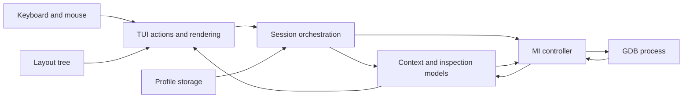

# Architecture

## Overview

The product is embedded-first, with shared target-neutral inspectors. Linux is
the frontend host, not the universal target OS. Native and existing remote-server integration are accepted
through M15. M16's reviewed OpenOCD management is also accepted;
M17 records physical validation on NUCLEO-F446RE and ESP32-S3. Known integration
gaps are listed below and in the roadmap.

`src/main.c` handles help/version and starts the terminal application.
`src/tui/app.c` owns startup/configuration/review/workspace pages, keyboard
and mouse controls, form editing and terminal lifetime. Rendering and theme
selection are in separate files. `src/tui/demo.c` owns explicitly simulated
sample data, demo actions and tabs. The layout module owns tiled geometry.
These samples are never
debugger-domain state and must be replaced by live data in real sessions.

The build and tests are C17 with strict warnings; Make is the only build driver.
C tests use POSIX pipes, processes and PTYs.  Application libraries are ncursesw and libelf (ELF metadata
only; GDB performs instruction decoding) and json-c (versioned profiles and appearance preferences).
The MI parser/controller and shared session module serve native launch/attach
and existing remote GDB-server sessions through the TUI. Console/output and Continue/Pause are
live. Source/Disassembly and stepping use the code model; Call Stack and Threads
use the selected-context model. Code breakpoints and Run to Selected use the
breakpoint model, which now also provides M12 hardware data watchpoints.
CPU Registers, Memory and Locals/Watches use the inspection models described below. Other
inspection views have explicit unavailable messages. Explicit --demo
retains simulated presentation separately. OpenOCD management is implemented and accepted at M16.
Remote connections use the shared inspectors and preserve capability limitations.
Profiles and key mappings retain a review step before connection.

The UI uses nonblocking ncurses input and polls terminal/backend/PTY/pidfd
descriptors together, redrawing after input or session revisions. Idle waits are
100 ms without a session, bounded to 25 ms with one. Raw input preserves function keys and Ctrl+Q;
Ctrl+C and SIGINT/SIGTERM/SIGHUP leave through normal cleanup. Module-owned globals are limited to a signal-safe exit flag and the screen's
color-enabled flag and selected palette index. Mouse and keyboard share action dispatch and rendered hit regions. Lowercase
h/j/k/l first receive ordinary text-field handling; outside editable fields they
are normalized to Left/Down/Up/Right before existing navigation dispatch. Divider
resize mode uses those aliases directly. File-filter edits still reset paging.
No Vim editing mode or new target operations are introduced.

Controls retain `(kind, value, pane)` identities across redraws; rectangles are
rebuilt from the existing layout. Directional navigation scans at most 1,024
rendered controls, excludes content/scrollbars/dividers, and prefers aligned
candidates before forward distance and perpendicular offset. Left/Right stay
within a visual row. Directions do not wrap; Tab/Shift+Tab retain sequential
control traversal. Scrollable menus/forms reveal adjacent items before painting
focus. No second layout tree or cached focus graph is maintained.

Content focus is separate from the last control identity. Only a deliberate body
or scrollbar click acquires it; arrows then use that view's existing navigation.
Escape/Tab or a click outside the pane returns to controls. A header `*` and
CONTENT FOCUS help text identify it without relying on color. Resizing and
fullscreen redraws preserve identity when visible, otherwise fall back to a
visible control. Opening a page resets content focus; value-read actions do not
implicitly acquire it.

While content is focused, Ctrl+arrows and Ctrl+h/j/k/l transfer focus between
rendered BODY controls using the panes' outer rectangles. The shared directional
scoring requires perpendicular overlap for pane movement, prefers nearby aligned
panes and does not wrap. Only visible bodies participate, including nested splits;
fullscreen/compact rendering cannot focus a hidden pane. Transfer preserves
viewports, active view tabs and the last control identity, updating the execution
mode when Source or Disassembly receives focus. ncurses decodes the standard
`CSI 1;5 A/B/C/D` Ctrl+arrow sequences through application key definitions.
Legacy Ctrl+H/J/K/L bytes are intercepted only during workspace content focus,
before text editing or Enter dispatch; terminfo-decoded Backspace also acts as
Ctrl+H there. Outside content focus, existing handling applies.
Startup explicitly calls `nonl()` after `raw()` so curses preserves Enter's
carriage return separately from Ctrl+J's line feed, including in `get_wch`.

Theme roles separate workspace, panel, raised header, notice and footer
surfaces. Selected-row variants retain semantic foreground colors. Direct-color
terminfo supplies exact RGB values; a matching Alacritty direct entry can be
selected when standalone Alacritty advertises truecolor. The app never changes
the terminal palette or tmux configuration. See the
[prototype mapping](requirements.md#interface-constraints) for rendering adaptations.

The workspace preserves per-view scroll/selection and tabs through compact
rendering, with interactive split-tree geometry, dragging and closing as
described below.

Tab activation promotes the active tab to the left. Focus follows its identity
as rendering promotes it to the first position. Mouse input suppresses the
additional inverse keyboard-focus marker;
keyboard input restores it. This prevents the old numeric control index from
highlighting/activating a different tab after reordering. The active-tab theme
and monochrome selection indicator remain intact.

The launcher uses the existing render/theme primitives: a bounded
card centered in the usable terminal area, full-row hit regions including choice
descriptions, simple ASCII icons/chevrons and a compact height below 28 rows.
No image assets, new dependency, animation or background work is needed. It keeps
native-vs-preview availability, profile review and q/Ctrl+Q policy
explicit; session configuration and the debugging workspace are unchanged.

## Source fullscreen rendering

`App.fullscreen_source` is a temporary pane identifier, or -1 for ordinary tiled
rendering. The Source Actions and Source pane-actions entries share one toggle;
Restore and workspace Escape/q leave it. Entry selects Source stepping without
moving execution. Leaving for the launcher clears the override.

While fullscreen, `draw_workspace` keeps the normal application chrome but gives
only that Source pane the available workspace rectangle. The layout module is
not rearranged: its split tree, ratios and pane membership stay intact. Hidden
render rectangles are zero-sized, so the existing code/context/register/variable/
memory visibility APIs hide their inspectors. They retain their normal pending
reply and stale-generation handling. Restoring recomputes normal rectangles for
the current terminal size from the original tree.

The fullscreen header exposes Restore instead of tab switches and the pane menu.
Divider rendering/hit tests and pane-switch shortcuts are disabled while the
override is active; retained geometry cannot create invisible click targets.
Source navigation, scrollbars and normal execution controls use their existing
paths. No saved layout, new session backend or target-access policy is introduced.

## Theme selection and preferences

`src/tui/theme.{h,c}` defines the built-in palette catalog, stable family/variant
identifiers and semantic curses pairs. Catppuccin Macchiato is the default;
All seven families, including Monokai Pro, remain selectable. The
37 palettes use shared workspace/panel/raised/selection surfaces and semantic
foregrounds. Muted/accent colors are adjusted toward text where required for
contrast. RGB roles map to direct color, nearest xterm 256-color entries, or
existing 8-color/monochrome fallbacks. If quantization merges a foreground with
its background, the text color supplies a contrasting fallback.

`app.c` owns Config, Themes and theme-preview page state. A draft palette is
separate from the saved choice. Changing a family chooses a valid variant;
preview reinitializes curses pairs and requests a full repaint. Preview renders
an independent `TbDemo`/`TbLayout`, never the live session or inspection models.
Back restores the saved palette; Save returns to Config only after persistence
succeeds. Theme operations do not modify workspace geometry or session profiles.

`src/tui/preferences.{h,c}` owns global version-1 `preferences.json`, independently
of `profiles.json`. It stores theme/variant identifiers, not runtime color data
or debugger state. Reads require an owned regular non-symlink file of at most
1 KiB and validate the schema and known family/variant pair. Invalid files are
preserved, Macchiato is used and writes are blocked until correction/restart.
Saves use an advisory lock, stale-file identity checks, a private 0600 temporary
file, fsync and atomic rename. A post-rename directory-sync error is reported as
uncertain crash durability, not as a rolled-back save.

The catalog adapts the referenced upstream palettes; it does not embed Neovim or
execute Lua. [THIRD_PARTY_NOTICES](../THIRD_PARTY_NOTICES) retains exact upstream
revisions and MIT notices and accompanies the binary distribution.

## Data flow and invariants

Models own snapshots; rendering consumes them. The shared session routes events
and pumps models outside callbacks. Every pending value/result is scoped by
session, stop and context generations; per-view revisions additionally protect
local navigation. Bounded work and owned resources keep errors and output floods
from starving terminal input. Demo samples never become live debugger state.

## Shared native and remote sessions

`src/session/session.c` owns `TbSession`: MI event routing, setup, model pumping,
execution actions, logs and teardown. `session.h` describes local, `remote` and
`extended-remote` configurations. `native.h` retains source aliases for existing
native consumers; `native.c` holds the strict Linux mapping parser. Native PTY,
pidfd and `/proc` work is conditional on the local session kind. Remote IDs are
opaque display strings, never local PIDs or inputs to process signaling/maps.

Remote configuration accepts a validated TCP endpoint, GDB executable and optional
symbol ELF. It loads symbols without programming firmware, then uses structured
`-target-select`. It does not launch/own a server or apply native PTY, process
arguments, ASLR or shell settings. Both protocols share the stopped-context and
inspector models. Extended mode may connect without an inferior; Continue does
not silently start a local process. Console supports deliberate server-specific
launch/attach commands. Source-profile restoration retains its execution interlock.

Capabilities record connection state, architecture, address width, octet support,
byte order, configured symbol image and unknown relocation status. Constant-only
C expressions establish unsigned-char and pointer widths without evaluating a
target variable. Unknown/non-octet or wider-than-64-bit addressing blocks byte
Memory requests before dispatch. A known incompatible ELF width/order/machine
fails setup. Unknown architecture is not fabricated. GDB's `auto` endian setting
is not a resolved byte order: explicit ELF metadata can supply an order, otherwise
Memory retains single-byte formatting until the user supplies one.

Remote ordinary-memory evidence is empty by default. Readable target descriptions,
ELF sections and a successful read do not prove side-effect-free RAM/Flash. An
adapter may supply affirmative bounded ordinary-region evidence through
`TbSessionConfig`; this is not currently a generic UI map editor. Without it,
Memory Go/Refresh and explicit Previous/Next read actions remain available, while
wheel/key browsing cannot silently cross unknown regions. Opening views causes
no speculative memory scan. New remote inferiors revoke previous region evidence
and re-query metadata. Typed inferior-exit notifications revoke reads and stop
model pumping until a new inferior is established. Retained values remain stale.

Close interrupts a running target once, waits for the asynchronous stop, then
sends `-target-disconnect` and reaps only the frontend's owned GDB. Target
halt/resume disposition is server-dependent. Refusal, timeout or unconfirmed
disconnect is reported; uncertain cleanup aborts owned GDB without sending it a
normal quit command that could terminate a remote inferior. No server PID is
acquired or killed. Disconnect evidence cannot establish physical target state.

Protocol references: [MI target manipulation](https://www.sourceware.org/gdb/download/onlinedocs/gdb.html/GDB_002fMI-Target-Manipulation.html),
[connection modes](https://www.sourceware.org/gdb/current/onlinedocs/gdb.html/Connecting.html)
and [byte order](https://sourceware.org/gdb/current/onlinedocs/gdb.html/Byte-Order.html).

## OpenOCD setup and owned lifecycle

`src/session/openocd.{h,c}` provides a bounded script catalog, immutable reviewed
argument plan and nonblocking server process/log management. The catalog inspects
installed `board`, `interface` and `target` paths from explicit search directories,
`OPENOCD_SCRIPTS`, user OpenOCD locations and conventional system prefixes. It
never evaluates Tcl, infers script dependencies or treats a filename as hardware
compatibility evidence. Traversal, depth and catalog size are bounded; omitted
entries remain available through manual paths. Custom installation prefixes can
be supplied through profile search directories.

Board mode emits one selected `-f`, without appending populated adapter/target
fields. Advanced mode emits adapter then target. An explicit ordered script list
overrides both modes. Search directories retain order, and all arguments are
spawned literally without a shell. The review shows indexed arguments, resolved
endpoint, GDB/symbol choices and ownership. Managed servers bind IPv4 loopback;
remote hosts/IPv6 use existing-server mode. Tcl scripts and OpenOCD initialization
may affect the target: symbol loading adds no programming/reset/resume commands,
but cannot neutralize actions in deliberately selected configurations.

The manager checks local port availability, spawns only the reviewed executable,
closes unrelated child descriptors and captures stdout/stderr into bounded escaped
logs. Readiness requires this child's matching GDB-listener message and continued
liveness. Listening does not prove target readiness; structured GDB connection and
metadata negotiation remain mandatory. Startup has a five-second deadline;
owned-server stop sends TERM followed by a bounded KILL/reap fallback. GDB closes
before owned OpenOCD. External servers never enter this ownership path. An exited
or failed server invalidates the session rather than silently reconnecting to a
possibly unrelated endpoint. Port checks cannot eliminate the concurrent-bind
race; listener and connection failures remain explicit.

Reset is an explicitly confirmed `monitor reset halt`; Halt is deliberate too.
This provides an entry to startup debugging, not a universal guarantee of halting
before the first reset instruction. Core/probe/reset wiring and server scripts
determine that capability; inspect the verified PC and document reset-catch limits.
Running operations first wait for GDB's asynchronous stop. Monitor completion alone
is insufficient: the session flushes GDB's register/frame cache and verifies a
fresh stop using structured thread information. Explicit monitor-operation
verification requires a reported current thread and its numeric PC; all threads
being stopped alone is insufficient after reset invalidates RTOS task contexts.
Missing/departed current threads, absent frames and unavailable addresses fail
verification and revoke value inspection. Ordinary aborted-execution reconciliation
retains its state-only recovery semantics. Stop/context generations and the
original stop PC are updated only from backend evidence. Unconfirmed operations
leave value inspection unavailable, with an explicit reconnect diagnostic.
Disconnect offers Leave halted or Resume. The former requests Halt before
connection release; the latter explicitly requests `monitor resume` before
`-target-disconnect`. OpenOCD detach alone does not request execution. Backend/script-specific detach
events can override physical disposition, and errors are not reported as success.
No default region/MMIO authorization is inferred from OpenOCD or script selection.

References: [OpenOCD startup and script search](https://openocd.org/doc/html/Running.html),
[server configuration](https://openocd.org/doc/html/Server-Configuration.html),
[OpenOCD detach handling](https://openocd.org/doc/doxygen/html/gdb__server_8c_source.html) and
[GDB register/frame cache invalidation](https://sourceware.org/pipermail/gdb-patches/2020-November/173490.html).

## Tiled workspace

`src/layout/layout.c` is independent of curses and debugger data. Six root tiles
use 36/34/30 column proportions and a 62/38 default row split; ratios remain
user-adjustable. The original M02 56/44 row split was superseded by the accepted
five-row navigation/default-height correction. Each tile contains
a binary split tree. A leaf names a stable pane slot; an internal node stores
its direction, child indices and fixed-point ratio. The workspace owns a bounded
pool of 32 pane slots and 64 tree nodes, avoiding heap ownership complexity.
Closed nodes/slots are reused. There is no preset catalog or layout selector.

Geometry uses half-open rectangles and one-cell gutters. Recursive subtree
minimums constrain resizing (each leaf needs 20 columns and 7 rows); globally
shared row/column dividers respect all affected subtrees. New splits require
currently available space. Closing a nested leaf promotes its sibling into
the parent; a root leaf cannot close. Tabs retain per-view selection/scroll,
and each pane retains at least one tab. These rules follow the HTML prototype.

Geometry is recomputed after input, without changing requested ratios on
terminal resize. If the grid or its subtrees cannot fit, only the focused leaf
is painted; compact Prev/Next controls and `[`/`]` reach every retained pane.
Returning to sufficient dimensions restores the tree. Resizing a terminal during
a drag cancels that drag to avoid applying obsolete coordinates.

The UI maps gutter hit tests to layout operations. ncurses parses mouse input;
for terminals advertising an xterm-compatible `kmous`, the application explicitly
enables held-button motion mode 1002 and disables it at shutdown. The installed
ncurses XM capability otherwise enables click mode alone. Keyboard resize mode
selects the same dividers and uses the same constrained coordinate updates.
Physical mouse appearance/usability requires manual validation, even
when the PTY and real tmux forwarding tests pass.

## Owned MI parser

`src/gdb/mi.h` defines an internal C API; `mi.c` uses only the C library.
`tb_mi_parse` parses one record without its line delimiter. The returned record,
token, class, ordered result tree and decoded strings are independently owned;
release them together with `tb_mi_record_free`. Duplicate names and unnamed
list elements are preserved. `tb_mi_find` returns the first matching sibling.
Strings carry an authoritative byte length, including embedded decoded NULs;
tokens retain their exact digits rather than assuming an integer width.

Zero-initialize `TbMiParser`, feed arbitrary byte chunks, finish at EOF and
destroy its buffer. CR, LF and CRLF frame records, including a split CRLF.
Blank lines are ignored; an unterminated EOF tail is reported as truncated.
Callbacks receive either an owned record or a temporary error with a zero-based
record byte offset. The callback must not reenter/destroy the parser. Feed's
success means input was consumed; recoverable parse errors arrive through the
callback. Malformed and oversized records recover at the next line delimiter.
Allocation failure is fatal until destroy/reinitialization, with no retry of
partially consumed input. No callbacks retain pointers into input buffers.

Bounds are 1 MiB per encoded record excluding its delimiter, 16,384 value nodes
including containers, and 64 nested containers. Overlong lines are discarded
without growing the buffer further. Limit diagnostics are explicit; a future
controller must fail the affected operation rather than publish partial data.
These are defensive internal limits, not target architecture restrictions.

The parser handles result, execution/status/notification async, console/target/
log stream and prompt records. Unknown class/field names are retained. MI tuples
contain named results; lists contain either results or values, without mixing
the two. C string escapes are decoded as bytes; invalid/out-of-range escapes
are rejected. Raw stream text retains its spaces and gains the documented
implicit newline. Quoted streams have no added newline.

The grammar follows the official GDB manual's
[MI output syntax](https://sourceware.org/gdb/current/onlinedocs/gdb.html/GDB_002fMI-Output-Syntax.html)
and [stream records](https://sourceware.org/gdb/current/onlinedocs/gdb.html/GDB_002fMI-Stream-Records.html).
It is shared by MI2/MI3. The controller supplies interpreter selection,
request correlation and execution-state foundations; the parser itself has no
command encoder, transport, subprocess lifecycle or debugger-domain state.

`make mi-demo` runs the C-only diagnostic decoder with one-byte reads.
It escapes control/non-ASCII bytes before printing and launches no debugger.
Synthetic fixture provenance and expectations are in `tests/fixtures/mi/README.md`.

## Nonblocking controller and process ownership

`src/gdb/controller.{h,c}` is an internal, single-threaded C interface independent
of curses. It owns one spawned GDB child, three close-on-exec pipes, the parser
and up to 64 requests. `posix_spawnp` passes a literal executable and fixed argv:
`--quiet --nx --interpreter=mi3`. No shell, target arguments or connection command
is used. The child has a separate process group, reset signal mask and default
signal dispositions; cleanup signals only its owned PID, never the group.
All pipe endpoints stay above stdio, even when the host closed descriptors 0–2.
Parent endpoints are nonblocking; child endpoints remain blocking.

Startup waits for the MI prompt and successful `-gdb-set mi-async on` and
`-gdb-set non-stop off` replies before reporting READY (no target). One MI2 retry
is allowed only after the first child is reaped, both output pipes are drained,
and its bounded startup stderr contains GDB's explicit English unrecognized-MI3
interpreter diagnostic, before any prompt or command. Missing tools, timeouts,
generic failures, localized/unrecognized diagnostics and post-prompt failures
never trigger speculative retries. Setup errors fail visibly. Stderr remains
separate from parsed MI and is passed as length-delimited bytes.

Requests receive monotonically increasing tokens within a session, independent
caller cookies, deadlines from enqueue, and session/stop/context stamps. Commands
are assembled from a restricted operation name and plain safe ASCII tokens or
quoted C-string arguments (fixed-width octal for control/non-ASCII bytes); encoded commands are
bounded to 16 KiB. Raw command fragments are not accepted. This is MI encoding,
not shell quoting. Partial writes retain their offsets and ordering.

GDB's CLI-derived -gdb-set/-gdb-show consume a raw setting tail. They use a
restricted setting name and literal arguments without CR/LF instead of quoting
the name or an entire environment assignment. Quoted names can misleadingly
return ^done without applying the setting. Startup probes query actual mi-async/non-stop values,
and native fixtures verify shell-free argv and exact environment assignments.

Replies match only fully written requests with exact tokens. STOP/CONTEXT queries
require a stopped target. A resume/new stop invalidates stop-dependent replies;
explicit context changes invalidate context-dependent replies. Obsolete queued
queries are dropped before writing; already-sent stale results are not published
as successful replies. Unknown/late tokens are diagnostic stale events.
Repeated `*running` does not create extra epochs, and a late `^running` cannot
overwrite a newer `*stopped`. New sessions reset the parser/pipes and advance
session identity. The thread/frame model calls the context hook on selection
and refresh, invalidating older inspection requests.

Each accepted public request receives one reply, stale, timeout or cancellation
completion. Fully sent timeouts do not imply backend cancellation: late replies
are ignored and no command is retried. An incomplete write timeout closes the
session because the wire may contain an unfinished command. Protocol/limit/
allocation errors also fail the controller instead of exposing partial state.
Callbacks borrow events/records until return and must not mutate/reenter the
controller; consumers must copy data they retain.

`tb_gdb_pollfds` and `tb_gdb_timeout` allow the terminal event loop to poll
all sources together, then call `tb_gdb_pump(..., 0)`. The standalone pump waits
at most 25 ms or the next deadline, handles EINTR by returning to its caller,
and reads/writes at most 16 KiB per pipe per turn. It checks deadlines around
poll and handles closed command input even when no write is queued. Idle waits
use poll. Callback work must also remain bounded; the transport does not render.
SIGPIPE masking/consumption is local to each write, preserving the caller's
handler/mask and previously pending signal.

Close cancels requests and closes command input for cooperative EOF exit.
After 300 ms it sends TERM, then KILL after another 200 ms if needed. Reaping uses
`waitpid(owned_pid, ..., WNOHANG)`, clearing ownership before exit callbacks.
The host must not reap the controller's child; unexpected ECHILD is diagnosed
and clears the PID without signalling it again. A reaped child's pipes get
200 ms to drain before being closed if another process retained an endpoint.
Destroy refuses a live controller: close and pump until DISCONNECTED first.
The host must service the pump during shutdown. The native session implements
target release before using this process-close primitive.

The C fake peer and interactive diagnostic harness are in `tests/support/`,
with failure/pressure/PTY coverage in `tests/integration/`. They are explicitly
fake; they remain separate from the native workspace. An optional actual-GDB startup test performs
only negotiation, feature enumeration and MI exit, without any inferior/target.
The protocol state follows the official GDB manual's
[input syntax](https://sourceware.org/gdb/current/onlinedocs/gdb.html/GDB_002fMI-Input-Syntax.html),
[async records](https://sourceware.org/gdb/current/onlinedocs/gdb.html/GDB_002fMI-Async-Records.html)
and [interpreter options](https://sourceware.org/gdb/current/onlinedocs/gdb.html/Mode-Options.html).

## Native session and logs

`src/session/session.{h,c}` owns sequential configuration/actions over the
controller. Callbacks copy status and mark completions; requests are issued
after callbacks return, respecting controller ownership/reentrancy rules.
Startup validates a readable ELF/PID and directory, resolves the ELF before
changing GDB's working directory, copies bounded structured arguments/environment,
disables auto-load, pagination, confirmations and the inferior startup shell,
and preserves normal ASLR. It does not edit host ptrace policy or user GDB files.
Environment is session-only. The small quoted-word parser performs no expansions.

Native launch requires GDB 17+ for literal argument preservation with the startup
shell disabled. GDB 15/16 split the argument string on whitespace without
recognizing quotes; spaces, empty arguments and quoting cannot be transported
correctly through that backend path. GDB 17 uses quote-aware parsing in
[`init_for_no_shell`](https://gnu.googlesource.com/binutils-gdb/+/refs/tags/gdb-17.1-release/gdb/nat/fork-inferior.c).
The frontend retains shell-free launching; this native requirement does not
establish a minimum version or compatibility claim for remote target toolchains.
Configuration must select a supported debugger; startup does not currently probe
the backend's no-shell argument parser.

Launch loads symbols/executable, args/cwd/env and an owned output PTY, then reports
Loaded. Continue starts the program; subsequent Continue resumes a stopped
program. Pause uses MI interrupt. There is no automatic main breakpoint. Attach uses the selected PID and optional ELF, stops on
success and retains actionable permission failures. Attached processes retain
their existing stdio. Demo data is never live data.
Basic console run/r/start/starti operations also establish launch ownership;
failed operations do not retain a pending ownership claim. Multi-inferior
coordination and arbitrary session-topology changes are outside the current session model.

The PTY captures launched stdout/stderr together without using the debugger MI
pipe or frontend terminal. Only the owned slave's newline translation is changed;
terminal controls and non-ASCII bytes are escaped before display/export. Program
input and a full terminal emulator are deferred. Each pump drains at most 16 KiB.
Logs retain 512 lines of at most 255 bytes including channel prefixes; long
streams are split, partial lines flush independently per channel after an idle interval, and old lines
evict from a ring. Console panes scroll independently and normally follow the
tail. GDB console input is a deliberate single command carried by
`-interpreter-exec console`; embedded record delimiters are rejected and managed
interpreter/async changes have an explicit diagnostic.

The Console's inline Command field and Send control occupy a dedicated row below
the log, separate from the output viewport/scrollbars and Save Log action. Drafts
and edit cursors are bounded and pane-local, retained across view changes and
resize, and cleared on new sessions or split-pane reuse. Enter/Send dispatches
through the unchanged session API and clears the draft only after acceptance;
rejected requests preserve it. Escape releases field focus without sending.
Text editing takes precedence over navigation/action bindings; the final refresh
places the caret in the field after drawing the workspace chrome.

Save Log flushes pending fragments and exports the bounded readable history.
It creates a new file with O_EXCL and mode 0600, preserving existing files and
reporting open/short-write/close failures. It exports retained text, not a profile,
and cannot recover evicted history.

Normal Quit/Session requests use a full-page confirmation. The session interrupts
a running target, kills a still-owned launched inferior through GDB or
detaches/resumes an attached target, then closes/reaps GDB. Signal exits run the
same cleanup outside the handler. A stable Linux pidfd acquired from the actual
launch notification verifies/recover-kills the owned inferior if GDB dies;
numeric inferior PIDs are never used for recovery signals. An explicitly detached
inferior relinquishes ownership. Missing pidfd support, release failures and
unconfirmed exit are diagnosed, not counted as successful cleanup. The debugger
child is reaped by the controller; the kernel/adopting parent reaps an inferior
orphaned by a debugger crash.

`--demo` is an explicit visual-reference path. Bare invocation uses the native
launcher with implemented remote/OpenOCD choices. Live tabs/layout reuse
presentation state only, not sample debugger values. The workspace has no presets,
floating windows or editor modes. Workspace organization remains F06; custom
themes remain F44. F19's built-in themes affect presentation only.

## Selected context, Call Stack and Threads

`src/model/context.{h,c}` owns a bounded debugger snapshot independently of curses
and target architecture. The native session owns this model and passes controller
events to it first. Context requests use distinct cookies so their completion
cannot complete a native configuration/action request. Callbacks only copy
borrowed MI fields and mark work; the native pump issues new requests after
callbacks return and while session actions are idle.

Stopped snapshots carry session/stop/context generations, the original stopped
thread/PC frame and the independently selected thread/frame. Selecting a caller
does not move execution. GDB stop records can omit the innermost level; a supplied
stop frame address identifies frame zero. A later thread/frame selection never
rewrites that original stop frame. Resume, exit and disconnect mark retained data
stale; thread-created/exited/selected notifications schedule invalidation outside
the callback. Context requests from older generations are discarded. Manual
console commands invalidate context before execution and refresh it afterward.

Only visible context views trigger automatic reads, only while stopped. Refresh
and selections also wait for a stopped target. Sequential `-thread-info`,
`-stack-info-frame`, bounded `-stack-list-frames --no-frame-filters` and
`-stack-list-arguments --no-frame-filters --no-values` produce an owned
snapshot, published coherently after the sequence. Partial unwinds, missing
source/symbols, optimized-out arguments and command failures remain explicit;
no CLI output is parsed and automatic argument discovery does not evaluate values.
The frontend retains the frames GDB reports, including inline/tail-call frames,
without inventing missing frames. RTOS-specific inspection is planned, not part of this model.

Bounds: first 128 reported threads, 32 frames per stack page plus one lookahead,
and at most the first 4096 frame levels. Strings have fixed render-safe bounds;
argument discovery returns names only. Read Args deliberately requests simple
values for the selected frame only, with no automatic repeat or aggregate expansion. Requests have
three-second deadlines, no automatic retry loop and no idle/running polling.
Last selection wins when pending thread choices supersede each other; frame
selection is blocked during a thread-selection request to avoid selecting a
frame in the wrong thread. Stack pages preserve GDB's selected frame.

Live rows have mouse selection and arrow-key browsing followed by Enter.
`>` marks the selected context and `*` marks the stopped thread's innermost
frame; caller inspection is labelled. Stack paging, Refresh, scrollbars and
normal tiled resize/compact behavior reuse the existing pane controls. Snapshot
revisions cause redraws through the native event loop. Source/Disassembly now
consume this context; Locals/Watches also consume it. Code visibility requests selected
thread/frame metadata without fetching a whole stack when its view is hidden.
Raw source paths are retained separately from escaped display labels.

The protocol follows GDB's official
[stack commands](https://sourceware.org/gdb/current/onlinedocs/gdb.html/GDB_002fMI-Stack-Manipulation.html)
and [thread commands](https://sourceware.org/gdb/current/onlinedocs/gdb.html/GDB_002fMI-Thread-Commands.html).

## Source, disassembly and execution navigation

`src/model/code.{h,c}` owns per-pane source buffers, assembly windows, mixed-mode
settings and browsing positions independently of curses. The native session owns
it alongside context, routes distinct request cookies, and pumps both only after
controller callbacks return. Session/stop/context generations reject obsolete
backend replies; per-view versions additionally reject an outstanding assembly
reply after a local mixed/follow change. Resume retains explicitly stale code.
Stopped source/assembly follow GDB's selected frame; original stopped-PC markers
remain distinct from inspected caller markers. No compiler semantics are inferred.

`-file-list-exec-source-files` supplies a bounded file catalog, including before
execution. Exact file/fullname identities preserve spaces and duplicate basenames.
Each Source pane keeps a session-local Current tab and at most seven opened
GDB-known file tabs. Current follows the selected frame; file tabs retain their
identity across stops. Switching reloads only the active file, while the TUI
retains each tab's viewport. Closing a pane or resetting a session clears its
tabs. Catalog refresh does not turn an ambiguous basename into a different file.
Source reads accept regular files only, bounded to 1 MiB / 32,768 lines per pane;
text find and line navigation operate on this local cache. Rendering escapes
terminal controls/non-ASCII bytes and shares the demo's C/C++ lexical colors.
These are bounded synchronous local reads; unusually slow filesystems remain a
latency limitation. There is no eager scan of the project's files or target.
Unresolved relative source paths require GDB lookup recovery, rather than an
ambiguous read relative to the frontend's working directory.

`-data-disassemble` requests 256-byte address windows, retaining at most 128
instructions with opcodes and optional source groups (`-- 2` / `-- 5`). Forward
navigation uses the last decoded instruction's byte length, with 16 previous
window anchors retained for Back; it never guesses a backward instruction boundary.
Stopped refreshes retain the current window if it contains PC, and can restore
previously decoded ranges after returning from another function. A new window
may use the structured first instruction's function offset for one bounded
pre-context read (at most 1024 preceding bytes plus the normal 256-byte forward
range). The metadata-free compatibility path retains four preceding instructions;
the native indexed path retains up to 64 preceding instructions and the bounded
forward listing. Missing/too-distant metadata falls back to the known PC boundary.
All bytes are fetched fresh after stops; saved anchors are browsing context,
not trace or retained historical target state. Scrolling beyond a window edge
can load a known earlier/next window without resuming execution.
Without an earlier saved anchor, a known nearby function origin can supply a
bounded backward decode ending at the current window, retaining at most 128
preceding instructions. Unavailable or distant origins require explicit address/
symbol navigation; the frontend does not disassemble backwards from arbitrary bytes.
A short backward-prefix read prepends its rows to a bounded owned copy of the
current forward listing instead of replacing that listing. At most 128 combined
instructions remain; pending copies are released on completion, cancellation,
view-navigation changes, reset and destruction. The TUI preserves the old first
row's position, adjusted by the requested upward scroll, when it appears in the
combined result. A full older window uses its end instead. This avoids a one-row
result collapsing the display or jumping it to the far end of the retained data.
Mixed failures fall back independently per pane to assembly. Source text is
interleaved when its exact file matches the cached source; other source groups
keep their file/line labels with an explicit unavailable-text message. Current
x86 targets reported by GDB as i386-family explicitly select AT&T syntax.

Address navigation accepts hexadecimal addresses or simple identifiers/qualified
symbols, excluding calls/operators/command fragments. Symbol addresses use
`-data-evaluate-expression --language c` and a quoted symbol's address, avoiding
C++ overloaded address-of calls. Browsing never issues execution/PC-write commands.
Return to Stopped selects the original stopped thread/frame zero. Source lookup
settings use MI source directories and ordered GDB substitute-path rules, with
separate GDB-CLI and MI encoding; only successful replies update saved-in-session
settings. Clear resets both overrides. Profile persistence is described below.

The native module issues MI next/step/next-instruction/step-instruction/finish
against the selected thread's execution frame zero. Clicking Source/Disassembly
chooses the corresponding F10/F11 mode; toolbar and inspector clicks retain it.
Step Out remains finish. Full-page tiled Actions, file filtering and source
settings screens share normal mouse/Tab/arrows/Enter/Escape editing. Source/ASM
scroll and horizontal pan change only the viewport; `>` denotes actual stopped
execution and `~` an inspected frame. No secondary execution-like cursor is added.
Breakpoints/gutter/F9/Run to Selected use the breakpoint model below.

Live pane scrolling uses shared bounded content/viewport measurements. Optional
horizontal tracks reserve a row above the action footer; optional vertical
tracks have one-cell hit regions, vertical `|`/`#` glyphs and the horizontal
bar's colors/weight. Width/height calculations account for both
bars before painting and hit testing. Source keeps its line gutter fixed while
code text pans. Source, Disassembly, Console, Call Stack and Threads retain
horizontal offsets per pane/view, clamp to content bounds, and expose thumb
dragging, track paging and Left/Right navigation. A fitting axis renders no bar.
Later live views must supply their bounded row width to this same viewport path.
Demo vertical bars use the same narrow style; its static reference has no horizontal
data-navigation implementation. This adds no layout modes or debugger actions.
Live assembly initially includes prior decoded context where available, then
keeps its viewport until PC reaches a five-row top or bottom margin (scaled in
short panes and clamped to available context). Manual browsing does not
automatically snap back until stepping/Stopped. The default upper row receives
62% of the usable height; divider dragging continues to set the user's ratio.

Protocol references: GDB's [MI data commands](https://sourceware.org/gdb/current/onlinedocs/gdb.html/GDB_002fMI-Data-Manipulation.html),
[execution commands](https://sourceware.org/gdb/current/onlinedocs/gdb.html/GDB_002fMI-Program-Execution.html),
[file commands](https://sourceware.org/gdb/current/onlinedocs/gdb.html/GDB_002fMI-File-Commands.html)
and [source lookup](https://sourceware.org/gdb/current/onlinedocs/gdb.html/Source-Path.html).

## Image boundaries and code breakpoints

Pane `...` membership toggles query only that pane's tabs. Included options
alone receive a filled-circle marker, with ASCII fallback. Shared indexed
removal preserves active selection when another tab is removed and protects
the final tab. Adding activates the new view; promotion and per-view positions
remain. No global membership state or persistence is introduced.

`src/model/images.{c,h}` uses libelf/GElf for ELF32/64 in either byte order.
Allocated/executable sections, function/object symbols and ARM mapping symbols
classify ranges and supply trusted anchors. Native `/proc/PID/maps` plus PT_LOAD
offsets establish mapped-image load bias. Library/PID lifecycle events invalidate
metadata. Unsupported/unavailable metadata stays unknown, never fabricated.
Limits are 16 images, 256 allocated sections/image, 8192 retained symbols/image,
65536 scanned symbols/image and 64 MiB/image; limited catalogs are disclosed.

Indexed instruction caches merge sorted/deduplicated windows, retaining at most
128 instructions. Backward extension decodes forward from a known anchor in
256-byte chunks, at most 4096 chunks. It skips unknown/non-code boundaries to
the next known code anchor instead of guessing a variable-length x86 boundary.
Failures retain the prior listing. Raw decoding is explicit; repeated byte or
instruction patterns alone never classify code. Gap rows say how many bytes
were not decoded. Visible instruction metadata determines warnings, independent
of the last request or offscreen rows.

Visibility changes do not invalidate a cached code view; stop/context/settings
changes do. Opening/closing a selector therefore preserves cache and viewport.
One assembly formatter supplies both rendered rows and horizontal extent,
aligning address, byte, mnemonic and operand columns without discarding bytes.

`src/model/breakpoints.{c,h}` owns a bounded 256-row MI snapshot, parent/child and
pending locations, conditions, ignore counts, hits, enabled state and hardware
policy. Structured source/line arguments preserve literal quoted paths.
Notifications/stops mark the table dirty; no idle polling or parsed CLI table.
Gutter/F9 and the tiled Manage screen share this model.

Run to Selected inserts a separately owned, thread-specific temporary breakpoint.
An intervening stop cancels continuation and triggers cleanup. Stop generations,
notifications and a pre-insertion ID baseline protect user breakpoints through
races/timeouts. Ambiguous ownership blocks execution instead of deleting guessed
entries. Cleanup failure offers explicit Manage > Refresh retry without spinning.

Some GDB hardware-insertion aborts emit ^running then ^error with the same token
and no *stopped. The controller schedules one bounded -thread-info query. Only
a structured result confirming every thread stopped establishes stopped state;
the context model then refreshes the actual reported frame. Missing/running
thread states stay unconfirmed, with a useful diagnostic. CLI warnings are logs,
not evidence of execution state. Remote-board validation remains separate.

## CPU registers

`src/model/registers.{c,h}` owns discovered numeric IDs/names and cached values.
`-data-list-register-names` preserves empty-name positions; no ARM/x86 list is
canonical. `-data-list-register-values --thread ... --frame ...` reads only
requested visible rows, in batches of at most 32. Catalog capacity is 512 IDs;
values are bounded to 1024 bytes and flagged when bounded. Missing values and
errors are explicit, not zero-filled registers. Failures require explicit retry.

The TUI declares visible row ranges each render pass. A separate context-demand
flag allows a Registers-only workspace without conflicting with code demand.
No register reads occur while running, hidden or idle. A shared format selector
uses GDB Hex, Decimal, Octal, Binary, Raw and Natural representations. Canonical
hexadecimal samples drive change comparison independently of display format;
thread/frame/architecture changes reset baselines. Context generations and local
format versions reject obsolete replies. Long/unavailable canonical values do
not claim changes that cannot be established from complete samples.

The pane uses existing horizontal/vertical scrolling, Refresh and `*` plus color
for changed values. It labels selected context and stale data. GDB/MI provides
no standard structured group-discovery command here; All (ungrouped) is honest
fallback, without CLI-table parsing or guessed metadata. Writes, peripheral polling, SVD interpretation and register editing are not
implemented in this model.

Reference: GDB [MI data commands, register names and values](https://sourceware.org/gdb/current/onlinedocs/gdb.html/GDB_002fMI-Data-Manipulation.html).

## Memory inspector

`src/model/memory.{h,c}` owns up to
32 independent locations/settings and bounded byte/validity snapshots; `app.c`
owns per-pane inline drafts/cursors and viewport scrolling. The toolbar stays
above the body while body scrollbars use the adjusted body geometry. Enter and
Go share navigation; invalid input stays in the pane. Switching tabs retains
drafts and data. New sessions/split-slot reuse clear old instance state.

Memory has no Linux `/proc`/PID dependency. `tb_memory_order` and
`tb_memory_regions` take adapter metadata; region entries designate established
ordinary memory only. `tb_memory_browse` validates the next complete bounded
range, read completeness, overflow and current context before enqueueing. No
region metadata grants nothing implicitly; explicit address/Refresh remains
available. `session/session.c` reads ELF byte order and a bounded process-map
catalog after stops, excluding device/special-file mappings from ordinary-memory
authorization. Missing metadata is an honest unknown state.

Snapshots never exceed 1024 bytes; one backend request is active at a time.
Addresses are at most 64 bits and units are 8-bit bytes for the initial supported
targets. The metadata catalog holds at most 128 regions; omitted or unavailable
regions require explicit Go. Unknown or unsupported wider/non-octet targets produce capability diagnostics,
not fabricated values. GDB memory reads may use heuristic
partial reads; the frontend preserves the exact reported bytes/validity rather
than reconstructing inaccessible memory. Scalar address conversion suppresses
character-pointer string printing. User calls/writes/casts remain rejected.

## Locals and Watches

`src/model/variables.{h,c}` owns separate shared Locals/Watches trees; panes
retain their own selection and scroll, but do not create independent watch lists.
`session/session.c` routes events and drives the model without blocking the TUI.
Local names come from `-stack-list-variables --no-values`; value inspection uses
owned MI variable objects, not parsed CLI output or demo data.

Names and expression syntax are not evidence that a value is safe to read.
Creation, evaluation/formatting and child expansion pass authorization before
dispatch. The optional adapter callback must establish the complete operation's
read footprint without reading target memory to discover it. Automatic reads
require every span to fit established ordinary regions, with unknown or
side-effecting overlays taking precedence. Bounds are eight spans and 1024 total
bytes for this proof. Readability alone, an apparent base address, or absence of
`volatile` is insufficient. No complete proof means unknown, not necessarily unsafe.

The native adapter currently supplies no complete expression-footprint proof.
Values therefore require deliberate Read, expansion, page or format actions.
Adding a watch or opening a tab grants no read. Explicit inspection applies to
pointer children just as to roots; it grants only the current operation/context,
not ongoing polling or nearby reads. Calls, mutations and unsupported expression
forms remain rejected even on explicit Read. Explicit operations can access MMIO;
bounded rows and strings do not guarantee a hardware transaction width or a
complete byte limit for GDB's own value evaluation. This is not a sandbox around
GDB or manual Console commands.

Each tree holds at most 64 roots and 256 nodes, with 32 children per page and
depth limited to 12. Names/types/values have fixed display bounds. Expansion is
lazy, including C++ access-group children; specialized pretty-printer/STL objects
are unsupported. Root Read discards its old child page. Numeric formats preserve
canonical change comparisons across stops; scope changes reset comparisons and
same-stop refresh does not erase the previous-stop baseline. Optimized-out,
unavailable, failed and stale states remain explicit.

One variable request is active at a time. Session/stop/context generations reject
obsolete replies. Resume/context changes retire owned roots, and collapse/paging
prunes children; cleanup uses session scope while value requests use context
scope. No automatic idle/running/hidden value polling is introduced.

Call Stack arguments are names-only until explicitly read; remote sessions
retain unknown-region denial before automatic inspection. Target descriptions must not be treated
as complete MMIO safety evidence. Without sufficient proof, explicit inspection
remains the fallback. M17 validates real hardware; synthetic policy tests do not
establish peripheral safety on a board.

## Hardware data watchpoints

The existing breakpoint model issues `-break-watch` with optional `-r` or `-a`
and C expression parsing. The shared conservative expression grammar rejects
calls/mutations; creation remains deliberate because evaluation may read storage.
It does not relax M11 authorization or add automatic peripheral inspection.

Creation requires a stopped target and a complete fresh breakpoint table. The
model records existing IDs and generation, then reconciles the returned ID/type
against `-break-list`. Only matching hardware change/read/access types complete
the operation. Software fallback, mismatched mode, changed context or uncertain
creation causes owned-entry removal; ambiguous ownership blocks execution rather
than deleting an unrelated entry. Failed cleanup stays blocked until explicit
Manage → Refresh or session closure. Requests correlate tokens, and reconciliation
uses bounded tables rather than idle polling. Native Continue/Step/Console honor
the existing breakpoint busy interlock; closing the session remains available.

Re-enable repeats hardware verification. Managed software downgrades discovered
in later complete tables are removed before subsequent frontend execution.
This is backend reconciliation, not a promise of hardware insertion: slots,
alignment or width can still fail when GDB resumes, and backend errors remain
visible. No fixed slot count or architecture capability is inferred from Linux.
Explicit Console operations are not a sandboxed frontend execution path.

Memory's action reviews the address of the selected cached row's first group
and a 1/2/4/8-byte width. It requires current data and never watches an entire
displayed block implicitly. Address forms generate fixed unsigned C lvalues;
the initial target data-model assumptions require compatible C widths and octet
addressing. Remote capability handling retains that limit.
Variable actions prefill root expressions; child display labels are not guessed
into C paths, so qualified child expressions can be entered explicitly.
The form cancels submission if its stopped context changed.

Watchpoints share Breakpoints enable/disable/delete/condition/count controls.
MI stop records provide hit values and scope-expiry messages; deleted scoped
watchpoints disappear on reconciliation. They are excluded from code gutter
matching. Native fixtures and TUI tests are available; recorded execution evidence
is in [the ledger](validation.md#m12). Physical backend
support remains M17, and software watchpoints remain deferred beyond v0.1.0.

Protocol references: GDB [MI breakpoint commands, `-break-watch` and `-break-list`](https://www.sourceware.org/gdb/current/onlinedocs/gdb.html/GDB_002fMI-Breakpoint-Commands.html)
and [Setting Watchpoints, hardware limits and scope](https://www.sourceware.org/gdb/current/onlinedocs/gdb.html/Set-Watchpoints.html).

## Profiles and source restoration

`session/profiles.{c,h}` owns bounded connection definitions, action keys and
recent saved sessions, independent of curses, local process IDs or target values.
The launcher loads into configuration for review; it never starts a tool merely
because a profile was selected. Successfully initialized saved sessions enter recents. Remote profiles connect
only after review; OpenOCD profiles now prepare reviewed M16 sessions. Attach reload
leaves PID empty. Environment overrides are session-only.

Storage is `$XDG_CONFIG_HOME/the-bugger/profiles.json`, falling back to
`$HOME/.config/the-bugger/profiles.json` for missing/relative XDG configuration.
Loading absent data creates nothing. json-c parses a strict version-1 UTF-8
schema, at most 1 MiB, 16 profiles and 8 recent names. Root fields are `version`,
`profiles` and `recent`. Every profile requires the following fields; unknown
fields/types/versions and duplicate names or conflicting bindings are rejected.

| Fields | Representation |
|---|---|
| `name`, `kind` | Name; kind integer 0 native, 1 OpenOCD definition, 2 existing-server definition |
| `attach`, `start_server`, `adapter_target` | Boolean mode/configuration flags |
| `executable`, `directory`, `gdb`, `openocd`, `endpoint`, `board`, `adapter`, `target`, `protocol` | Literal strings; protocol `remote` or `extended-remote` |
| `arguments`, `scripts`, `search` | Ordered string arrays, at most 32 elements of at most 511 bytes |
| `directories`, `mappings` | Up to 8 source directories and 8 ordered `{from,to}` path substitutions |
| `keys` | Seven strings in Continue/Pause/Over/Into/Out/Breakpoint/Reset order: function key, Ctrl letter or `None` |

Names hold up to 63 bytes; paths/source prefixes up to 1023, endpoint up to 255.
F13–F24 display as Shift+F1–F12; terminal delivery still varies. Reserved
Ctrl+C/H/I/J/M/Q/S/Z and conflicting actions are rejected; mouse alternatives
remain. JSON quoting is not shell execution; arguments/scripts remain arrays.
The format deliberately excludes PID, environment overrides, geometry/tabs,
watch/breakpoint definitions, region grants, values and temporary backend state.
F01 and F12 own later restoration/sharing and schema evolution.

Writes use an owned regular file, nonblocking advisory lock, stale-writer stamp
check, private temporary file, fsync, atomic rename and directory fsync. Corrupt,
oversized or unsafe files are preserved and block writes until explicitly
repaired/reloaded; failures retain the previous data. A post-rename directory
sync failure reports a durability warning, not a claimed rollback. No background
disk polling, shell snippets or destructive repair is introduced.

`model/code.c` restores source settings asynchronously in a fresh session:
directories are applied in reverse saved order to account for GDB prepending,
then mappings in saved order. Only successful settings enter published state.
Native Continue/Step/Console are interlocked during restoration; close remains
available. A failed setting aborts the queue visibly without retry spin.
The TUI's source-settings save action captures applied settings, not pending ones.
Remote sessions retain this ordering/interlock. See [profile validation](testing.md#profiles-and-action-keys) for reproducible checks.

## Value-producing request audit

The M14 audit distinguishes target value inspection from symbol discovery and
GDB's own execution/unwind machinery. It does not infer remote compatibility
from native behavior. Authorization precedes dispatch, not rendering.

| Request path | Dispatch rule and boundary |
|---|---|
| Context / Call Stack | Automatic argument discovery uses `--no-values` and disables frame filters. Read Args requests `--simple-values` for the selected frame only, deliberately in a fresh stopped context. Refresh, resume, thread/frame changes and session reset invalidate this permission; no automatic repeat. Unexpected values in a names-only reply are ignored. |
| Native frame printing | Session setup applies `print frame-arguments none` before loading/attaching. This suppresses implicit argument-value formatting in frame/stop output; an explicit Console command can change GDB settings. Remote setup must establish the same policy before connecting. |
| Locals / Watches | Names-only discovery; creation, evaluation, formatting and child expansion require a deliberate operation or complete-footprint/ordinary-region proof. The native adapter supplies no automatic value authorization. No automatic pointer expansion. |
| Memory | Go/Refresh are deliberate bounded reads. Browsing requires an established ordinary region; unknown/MMIO does not inherit permission from the previous location. Native mapping metadata is parsed with checked fields, overflow/order validation and complete records; device and unknown special mappings are excluded. |
| CPU registers | Bounded visible-register reads while stopped, through GDB register IDs. These are CPU/debugger registers, not an MMIO peripheral inspector. Remote discovery retains target-specific IDs and unavailable states; F34 peripheral reads need their own policy. |
| Code / source | Source reads local files. Instruction fetches are bounded around selected code and validated executable-image ranges; explicit raw decoding is labelled. Address/symbol navigation is deliberate, uses a restricted address expression and never moves execution. |
| Breakpoints / data watches | Listing is metadata. Creation, conditions, Run to Selected and hardware watches are deliberate operations with execution/ownership interlocks. Watchpoint installation may read watched storage; it does not authorize future variable/Memory reads. |
| Console / profiles | Console and command files are deliberate GDB operations, not a sandbox. Profiles restore approved configuration/source mappings, not stale values or automatic arbitrary commands. Saved remote definitions require connection review; OpenOCD execution requires explicit startup review. |

The [GDB stack command reference](https://sourceware.org/gdb/current/onlinedocs/gdb.html/GDB_002fMI-Stack-Manipulation.html)
defines names-only and simple-value modes; [frame argument settings](https://sourceware.org/gdb/current/onlinedocs/gdb.html/Print-Settings.html)
define implicit frame formatting. GDB may access stack, unwind information and
debug registers to report context or perform execution control. Disabling argument values does not eliminate those
protocol/backend requirements. M15 records remote capability/read-policy tests.
Server/probe-specific operations and physical target access still require
M16/M17 validation.
See [M14 checks](testing.md#native-integration-and-hardening) for reproducible
coverage and the [validation register](validation.md) for recorded outcomes.

## Extension boundaries

The [future sequence](roadmap.md#release-progression-and-priority-changes)
prioritizes firmware diagnosis after the unchanged M14–M18 baseline. Native
Linux remains a maintained adapter and repeatable regression foundation; future
features need not have identical availability on native, ARM, Xtensa and RISC-V.
Shared UI/models and fixes continue to benefit native debugging. These extension points do not add a general framework or a new runtime dependency.

| Boundary | Planned consumers and architectural obligation |
|---|---|
| Session/server/probe | M15/M16 isolate ownership, lifecycle and capability evidence. F22 flashing and F45/F46 coordination consume explicit operations, never infer local PIDs or universal OpenOCD behavior. |
| Target architecture/registers | F11 metadata/groups and F35 fault decoding use discovered IDs plus a named core/variant decoder; unknown fields retain raw values. Cortex-M semantics do not enter generic register/state models. |
| Regions/peripherals | M15 region provenance and M11 pre-dispatch authorization feed F34 SVD and F03–F05 editing. Description readability is not side-effect proof or write permission. Reset/reconnect invalidates stale grants/snapshots. |
| RTOS/images | F31 bounds version/port-specific kernel readers; F33 owns image identities/relocations. Task IDs, core IDs and GDB threads/inferiors are distinct unless a verified backend maps them. |
| Acquisition/analysis | F13–F16/F29/F37/F40/F41 establish source capabilities and loss/time semantics before plots, timelines, profiling or coverage consume data. Reject unsupported paths honestly. |
| Presentation/persistence | F06 approves organization before more inspectors; F01/F12 evolve schemas and reviewed configuration. No presets, floating views or auto-executed shared setup. |

F13's planned local serial transport owns its TTY descriptor, configuration and
bounded RX/TX queues separately from GDB, inferior PTYs and application terminal
input. Nonblocking transport work must fit the existing event loop; a GDB stop
does not itself suspend serial reception or authorize transmission. A remote GDB
endpoint does not imply a serial endpoint on that host. Connection settings,
modem-line/hangup behavior and cleanup need explicit review; Linux
[termios](https://man7.org/linux/man-pages/man3/termios.3.html) includes input/output
translations and line-control settings that must not silently change the intended
stream. The [F13 acceptance contract](roadmap.md#f13--uartserial-console-planned)
defines the planned behavior; no serial transport is implemented yet.

Necessary vendor-specific tooling belongs in the smallest relevant adapter and
its compatibility tests. Do not require proprietary IDEs/SDKs or vendor protocols
in the core where standard tools suffice; do not reject a necessary integration
without examining it. Each gate selects concrete tools only after feasibility
and design review. Native-only PTY input/signal UI and general process expansion
are late reviewed candidates; native correctness/maintenance remains continuous.

## Known limitations and integration gaps

- Shared sessions isolate local PTY/pidfd/proc ownership from remote target IDs.
  Existing-server mode never owns the server. Managed OpenOCD lifecycle and
  named STM32/S3 target behavior have [M17 evidence](validation.md#m17--physical-board-validation);
  this does not establish behavior for other scripts, probes or boards.
- The native code index uses process maps and mapped ELF images. Remote runtime image identity/relocation remain unverified; configured ELF
  metadata is not independent proof of the loaded firmware. Remote metadata
  queries supply width/units and preserve unknown byte order without guessing. Initial Memory uses octet addressing and at most 64-bit addresses.
- Call Stack argument discovery is names-only. Explicit argument reads and native
  frame-print suppression have M14 native/terminal automated coverage. Metadata
  and stack unwinding can still require
  GDB-internal target accesses; this is not a claim that context discovery is
  read-free or that a remote server has authorized arbitrary memory access.
- The native variable adapter cannot prove complete expression footprints, so
  values require deliberate operations. Target descriptions and SVD readability
  alone cannot establish that MMIO access is free of side effects.
- Localhost GDB/gdbserver has focused automated coverage. Physical validation
  covers the named NUCLEO-F446RE and ESP32-S3 setups only; other targets and
  optional acquisition capabilities require separate evidence.
  See [hardware validation](testing.md#every-release-regression-matrix). Register
  groups have an ungrouped fallback; specialized views remain planned.

The [Memory validation record](validation.md#m10) summarizes the corrections
and their evidence limits; the roadmap assigns the remaining integration gaps.
