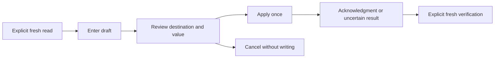

# 14 — Deliberately edit values

[Guide index](README.md) · Previous: [Registers](13-registers.md) · Next: [Console and logs](15-console_and_logs.md)

The Bugger supports reviewed edits of eligible built-in integer/bool variables, ordinary writable RAM bytes and scalar CPU registers. These are stopped-target operations with separate verification. They are not a general expression assignment facility, a Flash programmer or a peripheral editor.

Choose disposable state when learning. An address can be writable and still be crucial live stack, heap, DMA or control data. Permission to issue a write is not proof that the application can safely continue afterward.

**On this page**

- [The common workflow](#the-common-workflow)
- [Edit an integer or boolean](#edit-an-integer-or-boolean)
- [Edit Memory bytes](#edit-memory-bytes)
- [Remote STM32F446RE RAM evidence](#remote-stm32f446re-ram-evidence)
- [Edit a CPU register](#edit-a-cpu-register)
- [Uncertain writes and recovery](#uncertain-writes-and-recovery)

## The common workflow

Entering a draft does not apply it. Review shows what will change. **Apply** sends the proposed write. An acknowledgment reports the backend's response; you still need to **Read**, **Refresh** or **Verify** to see whether the resulting value matches. There is no automatic retry, rollback or restoration of old bytes/bits.

Execution/context changes or refreshed evidence can invalidate a draft/review. Return to the intended stop, obtain a new sample and review again. Vim Insert mode consumes the first Escape to return to Normal; the next Escape cancels the editor.

## Edit an integer or boolean

1. Stop the target, select the intended thread/frame and explicitly **Read** the variable in Locals or Watches.
2. Choose **Actions → Edit selected integer/bool**.
3. Enter a proposed decimal integer within the target storage/type bounds, or `true`, `false`, `1` or `0` for a boolean.
4. Choose **Review**, or press Enter in the field.
5. Check the actual destination, type and old/new value. **Apply** accepts; **Cancel** discards the draft. Enter on the review advances to Apply according to that editor's controls, so read before submitting again.
6. After acknowledgment, explicitly **Read the original variable** to inspect the result.

The editor accepts supported variables stored as built-in integers or booleans. Displaying a value does not make it editable: structures, arbitrary expressions, references, typedef forms and unsupported representations are excluded. The entire destination must be covered by writable-region evidence, and the sample must still belong to the current stopped context.

### Example on a disposable native variable

Use the [variables fixture](10-locals_and_watches.md#example-watch-a-global-and-inspect-a-callers-locals) at its first `variables_ready` stop. Add/read `variables_global`, initially 17. Review an edit to 18, Apply once, then Read it again. Its later code increments it by 3, so this deliberate change affects the program's subsequent result. To restore 17 before continuing, make another reviewed edit and Read it; Cancel after the first Apply cannot undo that write.

## Edit Memory bytes

1. Explicitly read the intended ordinary RAM range in Memory at a fresh stop.
2. Open **Options → Temporary ranges**, inspect the exact intended ordinary extent and Authorize it.
3. Select the row to change, then choose **Options → Edit selected row (ordinary writable RAM only)**.
4. Enter exactly two hexadecimal digits per displayed byte, without spaces or separators, for the selected extent of at most 16 bytes. The review states the required count.
5. Review address, count, old bytes and proposed bytes. Choose Apply once or Cancel.
6. After acknowledgment, explicitly **Refresh the original extent** to inspect the result.

Read authorization alone does not establish writability. Native sessions derive ordinary writable evidence from process mappings; remote sessions need eligible supplied evidence. An ELF section alone does not turn Flash or unknown memory into writable RAM.

For an initial test, use an interior slice of the disposable native `memory_buffer` and record the surrounding bytes. Copy the old full row, alter only the intended byte pairs, and verify the entire edited extent plus neighbors explicitly afterward. Do not paste a short replacement string expecting the editor to infer omitted bytes.

A write invalidates stopped samples and temporary grants. Reauthorize the ordinary range before another Memory edit. The fact that the dialog still shows the previous bytes is not a new sample.

## Remote STM32F446RE RAM evidence

The supported remote ordinary-RAM evidence review is device-specific and user-confirmed:

1. Stop a ready, compatible little-endian 32-bit ARM remote target.
2. Choose **Setup → Review STM32F446RE RAM evidence**.
3. Read every page, including connection identity and the stated main SRAM interval **`[0x20000000, 0x20020000)`**, 128 KiB, sourced to ST DS10693.
4. Confirm only if this connection actually reaches your identified STM32F446RE. Default **Back** cancels without confirmation.

Architecture, ELF and target scripts do not identify the MCU. The review does not detect or hardware-verify it. Confirmation makes this region eligible for the supported variable and Memory editors, not safe for arbitrary overwrites. Memory still needs separate ordinary-range authorization; every mutation still needs Review/Apply.

Confirmation and revocation do not access the target. **Setup → Revoke RAM evidence** withdraws confirmation. You must confirm again after Console commands, reset, reconnect, replacement of the debugged program, or relevant configuration/connection loss. Replacing evidence invalidates an open edit review even when the bounds are identical, so read and review again. Confirmation is not saved in profiles or setups and cannot clear an uncertain-write restriction. The setup-specific MMIO sampling review is separate.

## Edit a CPU register

Use a fresh **Registers** sample from **frame 0**. Editing requires an 8–64-bit scalar register on a target with eight-bit addressable bytes. GDB must identify it unambiguously, report it editable and support register writes with `may-write-registers` already enabled. The Bugger does not enable that permission for you. Caller-frame, wide/compound, truncated and unavailable values cannot be edited.

1. Stop and select **frame 0** in Call Stack. Select a fresh register row.
2. Choose **Edit** or press Enter on the selected register body row.
3. Enter raw hexadecimal bits, optionally prefixed by `0x`.
4. Choose **Review**. Check register name, discovered ID, width, thread, architecture, old bits and new bits across every page. **Apply** becomes available on the last page; resizing restarts review pagination as needed.
5. Apply once, then choose **Verify**, or return to Registers and explicitly **Refresh**.
6. Inspect the observed bits. A mismatch remains visible; reopening Edit shows requested and observed values. Cancel closes that result before another edit.

Input is raw bits, not an integer expression, floating-point conversion or bitfield editor. GDB editability does not prove hardware writability: targets can reject, normalize or ignore bits. Explicit verification establishes the observed result. To restore old bits, perform another reviewed edit and verify it; there is no automatic restoration.

## Uncertain writes and recovery

An error does not always mean that nothing was written. If the request may have reached GDB, further edits across **all three inspectors** can be blocked. Read the reported outcome and do not repeat Apply to see whether it works the second time.

For a completed but uncertain backend reply:

- Variable: explicitly Read the original variable, then use **Actions → Reconcile uncertain write after explicit Read**.
- Memory: explicitly Refresh the original extent, then use the corresponding **Options → Reconcile uncertain write after explicit Refresh**.
- Register: explicitly Verify the original register, then use **Reconcile** when available.

Reconciliation records what was observed; it does not undo the write. If the original variable scope is gone, begin a new session. A timed-out, canceled or otherwise lost write completion also requires a new session before further editing, even if a later value appears to match: GDB may still complete the earlier write.

When reconnecting, inspect the actual target contents before deciding what to do next. The new connection does not restore old RAM or registers. For a lost connection or unexpected result, retain [Console logs](15-console_and_logs.md) and report the destination, old/proposed/observed values and complete action sequence without exposing sensitive target data.
