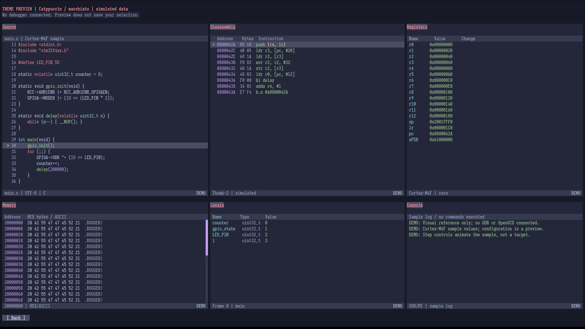
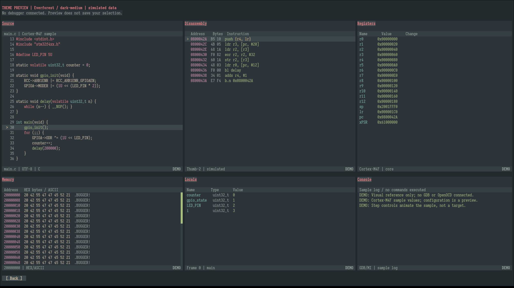
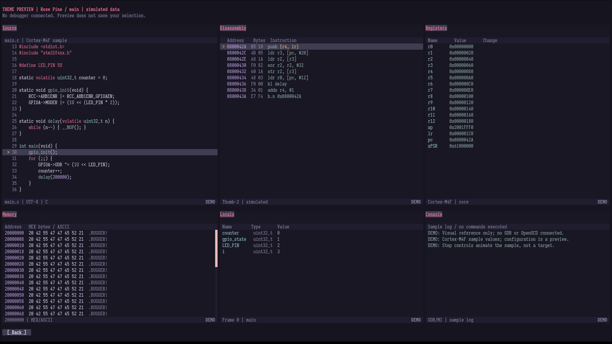

# 17 — Themes, keybindings and Vim-like input

[Guide index](README.md) · Previous: [Profiles and saved setups](16-profiles_and_saved_setups.md) · Next: [Debugging workflows](18-debugging_workflows.md)

Open **Config** on the launcher for **Themes**, **Keybinds** and **Profiles**. Appearance and keyboard preferences are personal and apply across sessions. They are separate from shared connection profiles and saved debugging definitions.

**On this page**

- [Choose and preview a theme](#choose-and-preview-a-theme)
- [Terminal color and tmux](#terminal-color-and-tmux)
- [Assign personal keys](#assign-personal-keys)
- [Vim-like input](#vim-like-input)
- [Preference files and compatibility](#preference-files-and-compatibility)

## Choose and preview a theme

1. Open **Config → Themes**.
2. Focus **Theme** or **Variant**. Left/Right cycles; Enter, Space or click opens its attached dropdown.
3. Use Up/Down and Enter/Space or click to choose. Long lists support Page keys, wheel and scrollbar. Escape/outside click cancels the dropdown without activating an underlying control.
4. Choose **Preview** for a simulated workspace. It starts no debugger and reads no target.
5. Back/Escape from Preview returns to the theme draft and restores the saved palette. **Save** applies/persists the draft and returns to Config; Back from Themes discards it.

Families are alphabetical. A family change selects its initial variant, with Macchiato for Catppuccin. The default without valid saved preferences is **Catppuccin / macchiato**. There are 66 built-in palettes across seventeen families:

| Family | Variants |
|---|---|
| Ashen | default, high-contrast |
| Catppuccin | latte, frappe, macchiato, mocha |
| Dracula | default, soft |
| Everforest | dark/light × medium, hard, soft |
| Gruber Darker | dark |
| Gruvbox Material | dark/light × medium, hard, soft |
| Kanagawa | wave, dragon, lotus |
| Modus | operandi, vivendi; also tinted, deuteranopia and tritanopia forms |
| Monokai Pro | pro, classic, machine, octagon, ristretto, spectrum, light |
| Moonfly | dark |
| Nightfox | nightfox, dayfox, dawnfox, duskfox, nordfox, terafox, carbonfox |
| Nord | dark, light |
| One Dark | dark, darker, cool, deep, warm, warmer, light |
| Rose Pine | main, moon, dawn |
| Solarized | dark, light |
| Tokyo Night | night, storm, moon, day |
| Zenburn | dark |

Ashen high-contrast uses black panels/red frames. Colors represent shared interface roles, so a scrollbar accent is consistent across views rather than a warning about their data. Monochrome retains text/symbol indicators. Modus color-deficiency variants preserve adapted semantic substitutions, but the terminal adaptation does not claim upstream accessibility certification. [Third-party notices](../../THIRD_PARTY_NOTICES) describe palette sources/licenses. Custom palette files are not implemented.

### Appearance examples

| Catppuccin Macchiato | Everforest Dark Medium | Rosé Pine Main |
|---|---|---|
|  |  |  |

These retained images illustrate palette differences in the **simulated theme preview**, not live values or an exact current control layout. For current live pane controls, see [navigation](02-interface_and_navigation.md) and the [workspace screenshot](README.md#what-the-workspace-tells-you).

## Terminal color and tmux

Direct-color terminfo allows the adapted RGB palette; otherwise the application falls back to 256/8-color or monochrome. In suitable standalone Alacritty environments, installed `alacritty-direct` is used; RGB-advertising tmux/screen environments can use installed `tmux-direct`. Missing entries/signals retain the original color mode. Some distributions package these terminfo entries in `ncurses-term`.

To force monochrome:

```sh
NO_COLOR=1 ./build/the-bugger
```

Use a TERM description supported by your terminal rather than forcing an unrelated one. The application does not change terminal palettes or tmux configuration. For mouse forwarding, enable `set -g mouse on`. RGB also needs appropriate outer-terminal/tmux forwarding; see [tmux's RGB guidance](https://github.com/tmux/tmux/wiki/FAQ#how-do-i-use-rgb-colour). Older tmux setups may need `COLORTERM` preserved. Different fonts and color capabilities can change appearance without changing application state.

## Assign personal keys

Open **Config → Keybinds**. All 30 actions are listed; at 112 columns or more, two tables appear side by side. Smaller terminals use a longer table with scrolling. Arrows, Tab/Shift+Tab and Home/End select bindings; Page keys, wheel and scrollbar move the viewport without changing the chosen action. Enter reveals and captures that action in one press.

1. Click a **Key** cell or focus it and press Enter.
2. Press the actual desired key, rather than typing its name.
3. Escape cancels capture; Delete clears it to **None**.
4. If the key is reserved, unsupported or already assigned, read the error and choose another. Capture stays active.
5. Choose **Save** to apply/persist the complete draft.

During capture the value disappears and its border is orange. Edited cells retain cyan borders; non-color emphasis also distinguishes them. Resize preserves capture. Captured keys take precedence over ordinary navigation/quit shortcuts, so Escape is the reliable cancel.

Supported assignments are printable ASCII (case-sensitive), terminal-reported function keys F1–F24, Shift+F1–F12 equivalents and permitted Ctrl letters. Space and Ctrl+C/I/M/Q/S/Z are reserved. Ctrl+H/J/K/L can be assigned only to spatial content-pane transfers because their terminal encodings overlap editing characters. Duplicate assignments are rejected; clear an existing binding before reusing its key.

Physical arrows, Ctrl+arrows, Tab/Shift+Tab, Escape and Ctrl+Q remain available. Additional Quit and traversal assignments supplement those fixed keys. Reset and additional movement/quit/traversal slots begin unbound except when optional Vim aliases populate them. Toolbar hints follow saved execution assignments. A Reset binding still requires supported OpenOCD context and confirmation.

### Save, undo and discard

**Undo** reverses the last draft change, including a confirmed Restore Defaults, with up to 128 changes retained. **Restore Defaults** asks before replacing the draft. Only Save persists either operation. Disabled Undo/Save/Restore controls are dimmed, skipped by focus and inert on click.

Back/Escape/the configured Back binding asks before discarding unsaved changes; quit also asks when capture is inactive. Cancel preserves the draft. Save with no changes is unavailable. Existing saved bindings, including custom F6 or None assignments, are preserved when the application adds a new action; assign Pause/Halt explicitly if your older map lacks it.

## Vim-like input

In Keybinds, toggle **Vim-like input [ Off ]** to On, then **Save**. It is off for new users. Enabling fills unassigned direction slots with `h/j/k/l` and content transfers with Ctrl+H/J/K/L without stealing custom assignments. A conflicting alias must be cleared first. Disabling removes only the stock aliases in their direction slots. Undo reverses the toggle; Restore Defaults also turns it off.

Every newly focused text field begins in **VIM NORMAL**. Cyan side borders/block cursor identify Normal where supported; green borders/thin cursor identify **VIM INSERT**. The footer names the mode even without color.

| Normal key | Meaning |
|---|---|
| i / a | Insert before / after cursor. |
| I / A | Insert at start / end. |
| h / l, Left / Right | Move within the single line. |
| 0 / $, Home / End | First / last character. |
| w / b / e | Next word / previous word / word end. |
| x, Delete | Delete the character under the cursor. |
| j / k, Down / Up | Move to another visible control. |

In Insert, printable characters are literal. Backspace/Delete, arrows, Home/End and Ctrl+U retain ordinary editing. Escape returns to Normal without discarding the text; another Escape leaves the field/screen. Tab changes focus and the next field starts Normal. Enter still invokes the field's existing submission action in either mode.

Example: focus a Console draft, press `A`, append text, Escape to Normal, `0` to reach its start, then `w` to move by a word. Enter sends only when you deliberately submit; changing mode does not send commands or read memory.

This is a single-line convenience set, not full Vim. Counts, operators such as `dd`/`D`, registers, macros and multiline editing are not implemented. Do not infer shell/Emacs features such as Ctrl+K, Ctrl+P/N/F/B or Meta+F/B from this mode. Consult [controls](20-controls_and_glossary.md) for the current supported editing set.

## Preference files and compatibility

Themes, keys and Vim preference share `preferences.json` in the [configuration directory](16-profiles_and_saved_setups.md#where-files-live-and-how-recovery-works). Saving one preserves the others. Profiles never override them. A theme-only older file loads factory keys; missing Vim preference defaults off while preserving custom mappings. Older application builds can reject newer fields, so retain a compatible executable or a backup when moving versions.

Invalid/unsupported/inaccessible preference files are preserved, defaults are used with a visible error, and saving is blocked. Repair and restart. Concurrent stale writers must restart before saving. Theme preview, capture, Undo and canceled/discarded drafts do not write the file.
