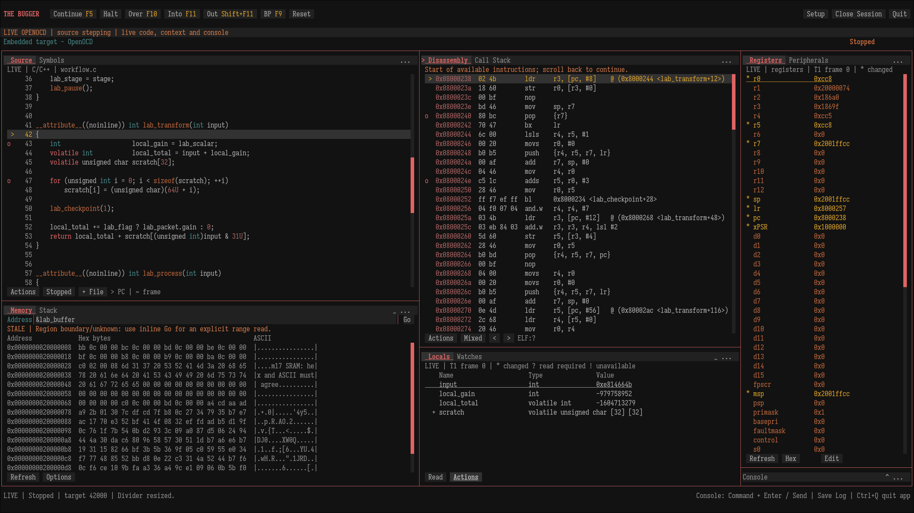

# The Bugger user guide

The Bugger brings source code, instructions, variables, registers, memory and debugger output into one terminal workspace. This guide teaches you how to use those tools together, whether you are starting your first Linux debugging session or investigating firmware on a connected board.

The pages describe the current repository build. A released executable can lag behind it; check `the-bugger --version` and the [changelog](../../CHANGELOG.md) when a control differs. Examples use real repository fixtures. Hardware examples identify their required board and tools rather than assuming that every GDB target behaves alike.

## Start here

New to debugging? Follow these pages in order:

1. [Get the application running and complete a first session](01-getting_started.md).
2. [Learn focus, panes, menus and text entry](02-interface_and_navigation.md).
3. Choose your connection: [native Linux](03-native_sessions.md), [OpenOCD](04-openocd_sessions.md), or an [existing GDB server](05-remote_sessions.md).
4. [Control execution](06-execution_control.md), [browse code](07-source_and_disassembly.md), and [stop at useful locations](08-breakpoints_and_watchpoints.md).
5. [Inspect variables](10-locals_and_watches.md), then try the [combined debugging exercises](18-debugging_workflows.md).

You can complete the Linux exercises without a board or probe. Embedded sessions require a target-compatible GDB, an appropriate server/probe and matching firmware symbols. Loading an ELF supplies symbols; it does not program firmware.

## Find the task you want

| I want to… | Open |
|---|---|
| Build, run a download, or try a hardware-free example | [01 — Getting started](01-getting_started.md) |
| Move focus, scroll, split or resize panes, use fullscreen, or enter text | [02 — Interface and navigation](02-interface_and_navigation.md) |
| Launch a Linux program or attach to a process | [03 — Native sessions](03-native_sessions.md) |
| Configure STM32, ESP32-S3 or ESP32-C6 debugging through OpenOCD | [04 — OpenOCD sessions](04-openocd_sessions.md) |
| Connect to a server already running elsewhere | [05 — Remote sessions](05-remote_sessions.md) |
| Continue, halt, step, run to a line, or investigate startup | [06 — Execution control](06-execution_control.md) |
| Open source files, repair source paths, inspect assembly or review an ELF mapping | [07 — Source and disassembly](07-source_and_disassembly.md) |
| Set conditions, skip breakpoint hits, or stop when memory changes | [08 — Breakpoints and watchpoints](08-breakpoints_and_watchpoints.md) |
| Find a caller or inspect another thread | [09 — Threads and Call Stack](09-threads_and_call_stack.md) |
| Read locals, expand a structure, or follow an expression over time | [10 — Locals and Watches](10-locals_and_watches.md) |
| Inspect bytes, change grouping, authorize a range or deliberately sample MMIO | [11 — Memory](11-memory.md) |
| Examine bytes around SP, annotate addresses or compare retained stack samples | [12 — Stack](12-stack.md) |
| Inspect CPU registers and compare changes | [13 — Registers](13-registers.md) |
| Change a variable, RAM bytes or a CPU register and check the result | [14 — Editing values](14-editing_values.md) |
| Send a GDB command or save retained output | [15 — Console and logs](15-console_and_logs.md) |
| Save connection settings and restore a workspace | [16 — Profiles and saved setups](16-profiles_and_saved_setups.md) |
| Change themes, shortcuts or Vim-like input | [17 — Customization](17-customization.md) |
| Follow a complete investigation using several views | [18 — Debugging workflows](18-debugging_workflows.md) |
| Diagnose an error, missing data or unexpected interface behavior | [19 — Troubleshooting](19-troubleshooting.md) |
| Look up a key, symbol, indicator or unfamiliar term | [20 — Controls and glossary](20-controls_and_glossary.md) |

## How to read the instructions

**Source → Actions → Go to line** means open the Source pane's **Actions** menu and choose **Go to line**. A pane is a bordered area; a tab chooses the view displayed inside it. Instructions refer to visible control labels, so you can use the mouse or focus the control and press Enter.

Keys in the guide are factory defaults. Personal assignments can change them; the toolbar displays your saved execution shortcuts. Fixed arrows, Tab/Shift+Tab, Escape and Ctrl+Q remain available. A shortcut's context matters: arrows can move between buttons, move a text cursor, or scroll a focused view. [Navigation](02-interface_and_navigation.md) explains the distinction.

Code blocks marked `sh` run in your Linux shell. Blocks marked `text` under a Console instruction go in The Bugger's **Command** field. Enter executable paths in the configuration form, not as extra command-line arguments to The Bugger. Paths in examples are relative to the repository root unless stated otherwise; replace `/path/to/...` with your actual installation.

## What the workspace tells you

The screenshot shows a live embedded session with a customized dark theme. Notice the top execution toolbar, the pane-local **Actions**/**Options** controls and the minimized Console at bottom right. Memory and Locals are expanded to different heights. The Disassembly edge notice and stale Memory sample describe that captured session; they are not mandatory startup messages. Your addresses, source, values, colors and open lower panes will differ.

The application distinguishes an observation from a current value. **STALE** means execution or context has changed since a sample was taken. **Read required** asks you to request a value deliberately. An unavailable value is not zero. Before changing target state, read the relevant [editing workflow](14-editing_values.md).

## Scope and further reading

Linux is the host platform. Recorded physical configurations cover STM32 NUCLEO-F446RE/ST-LINK, ESP32-S3/Xtensa and ESP32-C6FH4/RV32 using their matching tools. These are tested configurations, not promises about every board, probe or GDB extension. See [connection guidance](04-openocd_sessions.md) and the [validation records](../validation.md).

Symbols and Peripherals are unavailable live views. There is no interactive program-input terminal, UART console, dedicated RTOS inspector, trace analyzer, automatic firmware programming or arbitrary peripheral editor. You can make supported CPU-register, integer/bool and ordinary-RAM changes through the [reviewed editing workflows](14-editing_values.md).

If a session or control does not behave as described, start with [Troubleshooting](19-troubleshooting.md). For a quick reminder of keys, indicators or terminology, use [Controls and glossary](20-controls_and_glossary.md).
